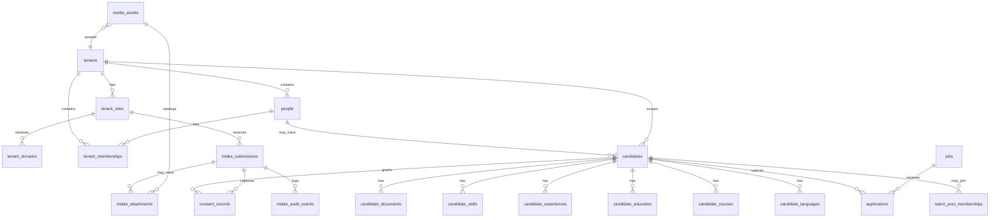

# STAGE 02 — MATRIZ Página → Seção → Componente → Campo → Entidade → Tabela → Permissão → Tenant

**Projeto:** J&S Empregos LTDA (CHECK BOULER 24H / Database-Driven UI/UX)
**Data:** 2026-11-05 (auditoria local de código; achados Supabase fornecidos na sessão)
**Estado:** **Stage 02.1 em andamento (Home detalhada, campo a campo + contrato visual)** — NÃO homologado; **sem alterações remotas no banco**.

## Regras de inventário (obrigatórias)

- Cada seção/componente registra **contrato funcional** (props/campos/origem/eventos/consultas/validações/permissões/tenant/comportamento) e **contrato visual** (estrutura, hierarquia, dimensões/proporções observadas em classes, alinhamento, imagens, enquadramento/recorte, camadas, responsividade, animações/transições, acessibilidade).
- **Evidência:** `OBSERVADO-CÓDIGO` = confirmado em TSX/config/hooks; `OBSERVADO-VISUAL` = confirmado por inspeção visual/asset real (ainda não executado nesta etapa, exceto metadados quando disponíveis); `PENDENTE` = requer inspeção da imagem, execução da página ou medição real. **Não inventar ângulos, dimensões em px, focal points ou conteúdo visual não verificável.**
- **Governança:** leitura local + documentação permitidas. **Não autorizado:** migrations, alterações no Supabase remoto, mudanças de RLS, publicação ou implementação estrutural sem aprovação explícita.

## Premissas (Database-Driven UI/UX)

- Supabase = fonte da verdade para dados, identidade, permissões e configuração declarativa.
- O banco **não** envia código executável; frontend renderiza apenas **componentes TSX registrados**, com props tipadas e validadas (Zod).
- Multi-tenant por resolução `Host/domínio → tenant_domains → tenant_sites → página publicada → dados do tenant`; visitante **não** escolhe tenant por UUID.
- Page Builder = composição/apresentação declarativa; **delega operações** às células/módulos existentes (não duplica CRUDs).
- RBAC/RLS/auditoria/validação server-side são obrigatórios; menu/navegação **não** é segurança.

## Achados críticos (P0 / bloqueadores)

1. Identidade/navegação/branding hardcoded (`src/config/company.ts`, `src/config/images.ts`, menus TSX). Não troca por tenant.
2. Isolamento tenant em consultas públicas (achado reportado): `public_jobs_v1`, `public_companies_by_type`, `companies_public_read`; `public_services_v1` associado ao tenant `js-empregos`.
3. Submissões públicas sem persistência real ou com contrato quebrado: `Contato` (mock/localStorage), `Parceiros`/`Fornecedores` (mock/localStorage), `JobApplicationForm` (WhatsApp), `candidates.ts` incompatível com schema/bucket/consent e não público-anônimo.
4. `leads` sem política de inserção pública anônima (achado). Requer fluxo controlado (Edge Function/service_role, validação, rate limit, anti-spam, consentimento, auditoria).
5. Sem Page Builder declarativo real: `page_templates` existe (1 registro `sobre_greeting`) mas não é renderer de seções/componentes; `global_navigation_links`/`page_templates` sem `tenant_id` (achado).
6. Mídia: estado atual `services-images`, `public-media`, `avatars`, `private-documents`; alvo consolidado requer plano (não remover prematuramente).

## STAGE 02.1 — HOME (`/`) — inventário detalhado

### Contexto da página

| Campo                           | Valor (OBSERVADO-CÓDIGO)                                                                                                                                                                                                          |
| ------------------------------- | --------------------------------------------------------------------------------------------------------------------------------------------------------------------------------------------------------------------------------- |
| Rota pública                    | `/` (renderizada sob `PublicLayout` em `src/App.tsx`)                                                                                                                                                                             |
| Arquivo                         | `src/pages/Home.tsx`                                                                                                                                                                                                              |
| Layout compartilhado            | `PublicLayout` = `ScrollToTop` + `Navbar` + `main` + `Footer` + `PublicBottomNavigation` (`src/components/layout/PublicLayout.tsx`)                                                                                               |
| SEO                             | `<SEO title={`${COMPANY.name} — ...`} description={COMPANY.tagline + ...} keywords=[...] type="WebSite" />`; metadata vem de `src/config/company.ts`                                                                              |
| Dependências de conteúdo/config | `COMPANY` (`src/config/company.ts`), `HERO_SLIDES` (`src/content/homeHero.ts`)                                                                                                                                                    |
| Dependências de dados           | `usePublicJobsAsVagas({ limit: 4 })` (`src/hooks/useJobs.ts`), `useCompaniesByType('client')` (`src/hooks/useCompanies.ts`), `mockGetVagas` fallback (`src/services/mock/vagas`), `CLIENTS_LIST` fallback (`src/mock/clients.ts`) |
| Animações                       | `framer-motion` + `staggerReveal`/`revealUp`/`staggerItem` (`@/animations/*`)                                                                                                                                                     |
| Tenant/escopo                   | **PENDENTE resolver por domínio/site**. Hoje dados públicos mistos: hooks chamam repos sem tenant resolvido explicitamente na Home; risco P0 de isolamento em views públicas.                                                     |
| Permissão                       | Página pública leitura. Edição futura via Page Builder/admin com RBAC por tenant/site.                                                                                                                                            |

### Mapa de seções (ordem observada)

| #   | Seção                                      | Componente(s) principais                                    | Fundo (código)                          | Origem do conteúdo                                                                                         |
| --- | ------------------------------------------ | ----------------------------------------------------------- | --------------------------------------- | ---------------------------------------------------------------------------------------------------------- |
| 1   | Hero cinemático (carousel)                 | `HeroSplit` + `HeroImage` + `SafeImage`                     | imagem full-bleed + overlays/gradientes | `HERO_SLIDES` (TS) + CTAs montados em `Home.tsx`                                                           |
| 2   | Consultoria em RH / Soluções para empresas | `Section` + `Container` + grid de cards + ícones Lucide     | `bg-surface-alt`                        | array `empresaSolutions` inline em `Home.tsx`                                                              |
| 3   | Soluções em Facilities                     | `Section` + `Container` + grid                              | padrão (sem `bg-surface-alt`)           | array `facilitiesSolutions` inline                                                                         |
| 4   | Para Candidatos                            | `Section` + `Container` + 2 cards CTA                       | `bg-surface-alt`                        | texto/links inline (`/login`, `/trabalhe-conosco`)                                                         |
| 5   | Vagas em Destaque                          | `Section` + `Container` + `Card variant="gold-glow"`        | padrão                                  | `dbJobs` via `usePublicJobsAsVagas` com fallback `mockGetVagas().slice(0,4)`                               |
| 6   | Diferenciais J&S                           | `Section` + `Container` + grid cards                        | `bg-surface-alt`                        | array `differentials` inline                                                                               |
| 7   | Relacionamentos                            | `Section` + `Container` + 4 cards com links                 | padrão                                  | texto/links inline (`/clientes`, `/parceiros`, `/fornecedores`, `/empresas`)                               |
| 8   | Clientes reais                             | `Section` + `Container` + grid logos `SafeImage`            | `bg-surface-alt`                        | `confirmedClients` derivado de `companies` (DB `useCompaniesByType('client')`) com fallback `CLIENTS_LIST` |
| 9   | CTA comercial final                        | `Section` + `Container` + bloco com gradientes radiais/blur | padrão + efeitos decorativos            | texto/links inline (`/vagas`, `/empresas`)                                                                 |

### 1) Hero — `HeroSplit` (carousel)

| Item                          | Detalhe funcional (OBSERVADO-CÓDIGO)                                                                                                                                                                                                                                                               |
| ----------------------------- | -------------------------------------------------------------------------------------------------------------------------------------------------------------------------------------------------------------------------------------------------------------------------------------------------- |
| Componente                    | `src/components/sections/HeroSplit.tsx`                                                                                                                                                                                                                                                            |
| Entrada                       | `slides: HeroSplitSlide[]`, `autoPlay` default `true`, `interval` default `5000`; Home passa `interval={6000}`                                                                                                                                                                                     |
| `HeroSplitSlide`              | `id`, `image`, `alt`, `eyebrow?`, `title?`, `subtitle?`, `description?`, `cta?` (ReactNode)                                                                                                                                                                                                        |
| Fonte dos slides              | `src/content/homeHero.ts` → `HERO_SLIDES` (5 slides: `rh`, `facilities`, `limpeza`, `mao-de-obra`, `jardinagem`)                                                                                                                                                                                   |
| Campos por slide (conteúdo)   | `eyebrow`, `eyebrowIcon` (Lucide), `title`, `description`, `image` (path público), `imageAlt`, `primaryCta{label,href}`, `secondaryCta{label,href}`, `candidateCta{label,href}`                                                                                                                    |
| Composição em Home            | `heroSlides` mapeia `HERO_SLIDES` para incluir CTAs React (`Button` secondary/outline/ghost + links) e bloco extra “Está procurando uma oportunidade?” + `candidateCta`                                                                                                                            |
| Comportamento                 | `useState(current)` + `setInterval` muda slide a cada `interval`; limpa timer no unmount/deps. Navegação manual por botões/indicadores (observar: indicadores renderizados como botões com `aria-label`, `aria-pressed`; checar implementação completa no arquivo — **OBSERVADO-CÓDIGO parcial**). |
| Acessibilidade (código)       | `SafeImage alt={slide.alt}`; imagem de overlay/grid decorativa com `alt="" aria-hidden="true"`; indicadores com labels/pressed.                                                                                                                                                                    |
| Entidades alvo (Page Builder) | `site_pages(slug='/')`, `site_page_sections(component_key='hero_split_carousel')`, `site_page_section_items`/slides, `site_navigation`/CTAs, `media_assets`                                                                                                                                        |
| Dados alvo (declarativo)      | `slides[].{eyebrow, eyebrow_icon_key, title, description, image_asset_id/url, image_alt, primary_cta, secondary_cta, tertiary_cta, order, is_active, autoplay_ms, transition}`                                                                                                                     |
| Permissão/tenant              | Público lê página publicada do tenant resolvido. Admin do tenant edita/publica versão.                                                                                                                                                                                                             |

| Contrato visual — Hero | Observação                                                                                                                                                                                                                                                                           |
| ---------------------- | ------------------------------------------------------------------------------------------------------------------------------------------------------------------------------------------------------------------------------------------------------------------------------------ |
| Estrutura              | Seção full-width com `min-h-[760px]`, `overflow-hidden`; grid `lg:grid-cols-2` (texto + imagem destaque `HeroImage`) sobre fundo de imagem (`SafeImage` absoluta `inset-0`).                                                                                                         |
| Imagem de fundo        | `SafeImage` do slide com `object-cover`, `loading="eager"`, `decoding="async"`; transição `AnimatePresence` (`opacity`/`scale` 1.05→1→0.98, duração ~0.7s). **Enquadramento/ângulo/ponto focal reais: PENDENTE inspeção visual dos assets.**                                         |
| Camadas/overlays       | Overlay SVG `/images/hero/hero-overlay.svg` (`opacity-65`, decorativo) + gradiente horizontal `from-background/95 via-background/70 to-transparent` + gradiente vertical `from-background via-background/30 to-background/10` + grid decorativo `/images/backgrounds/hero-grid.svg`. |
| Coluna texto           | Eyebrow em pill (`rounded-full`, `bg-primary/10`, borda), `h1` grande (`text-4xl`→`lg:text-6xl`), descrição `text-muted-foreground`, CTAs flex wrap. Texto anima em `x` (offscreen → 0 → offscreen) com variantes mobile/desktop; reduzido com `useReducedMotion`.                   |
| Coluna imagem destaque | `HeroImage` com `aspect-[4/3]` mobile/base, `sm:aspect-[3/2]`, `lg:aspect-[4/3]`, `max-w` responsivo; anima entrada/saída lateral + `scale`. **Recorte:** `object-cover` (via `SafeImage` em `HeroImage`). **Ponto focal/corte de elementos principais: PENDENTE.**                  |
| Responsividade         | 1 coluna em mobile, 2 em `lg`; variantes de movimento consideram mobile; `useIsMobile` via `matchMedia('(max-width: 768px)')`.                                                                                                                                                       |
| Acessibilidade visual  | Requer contraste texto/sobreposição verificado visualmente (PENDENTE). Decorativos ocultos a leitores de tela.                                                                                                                                                                       |

### 2) Consultoria em RH / Soluções para empresas

| Item             | Detalhe funcional (OBSERVADO-CÓDIGO)                                                                                                                                                               |
| ---------------- | -------------------------------------------------------------------------------------------------------------------------------------------------------------------------------------------------- |
| Componente base  | `Section className="bg-surface-alt"` + `Container`                                                                                                                                                 |
| Cabeçalho        | `h2` “Consultoria em RH e soluções para empresas”; parágrafo descritivo; animações `whileInView`/`staggerReveal`/`revealUp`                                                                        |
| Coleção          | `empresaSolutions` (6 itens inline): `title`, `description`, `href`, `icon` (Lucide), `highlight?` (não usado visualmente no JSX atual)                                                            |
| Item/card        | Card custom (não `ServiceCard`): ícone em círculo `bg-primary/10`, `h3`, descrição, `Button variant="outline" size="sm" w-full` “Saiba mais” + `ArrowRight` dentro de `Link to={href}`             |
| Grid             | `grid-cols-1 sm:grid-cols-2 lg:grid-cols-4 3xl:grid-cols-5 gap-6`                                                                                                                                  |
| CTA seção        | “Solicitar Orçamento” `Button variant="secondary" size="lg"` → `/empresas`                                                                                                                         |
| Entidades alvo   | `site_page_sections(component_key='card_grid_services')`, `site_page_section_items`, `services`/`service_categories` ou coleção de links editoriais, `media_assets` (ícone/imagem opcional futura) |
| Tenant/permissão | Público leitura. Links podem apontar para slugs de serviços do tenant; admin edita coleção.                                                                                                        |

| Contrato visual — cards RH | Observação                                                                                                                                          |
| -------------------------- | --------------------------------------------------------------------------------------------------------------------------------------------------- |
| Estrutura                  | Header centralizado + grid responsivo + CTA centralizado; cards com borda, `rounded-2xl`, hover `border-primary/30`.                                |
| Imagens                    | **Nenhuma imagem fotográfica** nesta seção (ícones vetoriais Lucide).                                                                               |
| Movimento                  | `motion.div` com variantes stagger no container e itens; `whileInView once`; respeitar redução de movimento (PENDENTE confirmar em `animations/*`). |

### 3) Soluções em Facilities

| Item           | Detalhe funcional (OBSERVADO-CÓDIGO)                                                                                                   |
| -------------- | -------------------------------------------------------------------------------------------------------------------------------------- |
| Fundo          | `Section` padrão                                                                                                                       |
| Coleção        | `facilitiesSolutions` (5 itens): Limpeza, Controlador de acesso, Portaria, Zeladoria, Jardinagem; campos `title/description/href/icon` |
| Grid           | `grid-cols-1 sm:grid-cols-2 lg:grid-cols-4 gap-6`; cards `text-center`, ícone centralizado                                             |
| CTA            | “Conheça nossas soluções” secondary → `/servicos`                                                                                      |
| Entidades alvo | Mesma família `card_grid_services`/links editoriais ou `services` filtrados por categoria facilities.                                  |

### 4) Para Candidatos

| Item           | Detalhe funcional (OBSERVADO-CÓDIGO)                                                                                                             |
| -------------- | ------------------------------------------------------------------------------------------------------------------------------------------------ |
| Fundo          | `bg-surface-alt`                                                                                                                                 |
| Layout         | 2 cards em `md:grid-cols-2`: “Já é candidato?” → `/login` (primary); “Ainda não tem cadastro?” → `/trabalhe-conosco` (secondary)                 |
| Conteúdo       | Totalmente estático inline.                                                                                                                      |
| Entidades alvo | `site_page_sections(component_key='dual_cta_cards')` com CTAs configuráveis por tenant.                                                          |
| Segurança      | Links públicos; `/login` e fluxo de cadastro seguem auth/RBAC/consentimento nos módulos/células correspondentes (fora do escopo visual da Home). |

### 5) Vagas em Destaque

| Item                | Detalhe funcional (OBSERVADO-CÓDIGO)                                                                                                                                                                                              |
| ------------------- | --------------------------------------------------------------------------------------------------------------------------------------------------------------------------------------------------------------------------------- |
| Fonte primária      | `usePublicJobsAsVagas({ limit: 4 })` → `jobsRepository.getPublished('', {limit:4})` → mapeia `JobListItem` para `Vaga`                                                                                                            |
| Fallback            | `destaques = dbJobs.length > 0 ? dbJobs.slice(0,4) : mockGetVagas().slice(0,4)` (usa `@/services/mock/vagas`)                                                                                                                     |
| Campos renderizados | `vaga.titulo`, `vaga.empresa`, `vaga.tipoContrato`/`tipo_contrato`, `vaga.cidade`, `vaga.estado`, `vaga.modalidade` (PRESENCIAL/HIBRIDO/REMOTO → label PT), `vaga.slug`                                                           |
| Ação                | `Button primary sm` “Ver vaga” → `/vagas/${vaga.slug}`; header “Ver todas as vagas” → `/vagas`                                                                                                                                    |
| UI                  | `Card variant="gold-glow" hover padding="lg" className="rounded-2xl"`; grid `md:grid-cols-2 lg:grid-cols-4 3xl:grid-cols-5`                                                                                                       |
| Risco P0            | Hook passa tenant vazio `''` ao repo e usa `getPublished`; **isolamento multi-tenant depende da view/query no Supabase** (achado reportado). Home não resolve tenant por domínio.                                                 |
| Entidades alvo      | `jobs`, `companies` (nome/logo), possivelmente view pública **filtrada por tenant/site resolvido**; `site_page_sections(component_key='featured_jobs_grid', data_source='published_jobs', limit=4, order_by='published_at desc')` |

| Contrato visual — vagas | Observação                                                                                                                                 |
| ----------------------- | ------------------------------------------------------------------------------------------------------------------------------------------ |
| Imagens                 | **Sem imagem no card atual** (apenas texto/badges). Campos como `imagemUrl`/logo existem no tipo mapeado mas não são renderizados na Home. |
| Movimento               | Stagger no grid/itens; hover de card (`gold-glow` via `Card`).                                                                             |

### 6) Diferenciais J&S

| Item           | Detalhe funcional (OBSERVADO-CÓDIGO)                                         |
| -------------- | ---------------------------------------------------------------------------- |
| Coleção        | `differentials` (6 itens inline): `title`, `description`, `icon`             |
| Grid           | `sm:grid-cols-2 lg:grid-cols-3`; cards com ícone, `h3`, descrição            |
| Entidades alvo | `site_page_sections(component_key='icon_features_grid')` + itens editoriais. |

### 7) Relacionamentos

| Item           | Detalhe funcional (OBSERVADO-CÓDIGO)                                                                              |
| -------------- | ----------------------------------------------------------------------------------------------------------------- |
| Layout         | 4 cards: Clientes (`/clientes`), Parceiros (`/parceiros`), Fornecedores (`/fornecedores`), Empresas (`/empresas`) |
| Conteúdo       | Textos/ícones/links estáticos inline.                                                                             |
| Entidades alvo | `site_page_sections(component_key='relationship_hub_cards')` com links/ícones configuráveis.                      |

### 8) Clientes reais (logos)

| Item               | Detalhe funcional (OBSERVADO-CÓDIGO)                                                                                                                                                                |
| ------------------ | --------------------------------------------------------------------------------------------------------------------------------------------------------------------------------------------------- |
| Fonte primária     | `useCompaniesByType('client')` → `companiesRepository.findPublicByRelationshipType('client')` (view/tabela pública) com fallback mock em `useCompanies.ts` (`CLIENTS_LIST` → `PublicCompanyByType`) |
| Derivação Home     | `confirmedClients`: se `companies.length>0`, filtra `company_name`, mapeia `mapPublicCompanyByTypeToClientVisual`, filtra itens com `name && logo`; senão usa `CLIENTS_LIST` com `name && logo`     |
| Campos usados      | `client.id`, `client.logo`, `client.name` (alt/texto)                                                                                                                                               |
| UI                 | Grid `grid-cols-2 sm:grid-cols-3 lg:grid-cols-4`, cards centralizados `max-w-[280px]`; `SafeImage` em container `h-16 w-auto`, `object-contain`, texto nome abaixo                                  |
| Fallback de imagem | `SafeImage` tenta `src` → `fallbackSrc/fallbackType` → `IMAGE_FALLBACKS.global` → placeholder SVG; em DEV loga ausências                                                                            |
| Risco P0           | Consulta pública por tipo de relacionamento; **isolamento por tenant e autorização pública** dependem da view/RLS/política real (achado).                                                           |
| Entidades alvo     | `companies`, `company_relationships`/tipos, `media_assets` (logo), configuração de seção (`show_logo_wall`, filtros, ordem, limite)                                                                 |

| Contrato visual — logos clientes | Observação                                                                                                                                                                                                |
| -------------------------------- | --------------------------------------------------------------------------------------------------------------------------------------------------------------------------------------------------------- |
| Composição                       | Logo contido (não cobre card) em `object-contain`; card com borda/fundo. **Dimensões/proporção/qualidade do asset original: PENDENTE** (inspecionar arquivos em `public/images/clientes/` e/ou metadata). |
| Acessibilidade                   | `alt={client.name}` presente.                                                                                                                                                                             |

### 9) CTA comercial final

| Item           | Detalhe funcional (OBSERVADO-CÓDIGO)                                                                                                                          |
| -------------- | ------------------------------------------------------------------------------------------------------------------------------------------------------------- |
| Conteúdo       | Título, parágrafo, 2 CTAs: `/vagas` (secondary) e `/empresas` (outline)                                                                                       |
| Visual         | Container `rounded-3xl` com gradiente radial `hsla(var(--primary),0.15)`, dois círculos blur animados (`animate-pulse-glow`, `animate-float-*`) — decorativos |
| Entidades alvo | `site_page_sections(component_key='final_cta_banner')` com título, texto, CTAs e opções de fundo/mídia.                                                       |

## Inventário visual — imagens referenciadas pela Home (código)

> Dimensões px, enquadramento fotográfico real, ângulo, ponto focal e partes sensíveis ao corte: **PENDENTE** (inspecionar assets/render). O recorte efetivo em runtime é principalmente `object-cover` no hero e `object-contain` nos logos.

| Identificação (path/ref)                                             | Página/Seção/Componente                                       | Função visual                       | Recorte/comportamento (código)                                                    | Responsividade (código)                         | Alt/A11y                                            | Status                            |
| -------------------------------------------------------------------- | ------------------------------------------------------------- | ----------------------------------- | --------------------------------------------------------------------------------- | ----------------------------------------------- | --------------------------------------------------- | --------------------------------- |
| `/images/servicos/assessoria-rh.png`                                 | `/` §1 Hero, slide `rh` (`HeroSplit`/`HeroImage`/`SafeImage`) | Imagem hero (fundo full + destaque) | Fundo `object-cover`; destaque via `HeroImage` aspect 4/3→3/2→4/3, `object-cover` | 1 col mobile, 2 col `lg`; alturas/aspect variam | `Equipe em reunião corporativa de recrutamento`     | OBSERVADO-CÓDIGO; visual PENDENTE |
| `/images/servicos/facilities/facilities-real.webp`                   | `/` §1 slide `facilities`                                     | Imagem hero                         | idem                                                                              | idem                                            | `Equipe de facilities em escritório corporativo`    | PENDENTE                          |
| `/images/servicos/limpeza/limpeza.jpg`                               | `/` §1 slide `limpeza`                                        | Imagem hero                         | idem                                                                              | idem                                            | `Profissional de limpeza em escritório corporativo` | PENDENTE                          |
| `/images/servicos/mao-de-obra-temporaria/mao-de-obra-temporaria.jpg` | `/` §1 slide `mao-de-obra`                                    | Imagem hero                         | idem                                                                              | idem                                            | `Equipe de trabalho em obra corporativa`            | PENDENTE                          |
| `/images/servicos/jardinagem/jardinagem-real.webp`                   | `/` §1 slide `jardinagem`                                     | Imagem hero                         | idem                                                                              | idem                                            | `Profissional de jardinagem em área corporativa`    | PENDENTE                          |
| `/images/hero/hero-overlay.svg`                                      | `/` §1 overlay decorativo                                     | Camada sobre fundo hero             | `object-cover opacity-65 absolute inset-0`                                        | full viewport hero                              | `alt="" aria-hidden`                                | decorativo                        |
| `/images/backgrounds/hero-grid.svg`                                  | `/` §1 textura decorativa                                     | Grid sobre hero                     | `opacity-80 absolute inset-0`                                                     | full                                            | `alt="" aria-hidden`                                | decorativo                        |
| `client.logo` (DB/mock, ex.: `/images/clientes/*.jpg`)               | `/` §8 Clientes reais                                         | Logo em card                        | `SafeImage object-contain` em `h-16 w-auto`                                       | grid 2→4 colunas                                | `alt={client.name}`                                 | caminhos variam; assets PENDENTE  |

## Contratos compartilhados usados pela Home (Stage 02.2 parcial)

| Componente                          | Contrato funcional                                                                    | Contrato visual/responsivo                                                    | Dados que precisará do banco (futuro)                                           |
| ----------------------------------- | ------------------------------------------------------------------------------------- | ----------------------------------------------------------------------------- | ------------------------------------------------------------------------------- |
| `SafeImage`                         | Fallback por `fallbackSrc/fallbackType`/global; loading skeleton; `onError` troca src | `objectFit` default `cover`; fade opacity; wrapper `relative overflow-hidden` | `media_assets.storage_path/public_url/alt_text/focal_point/variants`            |
| `HeroSplit`                         | Carousel, autoplay/interval, indicadores, slides com CTAs ReactNode                   | Full hero 760px min, grid 2 col `lg`, overlays, motion lateral/reduced motion | Seções/slides declarativos, CTAs, mídia, timing, transição, ordem, visibilidade |
| `HeroImage`                         | Mostra imagem ou placeholder SVG se erro/ausência                                     | `aspect-[4/3                                                                  | 16/9                                                                            | 3/2]`, `rounded-3xl`, shadow | `media_assets` + preset de aspect/crop |
| `Section`                           | Wrapper semântico `section`                                                           | Padding vertical `py-[80px] sm:py-[100px] lg:py-[120px]`                      | Preset de seção/theme token                                                     |
| `Container`                         | Wrapper largura                                                                       | `max-w-6xl` base, expande em `lg/xl` para 1920/2200                           | Preset layout/container                                                         |
| `Card` (`gold-glow`, `interactive`) | Variantes e padding                                                                   | Estados hover/focus, glow wrapper                                             | Preset visual de componente registrado                                          |
| `Button`                            | Variantes/sizes, loading, Link `to`                                                   | Tokens de cor/foco/sombra                                                     | Label/variant/ação declarativa (CTA)                                            |
| `SEO`                               | Title/description/keywords/type                                                       | N/A (head)                                                                    | `site_pages`/revisions SEO por tenant/slug                                      |

## STAGE 02.1 (continuação) — `/vagas` (listagem pública)

### Contexto da página

| Campo                               | Valor (OBSERVADO-CÓDIGO)                                                                                                                                                                                                                                                                                                           |
| ----------------------------------- | ---------------------------------------------------------------------------------------------------------------------------------------------------------------------------------------------------------------------------------------------------------------------------------------------------------------------------------- |
| Rota pública                        | `/vagas` (`PublicLayout`)                                                                                                                                                                                                                                                                                                          |
| Arquivo                             | `src/pages/Vagas.tsx`                                                                                                                                                                                                                                                                                                              |
| SEO                                 | `<SEO title={`Vagas — ${COMPANY.name}`} description=... keywords inclui vagas/emprego/remoto/home office type="WebSite" />`                                                                                                                                                                                                        |
| Fonte de dados                      | `usePublicJobsAsVagas()` **sem** `search/limit` na chamada da página → carrega todas as vagas publicadas retornadas pelo repo; filtro/pesquisa/ordenação visual são **client-side** via `useMemo(filterVagas(dbJobs, ...))`                                                                                                        |
| Hook                                | `src/hooks/useJobs.ts` → `jobsRepository.getPublished('', filters?)` (tenantId vazio) → mapeia `JobListItem`→`Vaga`. Se `rows.length > 0` usa DB; se vazio `items=[] source='none'`; em erro `items=[] source='none'`. **Não usa fallback mock de vagas na própria página/hook atual** (diferente da Home que usa `mockGetVagas`). |
| Mock existente (não consumido aqui) | `src/services/mock/vagas.ts` (`mockVagas`, `mockGetVagas`) — disponível como referência, mas `/vagas` não o importa.                                                                                                                                                                                                               |
| Tenant/escopo                       | **P0**: repo recebe `tenant_id=''`; `buildJobQuery` só aplica `eq('tenant_id')` se `filters.tenant_id` truthy (`jobs.repository.ts`), logo `getPublished` com tenant vazio **não filtra por tenant** na query. Isolamento depende de RLS/view pública (achado reportado). Não há resolução por domínio/site.                       |
| Permissão                           | Público leitura de vagas publicadas. CRUD/recrutador fora desta página.                                                                                                                                                                                                                                                            |

### Mapa de seções/estados

| #   | Seção/estado                        | Componentes                                                                                 | Origem                             |
| --- | ----------------------------------- | ------------------------------------------------------------------------------------------- | ---------------------------------- |
| 1   | Hero textual                        | `Section pt-20 md:pt-28`, `Container`, `h1` “Vagas Disponíveis”, parágrafo                  | estático inline                    |
| 2   | Barra de busca + filtros principais | inputs/selects controlados, botão “Mais/Menos filtros”                                      | estado local React                 |
| 3   | Filtros adicionais (condicional)    | selects Estado/Área/Salário mínimo/Data                                                     | `showMoreFilters`                  |
| 4   | Resumo e ações                      | contagem `vagas.length`, link “Cadastrar Currículo” (`/trabalhe-conosco`), “Limpar filtros” | derivado de `filterVagas` + estado |
| 5a  | Loading                             | 6 skeleton cards `gold-glow`                                                                | `isLoading`                        |
| 5b  | Erro                                | `ErrorState` com `refetch`                                                                  | `error`                            |
| 5c  | Vazio                               | card “Nenhuma vaga encontrada com os filtros aplicados.”                                    | `vagas.length===0`                 |
| 5d  | Lista                               | grid de cards por vaga + CTAs “Ver vaga”/“Candidatar-se” → `/vagas/${vaga.slug}`            | `vagas` filtradas client-side      |
| 6   | Rodapé de contagem (condicional)    | “Mostrando X vaga(s) de X disponível(is)” quando `vagas.length>0 && <100`                   | derivado                           |

### Contrato funcional — filtros, pesquisa, ordenação, paginação

| Item             | OBSERVADO-CÓDIGO                                                                                                                                                                                                                                                                                                                                                                                                 | Gap/observação                                                                                                                                                                                             |
| ---------------- | ---------------------------------------------------------------------------------------------------------------------------------------------------------------------------------------------------------------------------------------------------------------------------------------------------------------------------------------------------------------------------------------------------------------- | ---------------------------------------------------------------------------------------------------------------------------------------------------------------------------------------------------------- |
| Pesquisa         | `searchTerm` filtra client-side por `titulo`, `empresa`, `descricao`, `area` (case-insensitive `includes`)                                                                                                                                                                                                                                                                                                       | Sem busca server-side; sem debounce explícito; depende de todos os registros já carregados.                                                                                                                |
| Filtros          | `cidade` (texto contains), `estado` (igualdade, opções SP/RJ/MG fixas), `area` (texto contains, opções fixas produção/logística/administrativo/segurança/limpeza), `tipoContrato` (CLT/ESTAGIO/TEMPORARIO/TERCEIRIZADO), `modalidade` (PRESENCIAL/HIBRIDO/REMOTO; label “Trabalho de Casa”), `salarioMin` (número, compara `vaga.salarioMin >= min`), `dataDias` (7/30/90, usa `dataPublicacao/data_publicacao`) | Valores de área/estado/salário fixos no TSX; não vêm do banco. `area` pode ser `undefined` no mapeamento atual (`useJobs` mapeia `area: undefined`), então filtro por área tende a não casar com dados DB. |
| Ordenação        | **Não há controle de ordenação na UI**. Repo default `sort_by created_at desc`; página não expõe sort.                                                                                                                                                                                                                                                                                                           | PENDENTE definir ordenação pública (publicação, relevância, salário).                                                                                                                                      |
| Paginação        | **Não há paginação na UI**. Hook não passa `limit/offset`; repo pagina internamente (`range` com `pageSize 20` default quando `limit` ausente? `filters.limit` falsy → `pageSize=20`, `from=0,to=19`) mas `getPublished` recebe só search/status; **risco:** página pode exibir apenas 1ª página do repo se não houver loop/“carregar mais”.                                                                     | **P0 funcional**: verificar comportamento real (apenas 20 vagas?). Necessário “carregar mais”/paginação server-side ou ajuste.                                                                             |
| URL/query params | Filtros não sincronizam com URL.                                                                                                                                                                                                                                                                                                                                                                                 | Compartilhamento/deep-link PENDENTE.                                                                                                                                                                       |

### Contrato funcional — campos exibidos no card

| Campo UI            | Fonte `Vaga` (mapeada)                                                             | Fonte DB (`JobListItem`/jobs)                                                    |
| ------------------- | ---------------------------------------------------------------------------------- | -------------------------------------------------------------------------------- |
| Imagem              | `vaga.imagemUrl` → `` `h-32 w-full object-cover rounded-xl` (não `SafeImage`) | `metadata.imagem_url` via `mapJobListItemRow`                                    |
| Título              | `vaga.titulo`                                                                      | `jobs.title`                                                                     |
| Empresa             | `vaga.empresa`                                                                     | `companies.name/trading_name`                                                    |
| Tipo contrato badge | `vaga.tipoContrato` + `CONTRATO_LABELS`                                            | `jobs.contract_type` mapeado (clt→CLT etc.)                                      |
| Cidade/UF           | `vaga.cidade`, `vaga.estado`                                                       | `jobs.city`, `jobs.state`                                                        |
| Salário             | `vaga.salarioMin/salarioMax` formatado `pt-BR` com “R$” prefixo manual             | `jobs.salary_min/salary_max/salary_type`                                         |
| Modalidade          | PRESENCIAL/HIBRIDO/REMOTO                                                          | `jobs.work_mode` mapeado (onsite/hybrid/remote)                                  |
| Área                | `vaga.area` (texto pequeno)                                                        | **hook mapeia `area: undefined`** — não vem do DB no mapeamento atual            |
| Descrição           | `vaga.descricao` `line-clamp-3`                                                    | `jobs.description`                                                               |
| Slug/CTA            | `/vagas/${vaga.slug}`                                                              | `jobs.slug` (único por tenant no schema esperado; PENDENTE confirmar constraint) |

### Contrato visual — `/vagas`

| Item           | Observação (OBSERVADO-CÓDIGO)                                                                                                                                                                                              |
| -------------- | -------------------------------------------------------------------------------------------------------------------------------------------------------------------------------------------------------------------------- |
| Estrutura      | Hero centralizado; filtros em grid `md:grid-cols-6`; filtros extras `md:grid-cols-4` com animação height/opacity; lista `md:grid-cols-2 lg:grid-cols-3 xl:grid-cols-4 3xl:grid-cols-5`                                     |
| Cards          | `gold-glow-wrapper/card` classes + `min-h-[340px]`; hover título `group-hover/card:text-primary`; botões primary “Ver vaga” e outline “Candidatar-se” (ambos vão ao detalhe — duplicidade de ação, sem candidatura inline) |
| Imagem do card | `` nativo, sem fallback `SafeImage`, sem `loading="lazy"` explícito, `alt={vaga.titulo}`; `object-cover` `h-32` — **corte/qualidade/focal point PENDENTE**. Se URL inválida, pode quebrar visual (risco).             |
| Estados        | Skeleton mantém altura mínima; erro usa componente fallback; vazio em card glow.                                                                                                                                           |
| Acessibilidade | Inputs/selects com placeholders/labels implícitos; selects nativos; verificar labels associados/ARIA (PENDENTE).                                                                                                           |

### Rastreamento de dados `/vagas`

`Vagas.tsx` → `usePublicJobsAsVagas()` (`src/hooks/useJobs.ts`) → `jobsRepository.getPublished('', filters)` → `jobsRepository.list({tenant_id:'', status:'published', ...})` → `getSupabaseClient().from('jobs').select('*, companies(name,trading_name,logo_url)', {count:'exact'})` + filtros/ordem/range → Supabase `jobs` + join `companies` (RLS/view/policies reais **PENDENTE auditoria schema**).

## STAGE 02.1 — `/vagas/:slug` (detalhe público da vaga)

### Contexto

| Campo                | Valor (OBSERVADO-CÓDIGO)                                                                                                                                                                                                       |
| -------------------- | ------------------------------------------------------------------------------------------------------------------------------------------------------------------------------------------------------------------------------ |
| Rota                 | `/vagas/:slug`                                                                                                                                                                                                                 |
| Arquivo              | `src/pages/VagaDetalhe.tsx`                                                                                                                                                                                                    |
| Fonte de dados       | `usePublicJobBySlugAsVaga(slug)` → `jobsRepository.getBySlug('', slug)` (sem tenant) → `from('jobs').select('*').eq('slug', slug).single()` (join de `companies` **não** usado em `getBySlug`, apenas em `list/buildJobQuery`) |
| Loading/not found    | `isLoading` → “Carregando vaga...”; `!vaga                                                                                                                                                                                     |     | isNotFound`→`NotFoundState`com volta`/vagas` |
| Redirect slug antigo | Se `isNotFound && !isLoading`, consulta direta Supabase tabela `job_slug_redirects` (`old_slug`→`new_slug`) e `navigate('/vagas/'+new_slug)`. Tabela/permite leitura pública? **PENDENTE schema/RLS**.                         |
| Tenant/escopo        | `getBySlug` com tenant vazio omite filtro tenant — **P0 isolamento** se RLS não restringir adequadamente. Slug global vs por tenant **PENDENTE** (colisão entre tenants?).                                                     |

### Campos/áreas renderizadas

| Área            | Campos                                                                                | Origem `Vaga`/DB                                                                      | Observação                                                                                                                                                  |
| --------------- | ------------------------------------------------------------------------------------- | ------------------------------------------------------------------------------------- | ----------------------------------------------------------------------------------------------------------------------------------------------------------- |
| Header          | título, empresa, logo empresa, nível, qtd vagas, publicação, expiração, tipo contrato | `titulo, empresa, empresaLogo, nivel, vagas, dataPublicacao, expiresAt, tipoContrato` | `empresaLogo` em `Card`+`SafeImage object-contain`; metadados nível/vagas/publicação/expiração condicionais                                                 |
| Imagem destaque | `imagemUrl`                                                                           | `metadata.imagem_url`                                                                 | `` nativo `h-64 object-cover rounded-2xl`; **sem SafeImage/fallback lazy**; PENDENTE acessibilidade/qualidade/corte                                    |
| Meta grid       | área, cidade/UF, jornada `workSchedule`, modalidade, salário, carga `workload`        | `area, cidade, estado, workSchedule, modalidade, salario* , workload`                 | `area/workSchedule/workload/vagas/expiresAt` nem todos mapeados no `JobListItem→Vaga` (muitos `undefined`) — pode ocultar dados mesmo existentes.           |
| Conteúdo        | descrição “Sobre a vaga”, `responsibilities`, `requisitos`                            | `descricao, responsibilities, requisitos`                                             | Renderiza como `<p>` texto simples (sem sanitização HTML declarada; se vier texto puro ok; se vier HTML, risco XSS — **PENDENTE confirmar formato no DB**). |
| Benefícios      | `beneficios[]` chips                                                                  | `benefits` string CSV split em hook                                                   | Ordem/valores dependem do texto no DB.                                                                                                                      |
| Candidatura     | `JobApplicationForm` com `job.{id,title,city,state}`                                  | `vaga.id/titulo/cidade/estado`                                                        | Formulário embutido no final (âncora visual implícita); sem `job.slug/tenant` passado.                                                                      |

### SEO / structured data

- `SEO` com breadcrumbs Home/Vagas/slug, `jobPosting` (title, description, datePosted, validThrough, hiringOrg, city/state, employmentType mapeado, salary, benefits, requirements, responsibilities, slug). Bom para indexação; dados dependem de completude no DB.

### Contrato visual — `/vagas/:slug`

| Item           | Observação                                                                                                                      |
| -------------- | ------------------------------------------------------------------------------------------------------------------------------- |
| Layout         | `pt-20 md:pt-32`; header flex com logo opcional; grid meta `sm:grid-cols-2 lg:grid-cols-4`; seções separadas por borda superior |
| Imagem         | Banner `h-64`, `object-cover`, `rounded-2xl` — **ponto focal/corte PENDENTE**                                                   |
| Responsividade | Empilha em mobile; meta grid adapta colunas; conteúdo textual fluido                                                            |

## STAGE 02.4 (parcial) — Fluxo de candidatura `JobApplicationForm` (crítico)

### Estado atual (OBSERVADO-CÓDIGO) — **não persistente / WhatsApp**

| Item                        | Detalhe                                                                                                                                                                                                        |
| --------------------------- | -------------------------------------------------------------------------------------------------------------------------------------------------------------------------------------------------------------- |
| Arquivo                     | `src/components/forms/JobApplicationForm.tsx`                                                                                                                                                                  |
| Trigger                     | Renderizado em `VagaDetalhe` para vaga carregada                                                                                                                                                               |
| Biblioteca                  | `react-hook-form` + `zodResolver`                                                                                                                                                                              |
| Schema Zod                  | `name` min 2; `email` email; `phone` min 10 chars; `city` min 2; `contract?`; `experience?`; `message?`; `lgpd` boolean `refine true` (“Autorizo o tratamento…”)                                               |
| Campos UI                   | Nome, E-mail, Telefone/WhatsApp, Cidade, Tipo contrato desejado (select: clt/internship/temporary/freelance/contracted), Experiência, Mensagem; checkbox LGPD; infos fixas `COMPANY.email`, horário, cidade SP |
| Upload currículo/documentos | **NÃO EXISTE** campo de arquivo. Ícone `Upload` no botão é apenas visual.                                                                                                                                      |
| Persistência                | **NÃO grava** em `applications`, `candidates`, `candidate_documents`, `consents`, `leads`, nem Storage.                                                                                                        |
| Submissão                   | Monta mensagem via `buildJobApplicationMessage` e faz `fetch(getWhatsAppUrl(COMPANY.whatsapp, message), { method:'HEAD', mode:'no-cors' })`; trata `response.ok                                                |     | type==='opaque'`como sucesso e mostra tela “Candidatura enviada!” local. **Não abre WhatsApp de forma confiável com`fetch HEAD no-cors`** (normalmente deveria `window.open` da URL wa.me); comportamento real **PENDENTE validar**. |
| Tenant/vaga no payload      | Recebe `job.id/title/city/state`, mas mensagem usa principalmente `jobTitle`; não envia `job_id/tenant_id/slug` para backend (não há backend).                                                                 |
| LGPD/consentimento          | Checkbox obrigatório no form, mas **não registra consentimento auditável** (sem versão, IP/UA no servidor, timestamp persistido, finalidade específica vinculada a registro).                                  |
| Anti-abuso                  | Sem rate limit, captcha, honeypot, deduplicação, throttling server-side.                                                                                                                                       |

### Contrato quebrado relacionado — `src/services/candidates.ts` (observado)

| Item                         | Observado                                                                                               | Risco/contrato esperado                                                                                        |
| ---------------------------- | ------------------------------------------------------------------------------------------------------- | -------------------------------------------------------------------------------------------------------------- |
| Uso                          | Consumido por `TrabalheConosco` (`CandidateFormData`), **não** por `JobApplicationForm`                 | Dois fluxos de candidatura/talento com contratos diferentes.                                                   |
| Auth                         | `supabase.auth.getUser()` + busca `people.auth_user_id`; exige usuário identificado                     | **Inviável para captação pública anônima** sem fluxo auth controlado.                                          |
| Tenant                       | `getTenantId()` busca tenant fixo `slug='js-empregos'`                                                  | Quebra multi-tenant; deve resolver por tenant/site/domínio ou contexto controlado.                             |
| Storage upload               | bucket `'curriculos'`, path `curriculos/${uuid}.${ext}`                                                 | Bucket `curriculos` **não existe** (achado prévio); usar estratégia `private-documents`/Bunker com metadados.  |
| `candidates` insert          | `tenant_id, person_id, headline, source='site', status='active', metadata`                              | Campos plausíveis; confirmar schema real.                                                                      |
| `candidate_documents` insert | `candidate_id, tenant_id, storage_path, file_name, mime_type, size_bytes, category='cv'`                | Achado prévio: schema usa `size/document_type` (não `size_bytes/category`) — **PENDENTE confirmar e alinhar**. |
| `consents` insert            | `candidate_id, tenant_id, purpose='banco_de_talentos', status='granted', version, granted_at, metadata` | Achado prévio: schema usa `person_id/granted/term_version` — **PENDENTE confirmar e alinhar**.                 |

### Requisito alvo (arquitetura) — candidatura pública segura + Bunker

| Requisito                   | Direção (documentação; implementação PENDENTE aprovação)                                                                                                                                                                                                                                      |
| --------------------------- | --------------------------------------------------------------------------------------------------------------------------------------------------------------------------------------------------------------------------------------------------------------------------------------------- |
| Persistência real           | Submissão controlada (Edge Function/service_role) criando/relacionando registros de candidatura à vaga (`job_id/slug/tenant resolvido`), candidato/pessoa conforme modelo, e evento/auditoria.                                                                                                |
| Upload currículo/documentos | Aceitar PDF/DOC/DOCX (validar MIME real/magic bytes/tamanho); armazenar em bucket **privado** (estratégia Bunker/`private-documents`); registrar em `media_assets`/`candidate_documents` com hash, tamanho, MIME, nome original sanitizado, tenant, entidade, uploader/contexto, integridade. |
| Exportação gestão           | Bunker/Célula RH: consulta, prévia quando aplicável, download individual/lote/ZIP com índice, preservando metadados; somente usuários autorizados (RBAC) e tenant correto.                                                                                                                    |
| LGPD/consentimento          | Consentimento explícito com finalidade, versão do termo, timestamp server-side, contexto (IP/UA quando permitido por política), vínculo ao `person/candidate/application`.                                                                                                                    |
| Anti-abuso                  | Rate limit, validação server-side, anti-spam (captcha/honeypot conforme decisão), deduplicação controlada, proteção de IDs/tenant.                                                                                                                                                            |
| Isolamento                  | Resolver tenant por vaga/domínio/site no backend; nunca confiar em tenant escolhido pelo browser. RLS + checks de serviço.                                                                                                                                                                    |
| URLs privadas               | Currículos/documentos pessoais **nunca** públicos; acesso por URL assinada temporária ou endpoint autorizado com auditoria.                                                                                                                                                                   |
| Mídia existente             | **Não mover/apagar** assets atuais antes de inventário completo (fase B).                                                                                                                                                                                                                     |

### Entidades/tabelas candidatas (a confirmar em 02.5)

`jobs`, `applications` (0 registros reportado), `candidates`, `people`, `candidate_documents` (0), `consents`, `job_slug_redirects` (uso observado), `media_assets`, `tenant_sites/domains` (proposta resolução), `leads`/submissões conforme desenho; Storage buckets privados/públicos conforme Bunker.

## Inventário visual — `/vagas` e `/vagas/:slug` (código)

| Identificação                                                                                      | Local                               | Função                  | Recorte/comportamento                                                   | Alt/A11y                                  | Status                                                    |
| -------------------------------------------------------------------------------------------------- | ----------------------------------- | ----------------------- | ----------------------------------------------------------------------- | ----------------------------------------- | --------------------------------------------------------- |
| `vaga.imagemUrl` (metadata)                                                                        | `/vagas` card                       | Imagem opcional da vaga | `` `h-32 w-full object-cover rounded-xl`; sem fallback `SafeImage` | `alt={vaga.titulo}`                       | PENDENTE: dimensões/foco/qualidade; risco de URL quebrada |
| `vaga.imagemUrl`                                                                                   | `/vagas/:slug` banner               | Imagem destaque         | `` `h-64 w-full object-cover rounded-2xl`                          | `alt={vaga.titulo}`                       | PENDENTE corte/foco                                       |
| `vaga.empresaLogo`                                                                                 | `/vagas/:slug` header               | Logo empresa            | `SafeImage object-contain` em card `h-14 w-14`                          | `alt={vaga.empresa ?? 'Logo da empresa'}` | PENDENTE asset                                            |
| Ícones Lucide (Search/Filter/MapPin/Briefcase/Clock/DollarSign/CalendarDays/Hourglass/Mail/Upload) | filtros/meta/form                   | UI                      | vetorial                                                                | decorativo/label conforme contexto        | OK                                                        |
| Animações `animate-float/pulse`                                                                    | não usadas aqui; CTA final Home sim | —                       | —                                                                       | —                                         | —                                                         |

## Pendências de inspeção (vagas)

1. Confirmar paginação real de `jobsRepository.list/getPublished` quando `/vagas` carrega sem `limit` (risco de mostrar só 20).
2. Validar comportamento `fetch HEAD no-cors` no `JobApplicationForm` (WhatsApp).
3. Auditar schema real: `jobs` colunas completas (area/work_schedule/workload/vacancies/expires_at/metadata), `applications`, `candidate_documents`, `consents`, `job_slug_redirects`, `media_assets`, buckets/Storage policies/RLS.
4. Definir formato de texto rico/markdown/HTML para descrição/requisitos/responsabilidades (sanitização).
5. Inspecionar visualmente cards/banners de vagas com assets reais (foco/corte/mobile).

## STAGE 02.1 (continuação) — `/servicos` (catálogo público)

### Contexto da página

| Campo                          | Valor (OBSERVADO-CÓDIGO)                                                                                                                                                                                                                                                                                                                                                                                    |
| ------------------------------ | ----------------------------------------------------------------------------------------------------------------------------------------------------------------------------------------------------------------------------------------------------------------------------------------------------------------------------------------------------------------------------------------------------------- |
| Rota pública                   | `/servicos` (`PublicLayout`)                                                                                                                                                                                                                                                                                                                                                                                |
| Arquivo                        | `src/pages/Servicos.tsx`                                                                                                                                                                                                                                                                                                                                                                                    |
| SEO                            | Breadcrumbs Home/Serviços; título/description/keywords institucionais (`COMPANY.name`); `type="WebSite"`                                                                                                                                                                                                                                                                                                    |
| Fonte de dados                 | `usePublicServices()` (`src/hooks/useServices.ts`)                                                                                                                                                                                                                                                                                                                                                          |
| Comportamento de fallback/mock | `visibleServices = source === 'db' ? dbServices : mockServices` (importa `mockServices` de `@/services/mock/services`). Hook retorna `source='db'` quando `mapped.length>0`; `source='mock'` e `items=[]` quando DB vazio **ou** erro (hook loga fallback, mas lista vazia). **Página compensa** usando `mockServices` sempre que `source!=='db'`. Assim: DB com dados → DB; DB vazio/erro → mock completo. |
| Segmentação UI                 | `rhServices = visibleServices.filter(s.category==='rh')`; `facilitiesServices = filter(facilities                                                                                                                                                                                                                                                                                                           |     | terceirizacao)`. Categoria `candidato` existe no mock/tipo, mas **não é renderizada** nesta página. |
| Tenant/escopo                  | **P0**: `servicesRepository.findPublicServices()` consulta `public_services_v1` sem tenant resolvido no cliente; comentário do repo indica view filtrada por tenant slug `js-empregos` e `status='published'`. Achado prévio: `public_services_v1` associado ao tenant `js-empregos` — **não multi-tenant público**. Sem resolução por domínio/site.                                                        |
| Permissão                      | Público leitura catálogo publicado. CRUD admin (`findServices/createService/updateService/...`) exige `tenantId` no repo — fora desta página.                                                                                                                                                                                                                                                               |

### Mapa de seções/estados

| #   | Seção/estado                         | Componentes                                                                                                                                                                                                                                           | Origem               |
| --- | ------------------------------------ | ----------------------------------------------------------------------------------------------------------------------------------------------------------------------------------------------------------------------------------------------------- | -------------------- |
| 1   | Loading implícito                    | **Não há skeleton dedicado**; hook tem `isLoading`, mas página só trata `error && !isLoading` com `ErrorState`; durante loading pode renderizar conteúdo com `visibleServices` (mock/DB conforme source) — comportamento visual **PENDENTE validar**. | `isLoading/source`   |
| 2   | Erro                                 | `ErrorState onRetry={refetch}` somente quando `error && !isLoading`                                                                                                                                                                                   | `error`              |
| 3   | Hero textual                         | `h1` “Nossos Serviços”, parágrafo                                                                                                                                                                                                                     | estático             |
| 4   | Soluções em RH                       | `h2`, descrição, grid `ServiceCard`                                                                                                                                                                                                                   | `rhServices`         |
| 5   | Soluções Operacionais (Facilities)   | `h2`, descrição, grid `ServiceCard` (inclui `terceirizacao`)                                                                                                                                                                                          | `facilitiesServices` |
| 6   | Filtros/pesquisa/ordenação/paginação | **Inexistentes** na UI                                                                                                                                                                                                                                | —                    |

### Contrato funcional — campos do catálogo

| Campo UI (`ServiceCard`) | Fonte `Service`                                                           | Fonte DB (`public_services_v1` → mapper)              | Mock                                                       |
| ------------------------ | ------------------------------------------------------------------------- | ----------------------------------------------------- | ---------------------------------------------------------- |
| Imagem                   | `service.image` via `SafeImage` (`h-48 sm:h-52`, `object-cover`, lazy)    | `card_image_url` fallback `hero_image_url`            | paths locais `SERVICE_IMAGES`/`public/images/servicos/...` |
| Categoria badge          | `CATEGORY_LABELS[category]` (rh/Facilities/Terceirização/Para Candidatos) | `row.category` normalizado (`rh                       | facilities                                                 | terceirizacao`; `candidato` excluído do mapper público) | presente |
| Ícone                    | `SERVICE_ICONS[service.icon] \|\| shield`                                 | `icon` (default `shield`)                             | presente                                                   |
| Título                   | `service.title`                                                           | `name`                                                | presente                                                   |
| Descrição curta          | `service.shortDescription \|\| description`, `line-clamp-2`               | `short_description`/`description`                     | presente                                                   |
| Benefícios (chips)       | `benefits.slice(0,3)`                                                     | `benefits` jsonb/string parseado (`parseBenefitList`) | array                                                      |
| CTA                      | Link “Saiba mais” → `/servicos/${service.slug}`                           | `slug`                                                | presente                                                   |

### Contrato visual — `/servicos`

| Item           | Observação (OBSERVADO-CÓDIGO)                                                                                                                                                                                                                           |
| -------------- | ------------------------------------------------------------------------------------------------------------------------------------------------------------------------------------------------------------------------------------------------------- |
| Grid           | `sm:grid-cols-2 lg:grid-cols-3 xl:grid-cols-4 gap-6` por seção                                                                                                                                                                                          |
| Card           | `ServiceCard`: `min-h-[320px]`, `rounded-3xl`, borda, hover `-translate-y`/scale/borda primary; topo `h-48/52` com imagem, gradiente inferior escuro e badge categoria; corpo com ícone, título, descrição clamp, até 3 chips benefícios, “Saiba mais”. |
| Imagens        | `SafeImage` com fallback por tipo global; recorte `object-cover` — **foco/corte/qualidade PENDENTE**.                                                                                                                                                   |
| Acessibilidade | Card é `Link` com `focus-visible:ring`; imagem tem `alt={service.title}`.                                                                                                                                                                               |

### Rastreamento de dados `/servicos`

`Servicos.tsx` → `usePublicServices()` → `servicesRepository.findPublicServices()` → `from('public_services_v1').select('*').order('display_order', {ascending:true})` (sem filtro de tenant/categoria na chamada) → `mapPublicServiceV1ToService()` (exige `slug/name`, categoria válida pública; `image=card_image_url||hero_image_url`; parse benefits/process_steps/cta/gallery). Erro/DB vazio no hook → `items=[] source='mock'`; página exibe `mockServices`.

## STAGE 02.1 — `/servicos/:slug` (mini landing page do serviço)

### Contexto

| Campo                         | Valor (OBSERVADO-CÓDIGO)                                                                                                                                                                                                                                                                                                                                                                                                                        |
| ----------------------------- | ----------------------------------------------------------------------------------------------------------------------------------------------------------------------------------------------------------------------------------------------------------------------------------------------------------------------------------------------------------------------------------------------------------------------------------------------- |
| Rota                          | `/servicos/:slug`                                                                                                                                                                                                                                                                                                                                                                                                                               |
| Arquivo                       | `src/pages/ServicoDetalhe.tsx`                                                                                                                                                                                                                                                                                                                                                                                                                  |
| Fonte de dados                | `usePublicServiceBySlug(slug)` → `findPublicServiceBySlug(slug)` (`public_services_v1.eq(slug).maybeSingle`) → mapper; fallback: `mockGetServiceBySlug` se não houver match DB (e categoria != `candidato`) ou em erro DB.                                                                                                                                                                                                                      |
| Estados                       | `isNotFound` (`!isLoading && !error && item===null`) → `NotFoundState` “Serviço não encontrado” + voltar `/servicos`. `!service` (carregando/resolvendo) → `PageLoader`. **Observação:** hook define `isNotFound` com `!error`; em erro DB ele tenta mock — se mock achar, não fica not found.                                                                                                                                                  |
| Tenant/escopo                 | **P0**: lookup por slug na view pública sem tenant resolvido no cliente; view reportada como fixa em `js-empregos`. Slug global vs por tenant e unicidade **PENDENTE schema**. Publicação/status (`published`/draft/archived) controlados pela view/tabela — serviço não publicado deve ficar indisponível se view filtrar corretamente (**PENDENTE confirmar view**).                                                                          |
| Slug de formulário divergente | `ServiceRequestForm` tem `serviceOptions` hardcoded (ex.: `terceirizacao-facilities`, `limpeza-conservacao`, `jardinagem-paisagismo`, `portaria-zeladoria`) que **não correspondem** a todos os slugs reais (`facilities`, `limpeza*`, `jardinagem`, `controle-acesso`, `portaria`, `zeladoria-manutencao` etc.). Se `serviceSlug` não casar, `useEffect` não pré-seleciona label; usuário pode enviar slug não mapeado. **Risco de dados/UX**. |

### Campos/áreas renderizadas

| Área                   | Campos/origem                                                                                                                                                                                                                                                                                | Observação                                                                                                                                                                                                                                                                        |
| ---------------------- | -------------------------------------------------------------------------------------------------------------------------------------------------------------------------------------------------------------------------------------------------------------------------------------------- | --------------------------------------------------------------------------------------------------------------------------------------------------------------------------------------------------------------------------------------------------------------------------------- |
| SEO                    | `title={service.title — COMPANY}`, `description={service.shortDescription}`, keywords fixas + título, `type="Service"`, breadcrumbs Home/Serviços                                                                                                                                            | Metadados SEO do DB (`seo_title/description/keywords`) existem no `PublicServiceV1` mas **não são usados** na página atual.                                                                                                                                                       |
| Hero premium           | `heroImage = resolveServiceCover(service.image, {slug, fallbackType:'servicos'})`; fundo `SafeImage` eager + overlay `/images/hero/hero-overlay.svg` + gradientes + grid; texto: breadcrumb link, badge título, `h1`, `description`; CTAs WhatsApp `WHATSAPP_MESSAGES.services` e `/contato` | Coluna visual desktop: `` nativo `service.image` (não resolved cover, não SafeImage) em card `h-full object-cover opacity-80`; badge flutuante “Excelência Operacional/SLA+KPIs+Compliance” estático.                                                                        |
| Stats                  | 4 cards com `COMPANY.professionals/yearsOfExperience/clientsServed/citiesCovered`                                                                                                                                                                                                            | **Hardcoded/tenant-agnóstico** (config global), não por serviço nem por tenant dinâmico.                                                                                                                                                                                          |
| Sobre o Serviço        | `benefits.map` com check; CTA WhatsApp                                                                                                                                                                                                                                                       | Texto “Nossa equipe…” parcialmente fixo com `service.title` interpolado.                                                                                                                                                                                                          |
| Info contato           | `COMPANY.phone/email/address`, horário fixo                                                                                                                                                                                                                                                  | Hardcoded.                                                                                                                                                                                                                                                                        |
| Como Trabalhamos       | `service.processSteps` ou `DEFAULT_PROCESS_STEPS` (4 passos fixos)                                                                                                                                                                                                                           | Mapper parseia `process_steps` jsonb/objeto/string.                                                                                                                                                                                                                               |
| Diferenciais (3 cards) | “Profissionais Certificados/Tecnologia Integrada/Suporte 24/7”                                                                                                                                                                                                                               | **Totalmente estático**, não vem do serviço/DB.                                                                                                                                                                                                                                   |
| Galeria                | `resolveServiceGallery(service.gallery, {slug})` → URLs; se DB sem galeria válida, usa mapa local por slug ou `GALLERY_PLACEHOLDERS` SVG                                                                                                                                                     | `SafeImage` lazy, `aspect-square`, `object-cover`, `alt={`${service.title} - Imagem ${index+1}`}`. Imagens reais podem vir do DB (view expõe `gallery` jsonb de `{url,alt,sort_order}`; mapper retorna só URLs) — **`alt` por imagem do DB não é preservado** no `Service` atual. |
| FAQ                    | `faqData` fixo (5 perguntas)                                                                                                                                                                                                                                                                 | **Não** específico do serviço nem do DB.                                                                                                                                                                                                                                          |
| CTA final + formulário | `service.cta?.title/description` ou defaults; renderiza `ServiceRequestForm serviceSlug={service.slug}`                                                                                                                                                                                      | Único ponto de captação na página; sem persistência (abaixo).                                                                                                                                                                                                                     |

### Contrato visual — `/servicos/:slug`

| Item           | Observação (OBSERVADO-CÓDIGO)                                                                                                                                                                                |
| -------------- | ------------------------------------------------------------------------------------------------------------------------------------------------------------------------------------------------------------ |
| Hero           | `min-h-[100dvh]`; fundo full com imagem + overlays; grid 2 col `lg` (texto + card visual oculto em mobile `hidden lg:flex`); partículas/decorações animadas ocultas em mobile; indicador “Role para descer”. |
| Imagens hero   | Fundo via `SafeImage` (cover/hero resolved). Card lateral usa `` (raw) — pode divergir da resolução de capa/fallback. **Enquadramento/foco PENDENTE**.                              |
| Galeria        | Grid `sm:grid-cols-2 lg:grid-cols-4`, quadrada `aspect-square`, hover scale/opacity; overlay gradiente inferior. **Corte object-cover pode afetar composição** — PENDENTE.                                   |
| Responsividade | Seções empilham; hero reduz decoração mobile; formulário em card responsivo (`sm:grid-cols-2`).                                                                                                              |
| Acessibilidade | Overlays decorativos `aria-hidden`; botões FAQ com estado visual de rotação; verificar `aria-expanded/controls` no acordeão FAQ (**PENDENTE**).                                                              |

## STAGE 02.4 (parcial) — `ServiceRequestForm` (solicitação comercial)

| Item                    | Detalhe (OBSERVADO-CÓDIGO)                                                                                                                                                                                                                                                                                                              |
| ----------------------- | --------------------------------------------------------------------------------------------------------------------------------------------------------------------------------------------------------------------------------------------------------------------------------------------------------------------------------------- |
| Arquivo                 | `src/components/forms/ServiceRequestForm.tsx`                                                                                                                                                                                                                                                                                           |
| Schema Zod              | `name` min 2, `company?`, `email` email, `phone` min 10, `city` min 2, `service` min 2, `environment?`, `bestTime?`, `message?`                                                                                                                                                                                                         |
| Campos UI               | Nome, Empresa, E-mail, Telefone/WhatsApp, Cidade, Serviço (select hardcoded 8 opções), Tipo de ambiente (select 7 opções), Melhor horário, Mensagem                                                                                                                                                                                     |
| LGPD/consentimento      | **Não há checkbox/consentimento explícito** nem registro auditável.                                                                                                                                                                                                                                                                     |
| Anti-abuso              | Sem rate limit, captcha, honeypot, deduplicação server-side.                                                                                                                                                                                                                                                                            |
| Persistência            | **NÃO grava** em `leads`, `service_requests`, `site_form_submissions`, nem envia a endpoint/Edge Function. Sanitiza campos (`sanitizeName/Text/Email/Phone/Textarea`), monta mensagem `buildServiceRequestMessage` e executa `window.open(getWhatsAppUrl(COMPANY.whatsapp, message), '_blank')`; depois `setSuccess(true)` e `reset()`. |
| Tenant/vínculo          | Não envia `tenant_id/site_id/service_id/slug resolvido` para backend (não há backend).                                                                                                                                                                                                                                                  |
| E-mail/horário exibidos | `COMPANY.email`, horário fixo, `${COMPANY.address.city} - SP` hardcoded.                                                                                                                                                                                                                                                                |
| Risco de qualidade      | Opções de serviço no select não cobrem todos os slugs do catálogo; pré-seleção falha silenciosamente quando slug não existe no array.                                                                                                                                                                                                   |

## Contratos de mídia/imagem (serviços) — relação com Bunker

| Mecanismo               | Observado                                                                                                                                          | Implicação                                                                                                                                                                                      |
| ----------------------- | -------------------------------------------------------------------------------------------------------------------------------------------------- | ----------------------------------------------------------------------------------------------------------------------------------------------------------------------------------------------- |
| `public_services_v1`    | Expõe `card_image_url`, `hero_image_url`, `gallery` (`{url,alt,sort_order}`), `icon`, `metadata`                                                   | Banco já pode ser fonte de mídia; mapper descarta `alt` da galeria e usa só URLs.                                                                                                               |
| `resolveServiceCover`   | Prioridade: URL válida → `SERVICE_IMAGE_MAP[slug].cover` → `SERVICE_IMAGES` legado → fallback por categoria → global                               | Cobertura quando DB não fornece imagem; mistura assets locais com possíveis URLs DB.                                                                                                            |
| `resolveServiceGallery` | Se galeria DB válida (URLs locais/http), usa-a; senão mapa local por slug; senão `GALLERY_PLACEHOLDERS` SVG                                        | Placeholders são explícitos; DB tem prioridade quando válido.                                                                                                                                   |
| `service-image-map.ts`  | Mapeamento manual slug→cover/gallery para paths em `public/images/servicos/**`                                                                     | Útil como fallback, mas hardcoded/tenant-agnóstico; pode divergir do Bunker/DB.                                                                                                                 |
| `SafeImage`             | Fallback por tipo/global, skeleton, log DEV de missing                                                                                             | Bom para resiliência; não substitui metadados/focal point/media_assets.                                                                                                                         |
| Bunker alvo             | `media_assets` (tenant, bucket, storage_path, entity_type/id, hash, is_primary, sort_order), bucket `bunker` (não encontrado), Edge `media-upload` | **Não criar/mover/apagar** arquivos antes de inventário. Galeria/cover de serviços devem poder referenciar assets rastreáveis; alt, focal point, variantes e exportação **PENDENTE modelagem**. |

## Inventário visual — `/servicos` e `/servicos/:slug` (código)

| Identificação                                                                                            | Local                                  | Função          | Recorte/comportamento                                                                                       | Alt/A11y                                                     | Status                                  |
| -------------------------------------------------------------------------------------------------------- | -------------------------------------- | --------------- | ----------------------------------------------------------------------------------------------------------- | ------------------------------------------------------------ | --------------------------------------- |
| `service.image` (DB/mapped)                                                                              | `/servicos` `ServiceCard`              | Capa card       | `SafeImage` `h-48 sm:h-52 object-cover` lazy, hover scale; gradiente e badge sobrepostos                    | `alt={service.title}`                                        | PENDENTE foco/corte/asset real          |
| `heroImage` resolvido                                                                                    | `/servicos/:slug` fundo hero           | Hero background | `SafeImage` full `object-cover` eager; overlay SVG `opacity-65`; gradientes                                 | `alt={service.title}`                                        | PENDENTE                                |
| `/images/hero/hero-overlay.svg`, `/images/backgrounds/hero-grid.svg`, `/images/brand/watermark-logo.svg` | `/servicos/:slug` hero                 | Decorativos     | absolute overlays/opacidade                                                                                 | `aria-hidden`                                                | decorativos                             |
| `service.image` raw                                                                                      | `/servicos/:slug` card lateral desktop | Imagem destaque | `` `h-full w-full object-cover opacity-80` lazy com width/height attrs; **não usa resolver/SafeImage** | `alt={service.title}`                                        | risco inconsistência/fallback; PENDENTE |
| `resolveServiceGallery(...)` URLs                                                                        | `/servicos/:slug` galeria              | Mosaico/grid    | `SafeImage` `aspect-square object-cover`, hover scale/opacity                                               | `alt={`${service.title} - Imagem ${n}`}` (alt do DB perdido) | PENDENTE metadados/foco/corte           |
| `GALLERY_PLACEHOLDERS` SVGs                                                                              | galeria fallback                       | Placeholder     | mesmos estilos                                                                                              | genérico por índice                                          | placeholder explícito                   |

## Rastreamento `TSX → hooks → repositories → services → Supabase` (serviços)

| Camada         | Arquivo/função                                                                                                         | Responsabilidade                                                                                                                                   |
| -------------- | ---------------------------------------------------------------------------------------------------------------------- | -------------------------------------------------------------------------------------------------------------------------------------------------- |
| Página lista   | `src/pages/Servicos.tsx`                                                                                               | Render, agrupamento por categoria, fallback visual para mock                                                                                       |
| Página detalhe | `src/pages/ServicoDetalhe.tsx`                                                                                         | Hero, conteúdo, galeria resolvida, FAQ/benefícios/steps, CTA + `ServiceRequestForm`                                                                |
| Hooks          | `src/hooks/useServices.ts` (`usePublicServices`, `usePublicServiceBySlug`)                                             | Orquestra repo, mapeia view→`Service`, decide mock/DB/not-found                                                                                    |
| Mapper         | `src/types/domain/service-mapper.ts`                                                                                   | Normaliza categoria, benefits, process_steps, CTA, gallery                                                                                         |
| Repo           | `src/repositories/services.repository.ts`                                                                              | `findPublicServices/findPublicServiceBySlug` via `public_services_v1`; CRUD admin via `services/service_orders/service_executions` com `tenant_id` |
| Supabase       | View `public_services_v1` (leitura pública); tabelas `services`, `service_orders`, `service_executions` (admin/tenant) | **Schema/RLS/views PENDENTE 02.5**. View reportada fixa em `js-empregos`.                                                                          |
| Mocks          | `src/services/mock/services.ts`, `src/content/assets.ts`, `src/lib/images/service-image-map.ts`                        | Fallback e assets locais; `candidato` no mock não exposto no catálogo público mapeado.                                                             |

## Pendências de inspeção (serviços)

1. Auditar `public_services_v1` (colunas, filtro tenant/slug fixo `js-empregos`, status published, RLS/grants, exposição de metadados/SEO/gallery alt) e tabelas `services/service_orders/service_executions`.
2. Corrigir/alinhar `ServiceRequestForm.serviceOptions` aos slugs reais do catálogo ou carregar opções de fonte canônica; definir persistência segura (lead/submissão) com consentimento LGPD e anti-abuso.
3. Usar metadados SEO do DB em `ServicoDetalhe` (já presentes no view/modelo). Preservar `alt`/`sort_order`/focal point da galeria quando vier de `media_assets`/Bunker.
4. Validar estados de publicação: serviço draft/archived/não publicado/slug inexistente entre tenants. Confirmar unicidade de slug (global vs por tenant).
5. Substituir `` raw no card lateral do hero por `SafeImage`+resolver (consistência de fallback). Adicionar skeleton/loading em `/servicos` se necessário.
6. Inspecionar assets reais (dimensões, enquadramento, foco, legibilidade com overlays) e confirmar acessibilidade do acordeão FAQ (`aria-expanded`/`aria-controls`).

## STAGE 02.1 (continuação) — `/contato` (captação comercial/pública)

### Contexto da página

| Campo                   | Valor (OBSERVADO-CÓDIGO)                                                                                                                                                                                                                                 |
| ----------------------- | -------------------------------------------------------------------------------------------------------------------------------------------------------------------------------------------------------------------------------------------------------- |
| Rota pública            | `/contato` (`PublicLayout`)                                                                                                                                                                                                                              |
| Arquivo                 | `src/pages/Contato.tsx`                                                                                                                                                                                                                                  |
| SEO                     | Título/descrição/keywords com `COMPANY.name`; `type="WebSite"`                                                                                                                                                                                           |
| Layout                  | Hero textual + grid `lg:grid-cols-5`: coluna esquerda (imagem + card de informações + horário) e direita (formulário `lg:col-span-3`)                                                                                                                    |
| Fonte de dados exibidos | `COMPANY` (telefone, e-mail, endereço, tradingName), `CONTACTS.businessHours.weekday`, `IMAGES.hero.contato.src/fallback`, `WHATSAPP_MESSAGES.contactForm`                                                                                               |
| Submissão               | `handleSubmit(onSubmit)` → sanitiza campos → `mockSubmitContact(...)` → `setSubmitted(true)` + `reset()`                                                                                                                                                 |
| Persistência real       | **NÃO**. Não chama Supabase/Edge Function/API; não grava em `leads` nem em tabela de contato.                                                                                                                                                            |
| Mock/localStorage       | `src/services/mock/contatos.ts`: armazena `ContactFormData[]` em `localStorage` chave `jst_contacts` (apenas browser; sem tenant, sem ID, sem timestamp, sem consentimento).                                                                             |
| Tenant/escopo           | **Sem resolução por domínio/site**. `city/state` enviados ao mock são fixos de `COMPANY.address.city/state` (não input do usuário no formulário atual). Dados/identidade hardcoded no frontend.                                                          |
| Gestão/atendimento      | **Nenhuma tela/repositório observado nesta página** para fila de leads. `mockGetContacts()` existe no mock, mas não há integração administrativa aqui. Destino operacional real **PENDENTE** definir (célula comercial/admin, status, responsável, SLA). |

### Contrato funcional — formulário

| Campo UI                 | Nome/schema                                                             | Validação Zod     | Sanitização/transformação    | Observação                                                                                                                                                                                     |
| ------------------------ | ----------------------------------------------------------------------- | ----------------- | ---------------------------- | ---------------------------------------------------------------------------------------------------------------------------------------------------------------------------------------------- |
| Seu Nome *               | `name`                                                                  | `string().min(2)` | `sanitizeName` antes do mock | —                                                                                                                                                                                              |
| Empresa *                | `company`                                                               | `string().min(2)` | `sanitizeText`               | Obrigatória no form (pode restringir pessoa física; regra de negócio PENDENTE).                                                                                                                |
| E-mail *                 | `email`                                                                 | `email()`         | `sanitizeEmail`              | —                                                                                                                                                                                              |
| Telefone *               | `phone`                                                                 | `min(10)` chars   | `sanitizePhone`              | Sem máscara/formato E.164 garantido.                                                                                                                                                           |
| Assunto *                | `subject`                                                               | `min(2)`          | `sanitizeText`               | Lista fixa de assuntos **não** usada (campo livre).                                                                                                                                            |
| Mensagem *               | `message`                                                               | `min(10)`         | `sanitizeTextarea`           | —                                                                                                                                                                                              |
| Cidade/UF (não exibidos) | —                                                                       | —                 | `COMPANY.address.city/state` | Usuário não informa localização real; dado pode ser incorreto.                                                                                                                                 |
| Consentimento LGPD       | —                                                                       | —                 | —                            | **Ausente**: sem checkbox, sem versão do termo, sem finalidade, sem registro auditável.                                                                                                        |
| Anexos (Bunker)          | —                                                                       | —                 | —                            | **Ausente**. Não há upload; se futuramente houver documentos, devem seguir Bunker (privacidade/autorização/metadados), não URL pública.                                                        |
| Anti-spam/abuso          | —                                                                       | —                 | —                            | **Ausente**: sem captcha, honeypot, rate limit, throttling server-side, fingerprint/deduplicação controlada.                                                                                   |
| Botão submit             | `type="submit"` `variant="secondary"` `loading/disabled={isSubmitting}` | —                 | —                            | Label “Enviar e Abrir WhatsApp”, mas `onSubmit` **apenas** chama `mockSubmitContact` (não abre WhatsApp, não usa `buildContactMessage`/`getWhatsAppUrl`). **Inconsistência UX/implementação**. |

### Estado pós-envio

- `submitted=true` renderiza tela de sucesso (“Mensagem Enviada!”) com CTA WhatsApp (`getWhatsAppUrl(COMPANY.whatsapp, WHATSAPP_MESSAGES.contactForm)`) e “Voltar ao Início”. O WhatsApp só é oferecido **após** sucesso local do mock, não como canal de persistência.

### Rastreamento `TSX → hooks → repositories → services → Supabase`

| Camada                    | Arquivo/função                                                                                                  | Responsabilidade                                                                                  |
| ------------------------- | --------------------------------------------------------------------------------------------------------------- | ------------------------------------------------------------------------------------------------- |
| Página                    | `src/pages/Contato.tsx`                                                                                         | UI, validação RHF+Zod, sanitização, chamada mock, estado de sucesso                               |
| Mock                      | `src/services/mock/contatos.ts`                                                                                 | `mockSubmitContact`/`mockGetContacts` em `localStorage` (`jst_contacts`)                          |
| Tipos                     | `src/types/common.ts` (`ContactFormData`: name, company, phone, email, city, state, message, subject, service?) | Contrato local; campo `service?` não usado no form atual                                          |
| Utilitário não usado aqui | `src/utils/message-builder.ts` (`buildContactMessage`)                                                          | Existe para compor mensagem WhatsApp; **não integrado** ao `/contato`                             |
| Repo/Supabase             | **Nenhum** para contato/lead nesta página                                                                       | `leads` existe como tabela candidata (achados prévios), mas sem fluxo público seguro implementado |

### Contrato visual — `/contato`

| Item           | Observação (OBSERVADO-CÓDIGO)                                                                                                                                                      |
| -------------- | ---------------------------------------------------------------------------------------------------------------------------------------------------------------------------------- |
| Imagem lateral | `SafeImage` com `IMAGES.hero.contato.src` + `fallback`; `object-cover opacity-70` em container `rounded-2xl`; overlay gradiente inferior. **Foco/corte/dimensões reais PENDENTE**. |
| Cards info     | “Informações de Contato” (endereço, tel `tel:`, e-mail `mailto:`, horário `CONTACTS`) e “Horário de Atendimento” (3 linhas hardcoded).                                             |
| Formulário     | `card-base rounded-2xl p-8`; grid `md:grid-cols-2`; campos Nome/Assunto/Mensagem em `md:col-span-2`.                                                                               |
| Acessibilidade | Inputs via componentes `Input/Textarea` (verificar associação label/id/erro `aria-describedby` **PENDENTE**); links de contato semânticos.                                         |
| Responsividade | Colunas empilham abaixo de `lg`; imagem e cards acima do form no fluxo natural.                                                                                                    |

### Entidades/tabelas alvo (proposta, a confirmar em 02.5)

| Dado                  | Destino candidato                                                             | Observação                                                                                                                                        |
| --------------------- | ----------------------------------------------------------------------------- | ------------------------------------------------------------------------------------------------------------------------------------------------- |
| Submissão de contato  | `leads` ou `site_form_submissions`/`contact_submissions` (nome real PENDENTE) | Requer tenant resolvido por domínio/site, origem (`/contato`), UTM/referrer opcionais, status de atendimento, consentimento, carimbo server-side. |
| Consentimento LGPD    | `consents` ou registro vinculado à submissão (conforme schema real)           | Finalidade específica (“contato comercial/atendimento”), versão do termo, granted_at server-side, contexto permitido por política.                |
| Anexos (se aprovados) | Storage privado/Bunker + `media_assets` + vínculo à submissão                 | Nunca público; exportação/visualização só RBAC autorizado.                                                                                        |
| Gestão                | Célula comercial/admin (não Site Builder)                                     | Listagem, atribuição, histórico, status, auditoria — operações delegadas.                                                                         |

### Riscos/gaps (P0/P1)

1. **P0 Persistência:** dados só em `localStorage` do navegador; perda/ausência para gestão.
2. **P0 LGPD/consentimento:** sem coleta/registro auditável.
3. **P0 Anti-abuso:** formulário público sem proteção server-side.
4. **P0 Multi-tenant:** identidade/cidade/UF fixas; submissão futura precisa resolver tenant por Host/domínio.
5. **P1 UX:** botão afirma “Enviar e Abrir WhatsApp” mas não abre; `buildContactMessage` inutilizado.
6. **P1 Qualidade:** `service?` existe no tipo mas não no form; empresa obrigatória pode excluir contatos pessoa física (validar regra).

## STAGE 02.1 (continuação) — `/trabalhe-conosco` (Banco de Talentos / captação pública)

### Contexto da página

| Campo              | Valor (OBSERVADO-CÓDIGO)                                                                                                                                                                                                                                                                                                                       |
| ------------------ | ---------------------------------------------------------------------------------------------------------------------------------------------------------------------------------------------------------------------------------------------------------------------------------------------------------------------------------------------- |
| Rota pública       | `/trabalhe-conosco` (`PublicLayout`)                                                                                                                                                                                                                                                                                                           |
| Arquivo            | `src/pages/TrabalheConosco.tsx`                                                                                                                                                                                                                                                                                                                |
| SEO                | Título/descrição/keywords “Trabalhe Conosco/Currículo/Candidatura/Emprego/RH/Recrutamento” com `COMPANY.name`; `type="WebSite"`                                                                                                                                                                                                                |
| Objetivo declarado | Cadastro no Banco de Talentos mesmo sem vaga aberta; compatibilidade futura.                                                                                                                                                                                                                                                                   |
| Submissão          | `handleSubmit(onSubmit)` → `submitCandidateApplication(data, selectedFile, LGPD_CONSENT_VERSION='1.0')` (`src/services/candidates.ts`)                                                                                                                                                                                                         |
| Pós-envio          | Tela “Currículo Enviado!” + CTA WhatsApp `WHATSAPP_MESSAGES.careers` e “Voltar ao Início”.                                                                                                                                                                                                                                                     |
| Tenant/escopo      | **P0**: serviço busca tenant fixo `tenants.slug='js-empregos'` (`getTenantId()`), sem resolução por domínio/site. Captação pública multi-tenant inviável.                                                                                                                                                                                      |
| Identidade/auth    | **P0**: serviço exige `supabase.auth.getUser()` e resolve `people` por `auth_user_id`; se não houver pessoa, lança “Usuário não identificado. Faça login novamente.”. Fluxo conflita com captação pública anônima esperada em `/trabalhe-conosco` (não há gate de login na página). Comportamento real **PENDENTE validar** em sessão anônima. |

### Contrato funcional — formulário

| Campo UI                        | Nome/schema                                            | Validação Zod                                                  | Observação                                                                                                                                                                                                                                                                                                         |
| ------------------------------- | ------------------------------------------------------ | -------------------------------------------------------------- | ------------------------------------------------------------------------------------------------------------------------------------------------------------------------------------------------------------------------------------------------------------------------------------------------------------------ |
| Áreas de interesse (checkboxes) | `positions: string[]`                                  | `array(string()).min(1)`                                       | 12 opções hardcoded (`positionOptions`: auxiliar embalagens/logístico/RH, assistente administrativo/RH/DP/expedição/PCP, analista DP, conferente, tapeçaria, almoxarifado). Estado duplicado (`selectedPositions` + RHF hidden `positions`).                                                                       |
| Nome Completo *                 | `name`                                                 | `min(2)`                                                       | —                                                                                                                                                                                                                                                                                                                  |
| CPF                             | `cpf`                                                  | `optional()`                                                   | Sem máscara/validação de dígitos; dado sensível.                                                                                                                                                                                                                                                                   |
| RG                              | `rg`                                                   | `optional()`                                                   | Dado sensível.                                                                                                                                                                                                                                                                                                     |
| Cursos                          | `courses`                                              | `optional()`                                                   | —                                                                                                                                                                                                                                                                                                                  |
| Disponibilidade                 | `availability`                                         | `optional()`                                                   | —                                                                                                                                                                                                                                                                                                                  |
| Escala Preferida                | `schedule`                                             | `optional()`                                                   | —                                                                                                                                                                                                                                                                                                                  |
| Telefone *                      | `phone`                                                | `min(10)`                                                      | —                                                                                                                                                                                                                                                                                                                  |
| E-mail *                        | `email`                                                | `email()`                                                      | —                                                                                                                                                                                                                                                                                                                  |
| Cidade *                        | `city`                                                 | `min(2)`                                                       | Sem UF separada no form (UF pode ser necessária para matching/relatórios — PENDENTE).                                                                                                                                                                                                                              |
| Experiência *                   | `experience`                                           | `min(2)`                                                       | —                                                                                                                                                                                                                                                                                                                  |
| Currículo (texto) *             | `resume`                                               | `min(2)`                                                       | Texto livre; duplicidade conceitual com arquivo anexo.                                                                                                                                                                                                                                                             |
| Arquivo currículo               | `resumeFile?: FileList` (Zod) + `selectedFile` (state) | Opcional; se presente: PDF/DOC/DOCX por `file.type`; máx 10 MB | `resumeFile` no Zod não está registrado via `register` no `<input file>` atual (input usa `onChange` manual e `setSelectedFile`); arquivo efetivo enviado vem de `selectedFile`. **Validação client-side depende de implementação real** (PENDENTE). Nome sanitizado no client (`sanitizeFileName`) ao selecionar. |
| Consentimento LGPD *            | `lgpdConsent`                                          | `boolean refine true`                                          | Texto: tratamento para recrutamento/seleção + “Li e aceito a Política de Privacidade”. Versão enviada: `LGPD_CONSENT_VERSION='1.0'`. Registro auditável depende do serviço/DB (abaixo).                                                                                                                            |

### Contrato funcional — `submitCandidateApplication` (OBSERVADO; divergências críticas)

| Etapa                        | Comportamento atual                                                                                                                         | Risco/divergência                                                                                                                                                                                        |
| ---------------------------- | ------------------------------------------------------------------------------------------------------------------------------------------- | -------------------------------------------------------------------------------------------------------------------------------------------------------------------------------------------------------- |
| Supabase client              | Requer `getSupabaseClient()`                                                                                                                | OK técnico, mas fluxo público pode exigir endpoint controlado.                                                                                                                                           |
| Upload arquivo               | Se houver arquivo: bucket `curriculos`, path `curriculos/${crypto.randomUUID()}.${ext}`, `upsert:false`, `contentType=file.type`            | **P0**: bucket `curriculos` reportado inexistente; usar estratégia Bunker/`private-documents`. MIME só por `file.type` (client-declarado) — sem magic bytes server-side. Sem registro em `media_assets`. |
| Tenant                       | `tenants.slug='js-empregos'`                                                                                                                | **P0 multi-tenant**.                                                                                                                                                                                     |
| Pessoa                       | Busca `people.id` por `auth_user_id` do usuário logado                                                                                      | **P0** captação anônima/publica incompatível.                                                                                                                                                            |
| `candidates` insert          | `tenant_id, person_id, headline=positions.join(', '), source='site', status='active', metadata{target_area,target_role,experience_summary}` | Campos plausíveis; schema real **PENDENTE 02.5**. Não vincula vaga/aplicação.                                                                                                                            |
| `candidate_documents` insert | `candidate_id, tenant_id, storage_path, file_name, mime_type, size_bytes, category='cv'`                                                    | **P0 contrato**: achado prévio indica `size/document_type` no schema (não `size_bytes/category`). Erro de insert é só `console.error` — documento pode não ser registrado mesmo com upload ok.           |
| `consents` insert            | `candidate_id, tenant_id, purpose='banco_de_talentos', status='granted', version, granted_at, metadata{ip_address:null,user_agent}`         | **P0 contrato**: achado prévio indica `person_id/granted/term_version`. Erro só logado — consentimento pode falhar silenciosamente. IP `null` no client; auditoria server-side necessária.               |
| Rollback parcial             | Se insert de candidato falhar, remove arquivo do bucket `curriculos`                                                                        | Não cobre falhas de `candidate_documents/consents`; pode deixar estado inconsistente.                                                                                                                    |

### Mapeamento de dados (form → destino atual/alvo)

| Dado                                                    | Uso atual                                                                                                 | Destino alvo (Bunker/célula Candidato, a confirmar 02.5)                                                               |
| ------------------------------------------------------- | --------------------------------------------------------------------------------------------------------- | ---------------------------------------------------------------------------------------------------------------------- |
| `positions`                                             | headline/metadata candidate                                                                               | preferência de área/cargo, taxonomia de posições                                                                       |
| `name/email/phone/city`                                 | não enviados explicitamente a `people/candidates` no serviço atual (serviço só usa `person_id` existente) | `people`/perfil candidato/contato, com consentimento e tenant                                                          |
| `cpf/rg`                                                | coletados no form, **não persistidos** pelo `submitCandidateApplication` atual                            | dados sensíveis: minimização, base legal/LGPD, criptografia/mascaramento conforme política                             |
| `experience/courses/availability/schedule/resume` texto | só `experience_summary` no metadata; demais **não persistidos**                                           | perfil/currículo estruturado ou documento/metadados, conforme modelo                                                   |
| arquivo currículo                                       | Storage + tentativa `candidate_documents`                                                                 | Bunker/Storage privado + `media_assets` + `candidate_documents` alinhado ao schema, hash/MIME real/tamanho/integridade |
| `lgpdConsent` + versão                                  | tentativa insert `consents` (contrato possivelmente quebrado)                                             | consentimento auditável server-side (finalidade, versão, granted_at, contexto, vínculo person/candidate/tenant)        |

### Contrato visual — `/trabalhe-conosco`

| Item           | Observação (OBSERVADO-CÓDIGO)                                                                                                                          |
| -------------- | ------------------------------------------------------------------------------------------------------------------------------------------------------ |
| Layout         | 2 colunas `lg:grid-cols-5` (áreas de interesse à esquerda; formulário à direita). Formulário só aparece após selecionar ≥1 área.                       |
| Imagens        | **Nenhuma imagem/hero fotográfico**; uso de ícones Lucide (`Briefcase`, `Send`, `Upload`, `FileText`, `CheckCircle2`).                                 |
| Upload         | Dropzone visual com `<input type="file" accept=".pdf,.doc,.docx">` cobrindo área (`opacity-0`); exibe nome/tamanho após seleção.                       |
| Responsividade | Colunas empilham; campos em `md:grid-cols-2`. Lista de posições com `max-h-[520px] overflow-y-auto`.                                                   |
| Acessibilidade | `aria-label` no input de arquivo; checkbox LGPD com texto longo; verificar associação de erros/labels nos componentes `Input/Textarea` (**PENDENTE**). |

### Segurança/LGPD/Bunker (requisitos)

- **Privacidade:** currículos/CPF/RG são dados pessoais/sensíveis — armazenamento **privado**, acesso RBAC/tenant, URLs assinadas temporárias ou endpoint autorizado, auditoria de visualização/download/exportação.
- **Bunker:** Célula Candidato/Recrutamento consome Bunker para upload, metadados, integridade (hash, MIME real/magic bytes), exportação individual/lote/ZIP com índice. Bunker não executa regras de negócio de recrutamento.
- **Anti-abuso:** validação server-side, rate limit, anti-spam, deduplicação controlada, proteção contra envio anônimo sem política aprovada.
- **Consistência:** não duplicar fluxo com `JobApplicationForm` (vaga) e portal `/candidato/*`; definir fronteiras Banco de Talentos x candidatura a vaga x conta candidato.

## Riscos/gaps — `/trabalhe-conosco`

1. **P0** Captação pública vs auth obrigatória (`auth.getUser`/`people`) — pode falhar para visitantes.
2. **P0** Tenant fixo `js-empregos`.
3. **P0** Bucket `curriculos` e contratos `candidate_documents`/`consents` possivelmente inválidos; falhas de documento/consentimento podem ser silenciadas.
4. **P0** Validação de arquivo no servidor ausente (magic bytes/tamanho real/MIME confiável).
5. **P1** CPF/RG coletados e não persistidos (ou política de minimização não documentada); LGPD exige base legal/finalidade/retenção claras.
6. **P1** Campos do form (cursos, disponibilidade, escala, currículo texto, CPF/RG, nome/contato) não integralmente persistidos no serviço atual.

## STAGE 02.1 (continuação) — `/divulgar-vaga` (captação empresa / solicitação de publicação)

### Contexto da página

| Campo              | Valor (OBSERVADO-CÓDIGO)                                                                                                                                                                                                                                                                             |
| ------------------ | ---------------------------------------------------------------------------------------------------------------------------------------------------------------------------------------------------------------------------------------------------------------------------------------------------- |
| Rota pública       | `/empresas/divulgar-vaga` e alias `/divulgar-vaga` (`src/App.tsx`, `PublicLayout`)                                                                                                                                                                                                                   |
| Arquivos           | `src/pages/DivulgarVaga.tsx` (wrapper SEO) + `src/components/forms/DivulgarVagaForm.tsx`                                                                                                                                                                                                             |
| SEO                | Título/descrição/keywords “Divulgar/Publicar vaga/Recrutamento/Seleção”; `type="WebSite"`                                                                                                                                                                                                            |
| Objetivo declarado | Empresa preenche dados da empresa e da vaga; “equipe revisa e publica em até 24 horas”. “Sem custo para a primeira publicação” (texto estático).                                                                                                                                                     |
| Submissão          | Monta `JobCreatePayload` (`src/types/common.ts`: `company`, `job`, `source='website'`, `consentLgpd`) → sanitiza → compõe mensagem WhatsApp (`WHATSAPP_MESSAGES.comercial` + campos da vaga) → `window.open(getWhatsAppUrl(COMPANY.whatsapp, message), '_blank')` → `submitSuccess=true`, `reset()`. |
| Persistência real  | **NÃO**. Não chama Supabase/Edge/API; não grava em `leads`, `companies`, `jobs`, `recruitment_demands` nem submissões. Payload tipado existe apenas em memória.                                                                                                                                      |
| Tenant/escopo      | **Sem resolução por domínio/site**. Identidade/contato operacional usa `COMPANY.whatsapp` fixo. Não associa `tenant_id`/site/origem estruturada.                                                                                                                                                     |
| Gestão             | **Nenhuma** integração de fila/revisão/publicação nesta página. Fluxo operacional (triagem, aprovação, criação de vaga, publicação) **PENDENTE** na célula Recrutamento/Comercial/Admin.                                                                                                             |

### Contrato funcional — formulário

| Campo                 | Schema/validação Zod                      | Sanitização        | Observação                                                                                                                                                                  |
| --------------------- | ----------------------------------------- | ------------------ | --------------------------------------------------------------------------------------------------------------------------------------------------------------------------- |
| Nome da empresa *     | `companyName` min 2                       | `sanitizeText`     | —                                                                                                                                                                           |
| CNPJ                  | `cnpj?`                                   | `sanitizeText`     | Sem máscara/validação de dígitos/CNPJ.                                                                                                                                      |
| Responsável *         | `contactName` min 2                       | `sanitizeName`     | —                                                                                                                                                                           |
| E-mail *              | `email` email                             | `sanitizeEmail`    | —                                                                                                                                                                           |
| Telefone *            | `phone` min 10                            | `sanitizePhone`    | —                                                                                                                                                                           |
| WhatsApp              | `whatsapp?`                               | `sanitizePhone`    | —                                                                                                                                                                           |
| Cargo *               | `title` min 2                             | `sanitizeText`     | —                                                                                                                                                                           |
| Quantidade *          | `quantity` `coerce.number().min(1)`       | —                  | —                                                                                                                                                                           |
| Tipo de contratação * | `contractType` min 1                      | —                  | Opções: CLT, TEMPORARIO, EFETIVO, FREELANCE, ESTAGIO, AUTONOMO (valores uppercase próprios; mapear para enums do domínio `jobs`/DB na persistência).                        |
| Cidade *              | `city` min 2                              | `sanitizeText`     | —                                                                                                                                                                           |
| Estado (sigla) *      | `state` `length(2)`                       | `toUpperCase()`    | Sem validação de UF válida.                                                                                                                                                 |
| Modalidade *          | `workMode` min 1                          | —                  | PRESENCIAL/HIBRIDO/REMOTO.                                                                                                                                                  |
| Salário mínimo/máximo | `salaryMin?/salaryMax?` `coerce.number()` | —                  | No payload atual `salary` vira string “R$ …” ou “A combinar”; `salaryMax/salaryType` detalhados não são preservados integralmente no payload/mensagem (perda de estrutura). |
| Tipo de salário *     | `salaryType` min 1                        | —                  | MENSAL/HORA/DIARIA/NEGOCIAVEL.                                                                                                                                              |
| Descrição *           | `description` min 10                      | `sanitizeTextarea` | —                                                                                                                                                                           |
| Requisitos            | `requirements?`                           | `sanitizeTextarea` | —                                                                                                                                                                           |
| Benefícios            | `benefits?`                               | `sanitizeTextarea` | Texto livre; `jobs.benefits` no domínio pode ser string/CSV/jsonb conforme modelo.                                                                                          |
| Escolaridade          | `education?`                              | `sanitizeText`     | —                                                                                                                                                                           |
| LGPD *                | `consentLgpd` boolean `refine true`       | —                  | Texto: aceitar Política de Privacidade e autorizar tratamento para recrutamento/seleção. **Sem versão do termo, sem registro auditável server-side**.                       |

### Rastreamento `TSX → hooks → repositories → services → Supabase`

| Camada        | Arquivo/função                              | Responsabilidade                                                                                                                                                                                                         |
| ------------- | ------------------------------------------- | ------------------------------------------------------------------------------------------------------------------------------------------------------------------------------------------------------------------------ |
| Página        | `src/pages/DivulgarVaga.tsx`                | SEO + wrapper                                                                                                                                                                                                            |
| Formulário    | `src/components/forms/DivulgarVagaForm.tsx` | UI, RHF+Zod, sanitização, payload, WhatsApp, estados sucesso/erro                                                                                                                                                        |
| Tipos         | `src/types/common.ts` (`JobCreatePayload`)  | Contrato local de captação (company/job/source/consentLgpd)                                                                                                                                                              |
| Repo/Supabase | **Nenhum**                                  | Destino alvo provável: submissão controlada → `leads`/tabela de intake + revisão → `companies`/vínculo + `jobs` (draft/pending_review) conforme aprovação; **não duplicar** criação direta de vaga pública sem workflow. |

### Contrato visual

| Item           | Observação (OBSERVADO-CÓDIGO)                                                                                                                                                   |
| -------------- | ------------------------------------------------------------------------------------------------------------------------------------------------------------------------------- |
| Layout         | Hero lateral com benefícios estáticos (“Publicação em até 24h”, banco de talentos, suporte, “sem custo primeira publicação”) + formulário em `Card shadow-premium rounded-2xl`. |
| Imagens        | **Nenhuma imagem**; ícones/gradientes implícitos do design system.                                                                                                              |
| Responsividade | `lg:grid-cols-5` (2+3); campos em `md:grid-cols-2`.                                                                                                                             |
| Acessibilidade | `FormField/Input/Select/Textarea` + `role="alert"` em erro LGPD; verificar labels/ids/`aria-describedby` nos componentes base (**PENDENTE**).                                   |

### Riscos/gaps

1. **P0 Persistência:** captação só via WhatsApp; sem registro estruturado para revisão/publicação.
2. **P0 LGPD/anti-abuso:** consentimento sem versão/auditoria; sem rate limit/captcha/honeypot server-side.
3. **P0 Multi-tenant/domínio:** tenant/site não resolvidos; hardcoded `COMPANY.whatsapp`.
4. **P1 Modelagem:** `contractType/workMode/salaryType` usam valores próprios; precisam mapeamento canônico para `jobs`/enums DB. Salário máximo/tipo não preservados no payload simplificado atual.
5. **P1 Workflow:** criar vaga pública diretamente não deve ocorrer sem revisão/RBAC/aprovação (célula Recrutamento/Admin). Site Builder/Bunker não assumem CRUD operacional.

## Consolidação arquitetural (requisitos registrados; sem implementação/migration)

| Pilar                                      | Responsabilidade                                                                                                                                                                          | Observações conectadas ao Stage 02                                                                                                                                                                                                         |
| ------------------------------------------ | ----------------------------------------------------------------------------------------------------------------------------------------------------------------------------------------- | ------------------------------------------------------------------------------------------------------------------------------------------------------------------------------------------------------------------------------------------ |
| **Dashboard Global**                       | Central de Comando SaaS: mosaicos, KPIs reais, saúde das células, Kanban, observabilidade, auditoria, acompanhamento de tenants/portal                                                    | Separado de Admin Master (governança). Consome dados consolidados; não substitui operações das células. Reconciliar `/dashboard/global` vs `/dashboard/admin-master` sem duplicidade/alias oculto.                                         |
| **Admin Master**                           | Governança: tenants, usuários, permissões, segurança, configurações globais                                                                                                               | RBAC/Dispatcher/guards continuam canônicos.                                                                                                                                                                                                |
| **Site Builder / Database-Driven UI**      | Páginas, seções, slugs, mini landing pages, componentes registrados (Zod), identidade visual, formulários, cards, grids, heróis, mosaicos, navegação e publicação configuráveis por banco | Banco = config declarativa; **sem código executável**. Renderer consome contratos; delega operações a células existentes.                                                                                                                  |
| **Bunker / Célula Mídia (Media Registry)** | Infraestrutura central compartilhada (contratos) para upload, armazenamento, metadados, integridade, biblioteca, versionamento, controle de acesso, exportação                            | **`media_assets` = catálogo/registro**; **Storage/Bunker = infraestrutura**. Preservar imagens atuais; não mover/apagar antes de inventário/metadados. URLs assinadas para privados; público/privado separados por finalidade/autorização. |
| **Células autônomas**                      | Cada célula mantém operações, contratos e permissões (Site Builder referencia mídia; RH/Recrutamento gerencia candidatos/vagas; Bunker não executa regra de negócio)                      | CHECK BOULER 24H + Dispatcher Master + orquestradoras.                                                                                                                                                                                     |

### Requisitos Bunker (reforço)

Upload/gestão de imagens do site, currículos e documentos privados; preservação/catalogação de imagens existentes; metadados (dimensões, formatos, hash, descrição, alt, focal point/recorte quando aplicável), associação a tenant/entidade (empresa, serviço, vaga, página, seção, candidato etc.); visualização/gerenciamento por célula autorizada; exportação individual e lote/ZIP com índice e metadados; download autorizado por tenant/permissão/RBAC; histórico/auditoria de upload/visualização/download/exportação; versionamento/substituição controlada; reutilização sem duplicar uploads; recuperação/rastreabilidade.

## STAGE 02.1 (continuação) — `/empresas`, `/parceiros`, `/fornecedores` (vitrines públicas + cadastros)

> Auditoria somente leitura (2026-11-05). Evidências em `src/App.tsx`, `src/pages/Empresas.tsx`, `src/pages/Parceiros.tsx`, `src/pages/Fornecedores.tsx`, hooks `usePublicCompanies/useCompanies/usePublicPartners/usePublicSuppliers`, `src/repositories/companies.repository.ts`, componentes `ClientCard/PartnerSupplierCard`, mapeadores `client-visual/partner-visual/supplier-visual`, mocks `src/mock/clients.ts`, `src/mock/partners.ts`, `src/services/mock/parceiros.ts`, `src/services/mock/fornecedores.ts`, tipos `src/types/common.ts`.
> **Regra:** `/empresas` (clientes/“Para Empresas”), `/parceiros` e `/fornecedores` **não** são uma única entidade/célula; compartilham parte da infraestrutura visual/consulta (`companies` + `public_companies_by_type` + `PartnerSupplierCard`), mas têm contratos, objetivos, ownership e fluxos de submissão distintos. Cadastros públicos **não** devem criar registros definitivos diretamente.

### Rotas, aliases e ownership de navegação

| Rota                       | Página/componente                                                                        | Alias/correlatas                                                                                  | Proteção                                          | Observação                                                                                                                                                                       |
| -------------------------- | ---------------------------------------------------------------------------------------- | ------------------------------------------------------------------------------------------------- | ------------------------------------------------- | -------------------------------------------------------------------------------------------------------------------------------------------------------------------------------- |
| `/empresas`                | `src/pages/Empresas.tsx` (`Empresas`)                                                    | CTA interna → `/empresas/divulgar-vaga`, `/fornecedores`; hero CTAs WhatsApp comercial            | Pública (`PublicLayout`)                          | Vitrine “Para Empresas” + seção “Clientes que confiam na J&S” + CTAs B2B.                                                                                                        |
| `/empresas/divulgar-vaga`  | `DivulgarVaga`                                                                           | Alias `/divulgar-vaga`                                                                            | Pública                                           | Intake de vaga; auditado acima (WhatsApp, sem persistência).                                                                                                                     |
| `/parceiros`               | `src/pages/Parceiros.tsx` (`Parceiros`)                                                  | —                                                                                                 | Pública                                           | Vitrine de parceiros (`relationship_type=partner`) + formulário “Cadastro de Parceiros”.                                                                                         |
| `/fornecedores`            | `src/pages/Fornecedores.tsx` (`Fornecedores`)                                            | —                                                                                                 | Pública                                           | Vitrine de fornecedores (`relationship_type=supplier`) + formulário “Seja um Fornecedor”.                                                                                        |
| `/dashboard/empresas*`     | `src/modules/empresas/layout/EmpresasLayout` + `ModuleRouter` (`moduleIds=['empresas']`) | `/dashboard/empresas` também renderiza `EmpresasPage` legado sob `MODULE_PERMISSION_MAP.empresas` | Protegida (`PermissionGuard`)                     | **P1 ambiguidade/duplicidade de rota admin**: coexistem `EmpresasPage` legado e célula `empresas/*` via `ModuleRouter`. Consolidar responsabilidade canônica sem quebrar acesso. |
| `/dashboard/relationships` | `CompanyRelationshipsPage`                                                               | —                                                                                                 | `PermissionGuard(MODULE_PERMISSION_MAP.empresas)` | Gestão administrativa de relacionamentos comerciais (ownership/contrato **PENDENTE 02.5**).                                                                                      |

### Componentes, layout e renderização

| Página          | Componentes principais                                                                                            | Comportamento visual/responsivo                                                                                                                                                                                | Imagens/mídia                                                                                                                                                                                                                                                                 |
| --------------- | ----------------------------------------------------------------------------------------------------------------- | -------------------------------------------------------------------------------------------------------------------------------------------------------------------------------------------------------------- | ----------------------------------------------------------------------------------------------------------------------------------------------------------------------------------------------------------------------------------------------------------------------------- |
| `/empresas`     | `SEO`, `Section/Container`, `ClientCard`, `ErrorState`, botões/CTAs, ícones Lucide                                | Hero central + benefícios 4 cards; grid clientes `grid-cols-2 sm:grid-cols-3 lg:grid-cols-4` (loading skeleton 4); blocos “Seja um fornecedor” e “Soluções para empresas”. `staggerReveal/revealUp` animações. | Logos/hero de clientes via `SafeImage` em `ClientCard`; dados de `usePublicClients` (mapeados de `public_companies_by_type client`). **P1 Bunker**: URLs podem vir de `logo_url/image_url/relationship_metadata.hero_image_url/socials` sem contrato único de `media_assets`. |
| `/parceiros`    | `PartnerSupplierCard`, `ErrorState`, formulário RHF+Zod inline, ícones `Handshake/Shield/Phone/Send/CheckCircle2` | Vitrine `1/2/3/4/5` colunas responsivas; estado sucesso substitui página (`min-h-[70dvh]`); formulário em card `lg:grid-cols-5` (2+3). Exibe nota “catálogo de demonstração” quando `source==='mock'`.         | `PartnerSupplierCard`: `heroMedia = image                                                                                                                                                                                                                                     |     | logo`; badge de logo quando ambos existem; `SafeImage`lazy; fallback ícone`Building2`; socials LinkedIn/Instagram quando presentes. |
| `/fornecedores` | `PartnerSupplierCard`, `ErrorState`, formulário RHF+Zod inline, ícones `Truck/Shield/Phone/Send/CheckCircle2`     | Mesmo padrão de vitrine/sucesso/formulário; vitrine usa `suppliers` + `PARTNERS_LOGOS` slice como fallback mock.                                                                                               | Mesmo padrão de mídia/card; `industry` badge; socials opcionais.                                                                                                                                                                                                              |

**Acessibilidade (OBSERVADO, PENDENTE validação completa):** `SafeImage` com `alt`; `PartnerSupplierCard` links externos `target=_blank rel=noopener`; ícones sociais com `aria-label`. Verificar labels/ids/`aria-describedby`/focus/erro de campos nos formulários RHF e em `Input/Select` base; navegação por teclado em cards clicáveis/links.

### Rastreamento `TSX → hooks → repositories → services → Supabase`

#### `/empresas` (vitrine clientes B2B)

| Camada                  | Arquivo                                                                                                | Responsabilidade                                                                                                                                                                                                                                                                         |
| ----------------------- | ------------------------------------------------------------------------------------------------------ | ---------------------------------------------------------------------------------------------------------------------------------------------------------------------------------------------------------------------------------------------------------------------------------------- |
| Página                  | `src/pages/Empresas.tsx`                                                                               | Conteúdo B2B estático/CTAs + vitrine clientes                                                                                                                                                                                                                                            |
| Hook vitrine            | `src/hooks/usePublicCompanies.ts` `usePublicClients()`                                                 | Carrega `companiesRepository.findPublicByRelationshipType('client')`; mapeia `mapToClientVisual`. **Sem fallback mock nesta implementação**; erro zera lista e expõe `error`.                                                                                                            |
| Hook alternativo/legado | `src/hooks/useCompanies.ts` `useCompaniesByType('client')` + `buildClientFallback()` de `CLIENTS_LIST` | DB-first com fallback mock (`source db/mock/none`). **Não usado por `/empresas` atual** (PENDENTE reconciliar estratégia única).                                                                                                                                                         |
| Repository              | `src/repositories/companies.repository.ts`                                                             | `findPublicByRelationshipType(type)` → `from('public_companies_by_type').select('*').eq('relationship_type', type).order('company_name')`. Também `findAllPublic`/`findBySlug` (tabela `companies` + `company_social_links`) com fallback mock em `useCompaniesPublic/useCompanyPublic`. |
| Mapeadores              | `src/hooks/usePublicCompanies.ts` (inline `mapToClientVisual`), `src/types/domain/client-visual.ts`    | Resolve `logo/image/website/description/socials` de row/metadata. Campos extras (`industry`, `companySize`, `relationshipType*`) presentes no hook inline.                                                                                                                               |
| Supabase                | View `public_companies_by_type` (read-only, invoker/filtro a confirmar 02.5)                           | **P0 multi-tenant:** achado prévio indica ausência de filtro por tenant no contexto público.                                                                                                                                                                                             |
| Mock/fallback           | `src/mock/clients.ts` `CLIENTS_LIST`                                                                   | Fallback em `useCompanies*`; assets locais `/images/clientes/*` e sites externos.                                                                                                                                                                                                        |

#### `/parceiros` (vitrine + cadastro)

| Camada              | Arquivo                                                                      | Responsabilidade                                                                                                                                                                     |
| ------------------- | ---------------------------------------------------------------------------- | ------------------------------------------------------------------------------------------------------------------------------------------------------------------------------------ |
| Página              | `src/pages/Parceiros.tsx`                                                    | Vitrine + formulário RHF/Zod + sucesso/WhatsApp                                                                                                                                      |
| Hook vitrine        | `src/hooks/usePublicPartners.ts` `usePublicPartnersAsPartnerVisuals()`       | `findPublicByRelationshipType('partner')`; filtra `relationship_type==='partner'`; fallback `PARTNERS_LOGOS` → `PublicCompanyByType` mock → `PartnerVisual`; expõe `source/refetch`. |
| Mapeador            | `src/types/domain/partner-visual.ts` `mapPublicCompanyByTypeToPartnerVisual` | `hero_image_url/description/website` via metadata; socials se não vazio.                                                                                                             |
| Repository/Supabase | `companies.repository.ts` + `public_companies_by_type`                       | Mesmo contrato de leitura; **P0 tenant/filter** herdado.                                                                                                                             |
| Submissão cadastro  | `src/services/mock/parceiros.ts` `mockSubmitPartner`                         | **localStorage** `jst_partners`; `crypto.randomUUID()`; `status='pending'`; sem sanitização adicional além da página; sem Supabase/consentimento auditável/anti-abuse/tenant/anexo.  |
| Mocks visuais       | `src/mock/partners.ts` `PARTNERS_LOGOS`                                      | Nomes/marcas e fotos `picsum.photos` + logos locais `/images/parceiros/*`; fallback demonstração.                                                                                    |

#### `/fornecedores` (vitrine + cadastro)

| Camada              | Arquivo                                                                        | Responsabilidade                                                                                                                                                                      |
| ------------------- | ------------------------------------------------------------------------------ | ------------------------------------------------------------------------------------------------------------------------------------------------------------------------------------- |
| Página              | `src/pages/Fornecedores.tsx`                                                   | Vitrine + formulário RHF/Zod + sucesso/WhatsApp                                                                                                                                       |
| Hook vitrine        | `src/hooks/usePublicSuppliers.ts` `usePublicSuppliersAsSupplierVisuals()`      | `findPublicByRelationshipType('supplier')`; fallback `PARTNERS_LOGOS.slice(0,4)` como mock supplier (comentário: manter visível enquanto migration pendente); expõe `source/refetch`. |
| Mapeador            | `src/types/domain/supplier-visual.ts` `mapPublicCompanyByTypeToSupplierVisual` | Mesmo padrão defensivo de metadata/socials.                                                                                                                                           |
| Repository/Supabase | `companies.repository.ts` + `public_companies_by_type`                         | Mesmo contrato/P0 herdado.                                                                                                                                                            |
| Submissão cadastro  | `src/services/mock/fornecedores.ts` `mockSubmitSupplier`                       | **localStorage** `jst_suppliers`; `status='active'` fixo; `catalog/documents` vazios; sem persistência real/consentimento/anti-abuse/tenant.                                          |
| Mocks visuais       | `src/mock/partners.ts`                                                         | **P1 acoplamento incorreto de fallback:** fornecedores reutilizam `PARTNERS_LOGOS` (parceiros/marcas) como demonstração.                                                              |

### Contratos de formulários (RHF + Zod)

| Formulário               | Página          | Campos/validação                                                                                                                                                                       | Sanitização                                            | Destino atual                                                                             | LGPD/consent                                | Anti-abuso                                                |
| ------------------------ | --------------- | -------------------------------------------------------------------------------------------------------------------------------------------------------------------------------------- | ------------------------------------------------------ | ----------------------------------------------------------------------------------------- | ------------------------------------------- | --------------------------------------------------------- |
| Cadastro de Parceiros    | `/parceiros`    | `company` min2, `cnpj` min14, `responsible` min2, `phone` min10, `email` email, `area` min2, `city` min2, `state` min2, `documentation` min2 (select: contrato-social/certidoes/ambas) | `sanitizeText/Name/Email/Phone`; `state.toUpperCase()` | `mockSubmitPartner` → localStorage; sucesso + CTA WhatsApp `WHATSAPP_MESSAGES.partners`   | **Ausente** (sem checkbox/versão/auditoria) | **Ausente** (sem captcha/rate limit/honeypot server-side) |
| Cadastro de Fornecedores | `/fornecedores` | `company` min2, `cnpj` min14, `products` min2, `representative` min2, `phone` min10, `email` email                                                                                     | `sanitizeText/Name/Email/Phone`                        | `mockSubmitSupplier` → localStorage; sucesso + CTA WhatsApp `WHATSAPP_MESSAGES.suppliers` | **Ausente**                                 | **Ausente**                                               |

**P0/P1 cadastro:** formulários públicos não devem gravar dados sensíveis/comerciais apenas em localStorage nem abrir WhatsApp como “persistência”; destino alvo deve ser submissão controlada (Edge Function/service layer), resolução de tenant/site, validação server-side, consentimento LGPD versionado/auditável, deduplicação, fila de análise/aprovação, e só então eventual criação/atualização de entidades definitivas conforme RBAC.

### CTAs e navegação

| Origem                   | CTA                                       | Destino                                                     | Tipo              |
| ------------------------ | ----------------------------------------- | ----------------------------------------------------------- | ----------------- |
| `/empresas` hero         | Divulgar Vaga                             | `/empresas/divulgar-vaga`                                   | navegação interna |
| `/empresas` hero         | Falar com um consultor                    | WhatsApp `WHATSAPP_MESSAGES.comercial` (`COMPANY.whatsapp`) | externo           |
| `/empresas` fornecedores | Quero ser fornecedor                      | `/fornecedores`                                             | navegação interna |
| `/empresas` soluções     | Divulgar vaga / Falar com nosso comercial | `/empresas/divulgar-vaga` / WhatsApp comercial              | interno/externo   |
| `/parceiros` vitrine     | cards “Conhecer”/socials                  | `website/socials` por registro (blank)                      | externo por dado  |
| `/parceiros` sucesso     | Continuar no WhatsApp                     | `WHATSAPP_MESSAGES.partners`                                | externo           |
| `/fornecedores` sucesso  | Continuar no WhatsApp                     | `WHATSAPP_MESSAGES.suppliers`                               | externo           |

### Entidades, relacionamentos e ownership (candidatos; confirmar 02.5)

| Conceito                 | Evidência código                                                                                                                                                                   | Papel provável (candidato)                                | Status                                                                                                                                       |
| ------------------------ | ---------------------------------------------------------------------------------------------------------------------------------------------------------------------------------- | --------------------------------------------------------- | -------------------------------------------------------------------------------------------------------------------------------------------- |
| Empresa base             | `companies`, `company_social_links` (`CompaniesRepository.findAllPublic/findBySlug/loadSocials`)                                                                                   | Cadastro canônico de empresa                              | **CANDIDATO — schema/RLS PENDENTE**                                                                                                          |
| Relacionamento comercial | `company_relationships` (insert `relationship_type='client'` em `create`; update/delete checam cliente ativo), view `public_companies_by_type`                                     | Diferencia `client/partner/supplier` sem duplicar empresa | **CANDIDATO — confirmar colunas/status/tenant/FK/approval**                                                                                  |
| Mídia da empresa         | `companies.logo_url`, `row.image_url`, `relationship_metadata.hero_image_url`, `company_social_links`, `SafeImage/fallbacks`                                                       | Logo/hero/socials públicos                                | **P1 Bunker:** migrar/alinhara `media_assets` (catálogo) + Storage; preservar URLs atuais até inventário.                                    |
| Intake parceiro          | localStorage `jst_partners`, tipo `Partner` (`status pending/approved/rejected`)                                                                                                   | Captação/análise de parceria                              | **P0 mock:** precisa tabela/submissão controlada com workflow de aprovação.                                                                  |
| Intake fornecedor        | localStorage `jst_suppliers`, tipo `Supplier` (`status active/inactive`, `catalog/documents` vazios)                                                                               | Captação/análise de fornecedor                            | **P0 mock:** precisa modelagem própria (produtos, catálogo, documentos, homologação), não confundir com parceria.                            |
| Tenant/site              | Não resolvido nas páginas/hooks; `CompaniesRepository.findAll/create/update/delete` aceita `tenantId` em operações admin, mas leitura pública usa view global sem filtro no client | Isolamento multi-tenant                                   | **P0:** resolver por `Host/domínio → tenant_domains → tenant_sites` (Site Builder futuro); filtrar views públicas por tenant/site publicado. |

**Relacionamentos distintos (obrigatório):** cliente, parceiro e fornecedor podem referenciar a mesma `company` base em momentos diferentes **apenas se** o modelo permitir e houver workflow/status claro; a UI pública e os formulários tratam propósitos diferentes. **Não** unificar em uma célula “Empresas públicas” única: `/empresas` é vitrine B2B/clientes+CTAs; `/parceiros` é rede/alianças + candidatura de parceria; `/fornecedores` é cadeia de suprimentos/homologação + candidatura de fornecedor. `CompanyRelationshipsPage` (admin) é ponto natural de governança de relacionamentos, sujeito a RBAC/escopo.

### CHECK BOULER 24H — ownership/contratos candidatos

| Fluxo                                              | Célula/área candidata                                                                                           | Observação                                                                                                                   |
| -------------------------------------------------- | --------------------------------------------------------------------------------------------------------------- | ---------------------------------------------------------------------------------------------------------------------------- |
| Vitrine pública de clientes/parceiros/fornecedores | Site/Portal público + consumo de dados consolidados                                                             | Páginas públicas compostas; dados via view/repositório seguro. Site Builder futuro compõe apresentação; não duplica CRUD.    |
| Gestão de empresas/relacionamentos                 | `src/modules/empresas` / `CompanyRelationshipsPage` (admin)                                                     | Consolidar rota/admin canônica (`/dashboard/empresas` legado vs `empresas/*` célula). RBAC `MODULE_PERMISSION_MAP.empresas`. |
| Cadastro/homologação de parceiros                  | Área administrativa/comercial (célula a confirmar)                                                              | Intake público → fila/análise → aprovação → `company`/`company_relationships` quando aplicável.                              |
| Cadastro/homologação de fornecedores               | Área administrativa/compras/facilities (célula a confirmar)                                                     | Modelo pode exigir catálogo/documentos/SLAs; não reaproveitar semântica de parceiro.                                         |
| Mídia/logos/hero/docs                              | Bunker/Mídia (`src/modules/media`, `src/modules/midia` coexistem — **P1 duplicidade conceitual a reconciliar**) | `media_assets` = catálogo; Storage/Bunker = armazenamento. Uploads controlados; sem módulo implementando upload ad hoc.      |

### P0 / P1 / P2

| Sev. | Achado                                                                                                                                                                              | Evidência                                                                                                        |
| ---- | ----------------------------------------------------------------------------------------------------------------------------------------------------------------------------------- | ---------------------------------------------------------------------------------------------------------------- |
| P0   | `public_companies_by_type` usado sem resolução/filtro de tenant no fluxo público; risco de exposição cross-tenant conforme RLS/view.                                                | `companies.repository.ts findPublicByRelationshipType`; hooks públicos; achado prévio de view sem tenant filter. |
| P0   | Cadastros de parceiros/fornecedores persistem apenas em `localStorage` (mock), sem workflow de aprovação, sem consentimento LGPD auditável, sem anti-abuso, sem tenant.             | `src/services/mock/parceiros.ts`, `src/services/mock/fornecedores.ts`, páginas `Parceiros/Fornecedores`.         |
| P0   | CNPJ/contato comercial coletados sem política explícita de base legal, retenção, acesso RBAC, trilha de auditoria ou proteção server-side.                                          | Formulários públicos.                                                                                            |
| P1   | Estratégias de fallback divergentes: `/empresas` usa `usePublicClients` sem mock; parceiros/fornecedores usam fallback `PARTNERS_LOGOS` (fornecedor inclusive reutiliza parceiros). | `usePublicCompanies`, `usePublicPartners`, `usePublicSuppliers`, `mock/partners.ts`.                             |
| P1   | Duplicidade/ambiguidade admin de empresas (`EmpresasPage` legado + `ModuleRouter empresas/*` + `CompanyRelationshipsPage`).                                                         | `src/App.tsx` rotas `/dashboard/empresas`, `/dashboard/empresas/*`, `/dashboard/relationships`.                  |
| P1   | Mídia não padronizada no Bunker: logos/hero/socials vêm de colunas/metadata/URLs externas (`picsum`, sites, assets locais) sem contrato único `media_assets`.                       | mapeadores visuais, `ClientCard/PartnerSupplierCard/SafeImage`.                                                  |
| P1   | `mockSubmitSupplier` marca `status='active'` (semântica incorreta para homologação).                                                                                                | `src/services/mock/fornecedores.ts`.                                                                             |
| P2   | Contrato visual/a11y dos cards e formulários pode ser promovido a componentes registrados (Zod) no futuro Site Builder; hoje é TSX fixo.                                            | `PartnerSupplierCard`, `ClientCard`, forms inline.                                                               |

### Matriz de submissão futura segura (proposta, sem implementação)

| Fluxo                            | Entrada pública            | Validação                                                                             | Destino controlado (candidato)                                               | Pós-processo                                                                            | Exposição                                      |
| -------------------------------- | -------------------------- | ------------------------------------------------------------------------------------- | ---------------------------------------------------------------------------- | --------------------------------------------------------------------------------------- | ---------------------------------------------- |
| Interesse/parceria               | formulário `/parceiros`    | Zod client + Zod server, CNPJ/contato, consentimento versionado, anti-spam/rate limit | Edge Function/service_role → submissão/intake com `tenant_id/site_id/origem` | fila análise/aprovação → `companies` + `company_relationships(partner)` quando aprovado | nunca grava definitivo direto; admin via RBAC  |
| Homologação fornecedor           | formulário `/fornecedores` | idem + política de documentos/catálogo                                                | submissão/intake fornecedor                                                  | homologação/compras → `company_relationships(supplier)` + anexos Bunker privados        | documentos privados, URLs assinadas, auditoria |
| Divulgação de vaga (relacionada) | `/divulgar-vaga`           | já auditado                                                                           | intake/review                                                                | aprovação → `jobs` draft/published conforme workflow                                    | sem publicação automática                      |

## STAGE 02.1 (continuação) — páginas institucionais `/blog`, `/sobre`, `/processo-seletivo`, `/faq`, `/privacidade`, `/termos`

> Auditoria somente leitura (2026-11-05). Evidências em `src/App.tsx` (rotas lazy públicas + rotas de termos correlatas), `src/pages/Blog.tsx`, `src/pages/Sobre.tsx`, `src/pages/ProcessoSeletivo.tsx`, `src/pages/FAQ.tsx`, `src/pages/Privacidade.tsx`, `src/pages/Termos.tsx`, e referências observadas no código (`COMPANY/COMPANY_TIMELINE`, `IMAGES/SERVICE_IMAGES/HERO_ASSETS`, `SafeImage`, `PageTemplateBanner`, `Section/Container/SEO`, config WhatsApp). **Fatos observados vs inferências/pendências** marcados abaixo.
> **Escopo 02.1:** inventário de rotas, páginas, componentes, dados, formulários/CTAs, tenant/LGPD, mídia e ownership candidato. Sem implementar, migrar, criar CRUD, alterar banco/RLS/Storage, mover imagens, commitar/push/deploy.

### Matriz de rotas e páginas

| Rota pública         | Arquivo                          | Wrapper/layout                                                | Fonte de conteúdo (OBSERVADO)                                                                                                                                                         | Detalhe/slug                                                        | Submissão real                                                                                                                            | Tenant/site resolvido                                                                                       | Mídia/imagens                                                                                                                                      |
| -------------------- | -------------------------------- | ------------------------------------------------------------- | ------------------------------------------------------------------------------------------------------------------------------------------------------------------------------------- | ------------------------------------------------------------------- | ----------------------------------------------------------------------------------------------------------------------------------------- | ----------------------------------------------------------------------------------------------------------- | -------------------------------------------------------------------------------------------------------------------------------------------------- |
| `/blog`              | `src/pages/Blog.tsx`             | `PublicLayout` (App), `Section/Container/SEO`                 | Array local `articles[]` (6 itens hardcoded: slug, título, excerpt, date, readTime, category)                                                                                         | Não; cards exibem “Em breve” (sem link para detalhe)                | Não                                                                                                                                       | Não                                                                                                         | Não usa imagens por artigo                                                                                                                         |
| `/blog/:slug`        | mesmo `Blog.tsx`                 | `PublicLayout`                                                | Mesmo array/listagem; **`slug` não é lido** (`useParams` ausente)                                                                                                                     | **P1 rota/detalhe inconsistente:** URL de slug renderiza a listagem | Não                                                                                                                                       | Não                                                                                                         | —                                                                                                                                                  |
| `/sobre`             | `src/pages/Sobre.tsx`            | `PublicLayout`, `NightSky`/animações, `Section/Container/SEO` | Conteúdo institucional hardcoded + `COMPANY/COMPANY_TIMELINE`; `valores/servicos/qualityPolicies/chapters` locais; `PageTemplateBanner templateKey="sobre_greeting"` (fallback local) | Não                                                                 | Não                                                                                                                                       | Não no conteúdo principal; `PageTemplateBanner` pode depender de dados de template (**PENDENTE 02.3/02.5**) | `SafeImage` com `/images/sobre/*`, `HERO_ASSETS`, `SERVICE_IMAGES`, `IMAGES.hero.sobre.fallback`, logo; assets locais/Bunker **não inventariados** |
| `/processo-seletivo` | `src/pages/ProcessoSeletivo.tsx` | `PublicLayout`                                                | `steps[]` local + “Vagas em Destaque” **hardcoded** (4 vagas fixas) + CTAs para `/vagas`, `/trabalhe-conosco`, `/contato`, WhatsApp `WHATSAPP_MESSAGES.process`                       | Não                                                                 | Não                                                                                                                                       | Não                                                                                                         | Ícones Lucide; sem imagens                                                                                                                         |
| `/faq`               | `src/pages/FAQ.tsx`              | `PublicLayout`                                                | `FAQ_CATEGORIES[]` local (4 categorias, 13 itens) + busca client-side (`searchQuery`/`openFaq` state)                                                                                 | Não                                                                 | **Newsletter:** `<form onSubmit preventDefault>` lê `newsletter-email`, `form.reset()`; **sem persistência/API/consentimento/anti-abuse** | Não                                                                                                         | Sem imagens                                                                                                                                        |
| `/privacidade`       | `src/pages/Privacidade.tsx`      | `PublicLayout`                                                | Texto jurídico/técnico hardcoded (10 seções + nota de validação jurídica)                                                                                                             | Não                                                                 | Não                                                                                                                                       | Não                                                                                                         | Sem imagens                                                                                                                                        |
| `/termos`            | `src/pages/Termos.tsx`           | `PublicLayout`                                                | Texto jurídico/técnico hardcoded (9 seções + nota de validação jurídica); foro `Poá/SP` fixo                                                                                          | Não                                                                 | Não                                                                                                                                       | Não                                                                                                         | Sem imagens                                                                                                                                        |

### Rotas correlatas (fora do escopo principal, registrar para evitar confusão)

| Rota                      | Arquivo observado em `App.tsx`                              | Observação                                                                                                                                                |
| ------------------------- | ----------------------------------------------------------- | --------------------------------------------------------------------------------------------------------------------------------------------------------- |
| `/primeiro-acesso/termos` | `src/pages/primeiro-acesso/Termos` (`PrimeiroAcessoTermos`) | Fluxo de primeiro acesso; **não é a página pública `/termos`**. Ownership/consentimento/auditoria **PENDENTE**.                                           |
| auth termos (`/auth/*`)   | `src/pages/auth/Termos` importado como `AuthTerms`          | Verificar uso efetivo/roteamento no bloco auth; pode haver múltiplas superfícies de “termos”. **P1 fragmentação de conteúdo legal** se textos divergirem. |

### Componentes e padrões compartilhados (OBSERVADO)

| Componente/padrão                                                                | Uso nas 6 páginas                      | Observação 02.2                                                                                                                                                                   |
| -------------------------------------------------------------------------------- | -------------------------------------- | --------------------------------------------------------------------------------------------------------------------------------------------------------------------------------- |
| `SEO`                                                                            | Todas                                  | Títulos/descrições/keywords/type por página; `Sobre` usa breadcrumbs; `ProcessoSeletivo` breadcrumbs. Verificar canonical, OG/image, schema.org detalhado e tenant-aware no 02.2. |
| `Section` + `Container`                                                          | Todas                                  | Estrutura de layout pública consistente.                                                                                                                                          |
| `Button` / links (`Link`, `<a>`)                                                 | Blog/FAQ/ProcessoSeletivo              | CTAs internos/externos; WhatsApp em FAQ/Processo via `getWhatsAppUrl(COMPANY.whatsapp, ...)`.                                                                                     |
| `Input`                                                                          | FAQ (busca + newsletter email)         | Sem integração de backend.                                                                                                                                                        |
| `SafeImage`                                                                      | Sobre                                  | Fallbacks (`IMAGES.hero.sobre.fallback`, `fallbackSrc`); relevante para Bunker/inventário.                                                                                        |
| `PageTemplateBanner`                                                             | Sobre (`templateKey="sobre_greeting"`) | **Único ponto com possível leitura de template dinâmico** observado nestas páginas; confirmar fonte (`page_templates`/repository/cache) no 02.3/02.5.                             |
| `framer-motion` / animações (`revealUp`, `staggerReveal`, `NightSky`, particles) | Sobre/FAQ/Processo/legais parcialmente | Impacto de performance/acessibilidade (`prefers-reduced-motion` tratado em Sobre; validar nas demais em 02.2).                                                                    |

### Dados, formulários e destinos

| Página               | Formulário/entrada                  | Validação                             | Destino atual                                          | LGPD/consentimento                                                                                                            | Anti-abuso                                                  | Classificação                                                                                              |
| -------------------- | ----------------------------------- | ------------------------------------- | ------------------------------------------------------ | ----------------------------------------------------------------------------------------------------------------------------- | ----------------------------------------------------------- | ---------------------------------------------------------------------------------------------------------- |
| `/blog`              | Nenhum                              | —                                     | —                                                      | N/A                                                                                                                           | N/A                                                         | Conteúdo estático/mock editorial local (**MOCK/ESTÁTICO**)                                                 |
| `/sobre`             | Nenhum                              | —                                     | —                                                      | N/A                                                                                                                           | N/A                                                         | Institucional estático + config/assets; banner template **PARCIAL/PENDENTE** confirmação de origem         |
| `/processo-seletivo` | Nenhum                              | —                                     | —                                                      | N/A                                                                                                                           | N/A                                                         | Etapas estáticas; “Vagas em Destaque” hardcoded (**MOCK/ESTÁTICO**, não conectado a `jobs/public_jobs_v1`) |
| `/faq`               | Busca (estado local)                | não aplicável                         | memória React                                          | N/A                                                                                                                           | N/A                                                         | OK local                                                                                                   |
| `/faq`               | Newsletter (`email`, required HTML) | apenas `required`/`type=email` nativo | `preventDefault` + `reset()`; **nenhuma API/Supabase** | **P1 ausente:** sem texto de consentimento, finalidade, versão, dupla confirmação, opt-out persistido                         | **P1 ausente:** sem rate limit/captcha/honeypot server-side | **MOCK/SEM PERSISTÊNCIA**                                                                                  |
| `/privacidade`       | Nenhum                              | —                                     | documento público                                      | conteúdo declara tratamento LGPD; “última atualização” usa `new Date()` em cada render (**P1 versionamento/auditoria fraco**) | N/A                                                         | Conteúdo estático, sujeito a validação jurídica (nota no rodapé)                                           |
| `/termos`            | Nenhum                              | —                                     | documento público                                      | idem; foro/endereço legal fixos no texto                                                                                      | N/A                                                         | Conteúdo estático, sujeito a validação jurídica                                                            |

### Tenant, publicação e database-driven readiness

| Página                     | Situação atual                                                 | Gap para Site Builder/database-driven UI                                                                                                                                                                                                                                       |
| -------------------------- | -------------------------------------------------------------- | ------------------------------------------------------------------------------------------------------------------------------------------------------------------------------------------------------------------------------------------------------------------------------ |
| `/blog`                    | Lista fixa em código; `/blog/:slug` não resolve artigo         | Precisa modelo de conteúdo (posts/categorias/autores/status/publicação/slug/SEO/mídia), tenant/site, RBAC editorial, renderer por componentes registrados.                                                                                                                     |
| `/sobre`                   | Maioria hardcoded; alguns assets/config e `PageTemplateBanner` | Precisa separar conteúdo institucional configurável por tenant/site de componentes de apresentação; `page_templates`/blocos declarativos com validação Zod.                                                                                                                    |
| `/processo-seletivo`       | Etapas e vagas destaque hardcoded                              | Etapas podem virar conteúdo declarativo; vagas destaque devem consumir fonte canônica (`jobs`/view pública tenant-safe), não array fixo.                                                                                                                                       |
| `/faq`                     | Categorias/itens hardcoded                                     | Candidato a coleção configurável (perguntas/respostas/ordem/categoria/publicação/tenant/idioma).                                                                                                                                                                               |
| `/privacidade` / `/termos` | Texto fixo com data dinâmica                                   | **P1 governança legal:** publicar versões aprovadas, data/versão efetiva persistida, histórico, vínculo de aceite quando aplicável; evitar `new Date()` como “última atualização” legal. Superfícies auth/primeiro-acesso podem exigir variantes/aceites auditáveis separados. |

### CHECK BOULER 24H — ownership candidato (sem criar células novas)

| Página/fluxo                         | Célula/área candidata                                                       | Observação                                                                                                                    |
| ------------------------------------ | --------------------------------------------------------------------------- | ----------------------------------------------------------------------------------------------------------------------------- |
| `/blog` (futuro CMS/editorial)       | Conteúdo/Site público (Site Builder futuro) + Bunker para imagens           | Não implementar CMS paralelo; delegar publicação/apresentação a contratos registrados.                                        |
| `/sobre` institucional               | Conteúdo/Site público; identidade/branding pode consumir config tenant-safe | `PageTemplateBanner` já sugere ponte com templates; manter contrato.                                                          |
| `/processo-seletivo`                 | Conteúdo/Site público para etapas; **Recrutamento** para vagas reais        | Não duplicar listagem de vagas fora da célula/fonte canônica.                                                                 |
| `/faq`                               | Conteúdo/Site público/Suporte informacional                                 | Base de conhecimento futura pode integrar Suporte, mas página pública atual é estática.                                       |
| Newsletter FAQ                       | Marketing/Comunicação/CRM **somente se** houver contrato aprovado           | Hoje sem persistência; futuro exige consentimento, tenant, preferência e auditoria.                                           |
| `/privacidade`, `/termos` (públicas) | Jurídico/Compliance + Conteúdo publicado                                    | Aceites operacionais (auth/primeiro-acesso/candidatura) pertencem às células/fluxos que coletam consentimento, com auditoria. |
| Bunker/Mídia                         | Mídia/Bunker                                                                | `/sobre` referencia imagens locais/config; inventário/preservação antes de migração.                                          |

### Riscos e gaps (P0/P1/P2)

| Sev. | Achado                                                                                                                         | Evidência/impacto                                                                                            |
| ---- | ------------------------------------------------------------------------------------------------------------------------------ | ------------------------------------------------------------------------------------------------------------ |
| P1   | `/blog/:slug` não implementa detalhe (mesma listagem).                                                                         | Rota existe, UX/SEO/compartilhamento de artigo prejudicados; links futuros podem quebrar.                    |
| P1   | “Vagas em Destaque” em `/processo-seletivo` hardcoded.                                                                         | Divergência com vagas reais/publicadas; risco de informação desatualizada.                                   |
| P1   | Newsletter FAQ sem persistência, consentimento, finalidade, anti-abuso.                                                        | Coleta e-mail sem trilha LGPD/operacional; implementar apenas via submissão controlada aprovada.             |
| P1   | Privacidade/Termos com `new Date()` como “última atualização”; múltiplas superfícies de termos (pública/auth/primeiro-acesso). | Versionamento jurídico fraco; risco de divergência entre textos/aceites.                                     |
| P1   | Conteúdo institucional/legal/editorial quase todo hardcoded.                                                                   | Bloqueia multi-tenant/site builder/database-driven UI sem estratégia de migração declarativa.                |
| P2   | `/sobre` concentra grande volume de conteúdo/config/animações em um único componente.                                          | Custo de manutenção; 02.2 deve avaliar extração em seções/componentes registrados sem alterar comportamento. |
| P2   | Acessibilidade/animações: Sobre trata `prefers-reduced-motion` localmente; outras páginas usam motion — validar consistência.  | Conformidade UX/a11y.                                                                                        |

## STAGE 02.2 — Componentes compartilhados públicos (auditoria somente leitura)

> Auditoria somente leitura (2026-11-05). Evidências em src/components/layout/_, src/components/ui/_, src/components/sections/_, src/components/media/_, src/components/common/PageTemplateBanner.tsx, src/components/forms/_, src/animations/_, src/hooks/usePageTemplate.ts, src/hooks/useFooterConfig.ts, src/repositories/page-template.repository.ts, src/repositories/footer.repository.ts, src/config/seo.ts, src/types/footer.ts, src/App.tsx e busca de usos. **Sem alterações funcionais/migrations/Storage/RLS.**

### Navegação e shell público

| Componente             | Arquivo                                          | Contrato/props (OBSERVADO)                                                                                              | Origem de dados                                                                                                                                                                        | Reutilização/duplicidade                                                                                       | Acoplamentos/riscos                                                                                                                                                                                                                                                                               |
| ---------------------- | ------------------------------------------------ | ----------------------------------------------------------------------------------------------------------------------- | -------------------------------------------------------------------------------------------------------------------------------------------------------------------------------------- | -------------------------------------------------------------------------------------------------------------- | ------------------------------------------------------------------------------------------------------------------------------------------------------------------------------------------------------------------------------------------------------------------------------------------------- |
| PublicLayout           | src/components/layout/PublicLayout.tsx           | { children? }; compõe ScrollToTop + Navbar + <main pt/pb> + Footer + PublicBottomNavigation                             | Nenhuma (composição estática)                                                                                                                                                          | Shell padrão das rotas públicas via App.tsx                                                                    | **P1 Footer divergente:** usa Footer hardcoded; existe RoleBasedFooter + ooter_configs (useFooterConfig/ooter.repository) não integrado ao shell público. Decisão de fonte única pendente (não implementar).                                                                                      |
| Navbar                 | src/components/layout/Navbar.tsx                 | Sem props; estado local isOpen/openAccordion/scrolled; focus trap/escape/body overflow; tema (useTheme), auth (useAuth) | Links/submenus hardcoded (companiesSubmenu/candidatesSubmenu/contactSubmenu/loginSubmenu/topNavLinks); imagens logo por tema (IMAGES.logo.*); COMPANY, SOCIAL_LINKS, WHATSAPP_MESSAGES | Usado pelo PublicLayout                                                                                        | **P1 tenant/site/nav dinâmica:** navegação pública não consome catálogo tenant-aware. Submenu “Clientes” aponta /clientes enquanto 02.1 registra vitrine relacionada a /empresas (confirmar alias/rota real). Login submenu aponta tudo para /login (UX ambígua). Ícone TikTok inline duplicável. |
| Footer (público)       | src/components/layout/Footer.tsx                 | Props { onOpenAccessibility?, onOpenChat? }; accordion mobile local                                                     | Links sociais/contato/grupos hardcoded (ooterLinks, socialLinks, contactItems), COMPANY, NEW_WAVE_URL, IMAGES, PalavraDoDia                                                            | Usado por PublicLayout; Login.tsx/Suporte.tsx importam componentes de layout diretamente (acoplamento pontual) | **P1 duplicidade conceitual:** Footer hardcoded ≠ RoleBasedFooter orientado a ooter_configs (DB). Contratos de link/grupo diferentes (ooterLinks local vs FooterGroup[]/filterActiveLinks). “Política/Termos” links presentes; manter consistência com rotas públicas.                            |
| RoleBasedFooter        | src/components/layout/RoleBasedFooter.tsx        | { className? }; renderiza apenas se config ativa com links visíveis                                                     | useFooterConfig → ooter.repository → Supabase ooter_configs (getByScope, fallback global_public), escopo por auth/role (pickFooterScope/normalizeRoleName)                             | Não integrado ao PublicLayout; candidato a footer por escopo/portal                                            | **P0/P1 dependência de dados:** depende de tabela/RLS/conteúdo ooter_configs e mapeamento de roles; sem tenant explícito no hook/repo observado. Pode ocultar footer se vazio/inativo. Validar em 02.5.                                                                                           |
| PublicBottomNavigation | src/components/layout/PublicBottomNavigation.tsx | Sem props; usa pathname; layoutId="bottomNavIndicator"                                                                  | Itens hardcoded (Início/Vagas/Serviços/Empresas/Candidatos/Entrar)                                                                                                                     | Mobile-only no PublicLayout                                                                                    | **P1 duplicidade estrutural com PortalBottomNavigation** (mesmo padrão visual/animação, itens/destinos diferentes). layoutId compartilhado pode conflitar se ambos montados (improvável, mas verificar shells). Rotas devem refletir sitemap canônico.                                            |
| PortalBottomNavigation | src/components/layout/PortalBottomNavigation.tsx | Sem props; itens portal                                                                                                 | Hardcoded (/dashboard, RH, Financeiro, Relatórios, Mais)                                                                                                                               | Portal/mobile                                                                                                  | “Mais” aponta /dashboard (ambíguo); ativo por startsWith pode marcar múltiplos casos; não CellRegistry-driven. Fora do shell público, mas duplica contrato de navegação inferior.                                                                                                                 |

### Heróis, banners e estrutura visual

| Componente                                          | Arquivo                                                                  | Contrato/props                                                                                                                                                                                                                                                  | Dados/mídia                                                                                                           | Uso observado                                                                      | Achados                                                                                                                                             |
| --------------------------------------------------- | ------------------------------------------------------------------------ | --------------------------------------------------------------------------------------------------------------------------------------------------------------------------------------------------------------------------------------------------------------- | --------------------------------------------------------------------------------------------------------------------- | ---------------------------------------------------------------------------------- | --------------------------------------------------------------------------------------------------------------------------------------------------- |
| HeroSlider                                          | src/components/sections/HeroSlider.tsx                                   | slides: HeroSlide[] {id,title,subtitle,description?,badge?,cta?,image,fallback?,alt}, utoPlay?, interval?                                                                                                                                                       | Slides fornecidos pelo chamador; SafeImage eager                                                                      | Buscar usos específicos em 02.3 (inventário de componentes indica disponibilidade) | Bom candidato a componente registrado (schema de slide/CTA/mídia). Autoplay/acessibilidade (pausa, reduced motion) **PENDENTE** validação.          |
| HeroSplit                                           | src/components/sections/HeroSplit.tsx                                    | Props de texto + slides: HeroSplitSlide[], autoplay/interval; defaults por slide; useReducedMotion                                                                                                                                                              | Slides do chamador; SafeImage + overlays estáticos (/images/hero/hero-overlay.svg, /images/backgrounds/hero-grid.svg) | Home.tsx, ServicoDetalhe.tsx                                                       | **Positivo:** trata reduced motion. Overlays/imagens hardcoded no componente; para Site Builder/Bunker, caminhos precisam virar refs configuráveis. |
| HeroImage                                           | src/components/sections/HeroImage.tsx                                    | {src?,alt,className?,aspect?}; fallback SVG interno se erro/ausência                                                                                                                                                                                            | SafeImage + estado local de erro                                                                                      | Usado por HeroSplit                                                                | SVG fallback embutido útil; padronizar com SafeImage/fallbackSrc e catálogo de fallbacks em 02.2.2 se necessário.                                   |
| PageTemplateBanner                                  | src/components/common/PageTemplateBanner.tsx                             | {templateKey,fallback?,className?}                                                                                                                                                                                                                              | usePageTemplate → page-template.repository.resolve → Supabase RPC                                                     |
| esolve_page_template(p_key,p_person_id,p_tenant_id) | Sobre.tsx (sobre_greeting)                                               | **Parcial dinâmico:** depende de RPC/tabela de templates/Auth tenant/pessoa. Sem tenant explícito público; enantId vem de currentTenantId. Template renderiza data.resolved como texto (sem HTML rico observado). Confirmar contrato/RLS/abuso de keys em 02.5. |
| Section / Container                                 | src/components/sections/Section.tsx, src/components/common/Container.tsx | Wrappers de layout (id/className/children)                                                                                                                                                                                                                      | Nenhuma                                                                                                               | Amplamente reutilizados                                                            | Contratos simples e estáveis; candidatos a base do renderer database-driven.                                                                        |

### Cards, grids e mosaicos

| Componente                            | Contrato                                                                 | Dados                                                         | Reutilização                                                                                                                                   | Achados                                                                                                                                                  |
| ------------------------------------- | ------------------------------------------------------------------------ | ------------------------------------------------------------- | ---------------------------------------------------------------------------------------------------------------------------------------------- | -------------------------------------------------------------------------------------------------------------------------------------------------------- |
| Card (ui)                             | ariant default/elevated/outline/interactive/gold-glow, hover, padding    | Nenhuma                                                       | Base genérica                                                                                                                                  | Boa primitiva; abIndex/role group quando interativo — validar semântica real de foco/ação.                                                               |
| PremiumCard (ui)                      |
| ounded, interactable, hover, goldGlow | Nenhuma                                                                  | Sobre.tsx e seções premium                                    | Sobrepõe parte do comportamento de Card (gold glow/wrapper). **P2 duplicidade de padrão visual**; mapear unificação futura sem refactor agora. |
| ServiceCard                           | {service: Service, index}; link /servicos/:slug                          | service tipado (image/title/category/benefits), SERVICE_ICONS | Vitrines/listagens de serviços                                                                                                                 | Acoplado ao tipo Service e rotas /servicos. Imagens via SafeImage lazy; categoria/benefícios podem virar schema.                                         |
| ClientCard                            | {client, index}                                                          | logo/image/website/description/socials                        | /empresas vitrine                                                                                                                              | Contrato visual próprio; aceita objeto cliente.                                                                                                          |
| PartnerSupplierCard                   | {id,name,logo,image,website,description,industry,socials,index}          | props planas mapeadas por hooks                               | /parceiros, /fornecedores                                                                                                                      | **Boa reutilização visual** entre parceiros/fornecedores; não elimina separação de domínio/ownership/fluxo.                                              |
| GalleryGrid                           | ssets: MediaAsset[], primaryAssetId, callbacks remove/setPrimary/reorder | MediaUploader.types/Preview                                   | Componente de mídia (admin/uploader)                                                                                                           | Alinhamento potencial com Bunker/media registry; confirmar contrato MediaAsset e persistência em 02.3/02.5. Não confundir com galeria pública de página. |

### Mídia e SEO

| Componente   | Contrato                                                                                                                                              | Origem/efeito                                                                                                                  | Achados                                                                                                                                                                                                                                        |
| ------------ | ----------------------------------------------------------------------------------------------------------------------------------------------------- | ------------------------------------------------------------------------------------------------------------------------------ | ---------------------------------------------------------------------------------------------------------------------------------------------------------------------------------------------------------------------------------------------- |
| `SafeImage`  | `src/fallbackSrc/fallbackType`, `skeleton`, `objectFit`, preload/timeout; fallback encadeado (`src`→`finalFallbackSrc`→`GLOBAL_FALLBACK`→SVG default) | `IMAGE_FALLBACKS` config; muta DOM? não (estado local). Loga avisos em DEV                                                     | **Crítico para Bunker:** ponto central de renderização de imagens públicas/admin. Precisa suportar refs canônicas (`media_assets`/signed URLs/public URLs), alt/width/height/focal/placeholder sem duplicar lógica por página.                 |
| `SEO`        | `title/description/keywords/image/noindex/type/breadcrumbs/jobPosting`                                                                                | Usa `SEO_CONFIG` + `useLocation`; altera `document.title`, metas OG/Twitter e injeta JSON-LD; renderiza `<link rel=canonical>` | **P1 acoplamento global:** depende de `SEO_CONFIG` fixo (domínio `jsempregos.com.br`, site name/locale). Para multi-tenant, canonical/OG/siteName/keywords precisam resolver por tenant/site. `FAQPage` emite `mainEntity: []` (schema fraco). |
| `SEO_CONFIG` | `src/config/seo.ts`                                                                                                                                   | Constantes estáticas de domínio/marca                                                                                          | Bloqueia multi-domínio/white-label sem camada de resolução.                                                                                                                                                                                    |

### Mídia — superfícies paralelas e ownership (OBSERVADO, revisão crítica)

| Item                                | Evidência                                                                                                                                                                                        | Leitura técnica (fatos/pendências)                                                                                                                                                                                                                                                               |
| ----------------------------------- | ------------------------------------------------------------------------------------------------------------------------------------------------------------------------------------------------ | ------------------------------------------------------------------------------------------------------------------------------------------------------------------------------------------------------------------------------------------------------------------------------------------------ |
| Célula canônica `media`             | `src/modules/media/cellContract.ts` (`id/name/homeRoute/routes/navigation/permissions/lifecycle`), `src/modules/media/manifest.ts`                                                               | Célula registrada no padrão CHECK BOULER 24H; contratos/permissões/rotas declarados. Validar registro real em `CellRegistry/App` no 02.3.                                                                                                                                                        |
| Superfície paralela `midia`         | `src/modules/midia/{index,MidiaContext,MidiaRoutes,MidiaSidebar,permissions,types,DashboardMidia/*}`. Busca não encontrou consumidores/imports de `modules/midia` fora da própria pasta.         | **P1 risco de superfície paralela/órfã:** módulo PT-BR com contexto/sidebar/dashboard/rotas/permissões próprias; não comprovada integração ativa. Não declarar duplicidade funcional total sem consumidor/registro; investigar registro em 02.3.                                                 |
| `MidiaContext` × tenant             | `MidiaContext` chama `mediaAssetsRepository.findAllByEntity('', 'page', '')` e `findByEntity('', ...)` com comentário “tenant_id injetado pelo RLS”.                                             | **P0/P1 potencial falha lógica (OBSERVADO):** `MediaAssetsRepository` aplica `.eq('tenant_id', tenantId)` em todas as consultas (`tenantId=''` não equivale a “sem filtro/RLS injeta”). Pode retornar vazio ou comportamento incorreto. Confirmar intenção/RLS real em 02.5; não corrigir agora. |
| Componentes compartilhados de mídia | `MediaPicker` → `mediaAssetsRepository.findByEntity(tenantId,...)` + renderiza `MediaUploader`; `MediaUploader` → `useMediaUpload`; `useMediaUpload` → `supabase.functions.invoke('media-upload' | 'media-admin')`(FormData/body).`GalleryGrid`/`Preview`exibem`MediaAsset`.                                                                                                                                                                                                                        | Cadeia mista: leitura/listagem via repo client-side; mutações/upload/admin via Edge Functions. **PENDENTE 02.3/02.5:** verificar se Edge Functions aplicam tenant/RBAC/ownership e se componentes exigem `tenantId` onde necessário (`MediaPickerProps.tenantId?`, `MediaUploaderProps` sem `tenantId`). |
| Contratos de tipos mídia            | `MediaUploader.types`: `entityType` inclui `company                                                                                                                                              | service                                                                                                                                                                                                                                                                                          | partner                                                                                                                                                                                                                                                                                                  | supplier | job | candidate`; `purpose`inclui`logo | hero | card | gallery | cover | avatar | banner`. `MediaAssetsRepository` aceita entity/purpose mais amplos (`blog_post/page/avatar/document/ava`e`logo | hero | card | gallery`). | **P1 desalinhamento de contrato:** UI/hook e repo/DB podem divergir em entity/purpose; risco de bloqueio ou dados fora do contrato visual. Mapear enum canônico em 02.5. |

### Formulários compartilhados e experiência

| Grupo                                                                                                                  | Arquivos                                                 | Contrato/a11y (OBSERVADO)                                                                                                                      | Reutilização            | Achados                                                                                                           |
| ---------------------------------------------------------------------------------------------------------------------- | -------------------------------------------------------- | ---------------------------------------------------------------------------------------------------------------------------------------------- | ----------------------- | ----------------------------------------------------------------------------------------------------------------- |
| Primitivas UI                                                                                                          | FormField, Input, Select, Textarea, FormAlert            | Labels, ria-invalid, ria-describedby/erro em Input/Select/Textarea; FormField deriva id de child e usa                                         |
| ole="alert" no erro                                                                                                    | Base para formulários públicos/admin                     | Bom núcleo. Páginas Parceiros/Fornecedores usam Input direto com                                                                               |
| egister; Contato usa FormField; DivulgarVaga/ServiceRequest usam padrões próprios — **P2 consistência de composição**. |
| Formulários públicos compostos                                                                                         | JobApplicationForm, ServiceRequestForm, DivulgarVagaForm | RHF+Zod/sanitização/local state conforme página (auditados 02.1)                                                                               | Por domínio de captação | Não unificar domínios diferentes; unificar apenas primitives/validação/feedback/contrato de submissão controlada. |
| Animações/transições                                                                                                   | src/animations/{fade,scroll,parallax,counter,index}.ts   | Variants Framer Motion (adeIn*, stagger*,                                                                                                      |
| eveal*, useScrollAnimation)                                                                                            | Home, Sobre, cards, seções                               | Sobre implementa reduced motion em pontos locais; validar cobertura global em 02.2/a11y. Animações são apresentação, não devem carregar dados. |

### Mapa de acoplamentos (CHECK BOULER 24H / Bunker / multi-tenant)

| Acoplamento                                  | Evidência                                                                                | Risco                                                            | Ação documental próxima                                                                                              |
| -------------------------------------------- | ---------------------------------------------------------------------------------------- | ---------------------------------------------------------------- | -------------------------------------------------------------------------------------------------------------------- |
| Shell público ↔ config hardcoded             | Navbar/Footer/PublicBottomNavigation com links/brand/WhatsApp fixos                      | Dificulta Site Builder, multi-tenant e navegação dinâmica segura | 02.3 traçar fonte de navegação; 02.5 avaliar catálogo/nav/footer por tenant/site.                                    |
| Footer público ↔ ooter_configs não conectado | Footer.tsx local vs RoleBasedFooter/useFooterConfig/footer.repository                    | Duas verdades para footer                                        | Registrar decisão futura: integrar ou aposentar um contrato; manter AGENTS (não alterar footer sem regra explícita). |
| Template banner ↔ Supabase RPC/Auth          | PageTemplateBanner/                                                                      |
| esolve_page_template                         | Dependência de schema/RLS/RPC; tenant implícito                                          | 02.3 tracing completo; 02.5 validar tabela/função/permissões.    |
| SEO ↔ domínio fixo                           | SEO/SEO_CONFIG                                                                           | Canonical/OG incorretos em multi-domínio/tenant                  | 02.3/02.5: resolver site/domain/canonical por enant_domains/tenant_sites.                                            |
| Mídia ↔ caminhos mistos                      | SafeImage, assets locais, URLs externas, hero_image_url/metadata, GalleryGrid/MediaAsset | Duplicação, links quebrados, sem governança Bunker               | 02.3 inventário refs; 02.5 media_assets/Storage/RLS; preservar imagens existentes.                                   |
| Formulários ↔ destinos não controlados       | Componentes ok; destinos 02.1 (WhatsApp/localStorage/mock/sem API)                       | Risco LGPD/anti-abuso/tenant                                     | 02.4 matriz completa de submissões.                                                                                  |
| Células ↔ UI pública                         | páginas públicas consomem views/repos/config; modules/media                              | midia coexistem; portal bottom nav hardcoded                     | UI pode contornar contratos ou divergir de RBAC/células                                                              | Manter Dispatcher/RBAC/Bunker como fronteiras; evitar componentes que criem caminhos paralelos. |

## Resumo Stage 02.2 (estado)

- **Coberto:** navegação/shell público, heróis/banners, cards/grids básicos, SafeImage/SEO/PageTemplateBanner/GalleryGrid, primitivas de formulário e animações compartilhadas (nível contrato/uso/dependência).
- **P1 principais:** Footer hardcoded × RoleBasedFooter/footer_configs; nav/footer públicos hardcoded sem tenant/site; SEO_CONFIG fixo ao domínio principal; PageTemplateBanner depende de RPC/tenant implícito; duplicidade estrutural bottom nav público/portal.
- **P2:** sobreposição Card/PremiumCard, consistência de composição de formulários, cobertura de reduced motion/a11y fora dos pontos já tratados.
- **Próximo:** 02.3 data flow tracing (TSX → hooks → repositories → services → Supabase/config/mocks/localStorage/WhatsApp) por fluxo público/admin correlato.

## STAGE 02.3 — Rastreamento de dados (somente leitura, AUTORIZO 02.3)

> Auditoria somente leitura (2026-11-05). Cadeia exigida: `TSX → Hooks/Context → Repositories/Services → Dispatcher/Célula/Executor → Supabase/Config/Mocks/localStorage/WhatsApp/Edge`. Evidências por inspeção local (`register-cells`, `DispatcherMaster`, `AuthContext/AuthRoute/ProtectedRoute`, hooks/repos públicos, formulários, módulos `media`/`midia`, componentes de mídia, App). **Sem implementação, migrations, Supabase remoto, RLS, Storage, commit/push/deploy.** `git status` preservado (23 tracked modificados preexistentes + untracked docs/outros).

### 1) Identidade e contexto (CORE → UI/guards)

| Etapa           | Evidência (OBSERVADO)                                                                                                                                                                                                                                                                                                                            | Destino real                                                                           | Dispatcher/célula                                                                                                                                                                                                           | Achado                                                                                                                                                                                               |
| --------------- | ------------------------------------------------------------------------------------------------------------------------------------------------------------------------------------------------------------------------------------------------------------------------------------------------------------------------------------------------ | -------------------------------------------------------------------------------------- | --------------------------------------------------------------------------------------------------------------------------------------------------------------------------------------------------------------------------- | ---------------------------------------------------------------------------------------------------------------------------------------------------------------------------------------------------- |
| Auth/identidade | `AuthContext` (`src/contexts/AuthContext.tsx`) carrega `auth.users` sessão, `people` por `auth_user_id`, memberships, tenant selecionado (`sessionStorage jst_selected_tenant:*`), roles/permissões/RBAC, `firstLoginState/legalAcceptances`, flags `isAdminMaster/isCandidate/isEmpresa`. `resolvePostLoginDestination` usa `dispatcherMaster`. | Supabase Auth + tabelas identidade/RBAC (via client) + `sessionStorage` seleção tenant | `DispatcherMaster.resolveDestination` chamado no AuthContext (autoridade declarada para pós-login)                                                                                                                          | **P1/PENDENTE 02.5:** validar cadeia completa `people→tenant_memberships→role_assignments→roles→role_permissions→permissions` e RLS; `sessionStorage` guarda preferência de tenant (não autoridade). |
| Login UI        | `src/pages/Login.tsx` usa `useAuth.login/loginWithProvider`, Turnstile token opcional, navega para `/auth/welcome` após auth/person.                                                                                                                                                                                                             | `AuthContext` → Supabase Auth; possivelmente Edge/Turnstile conforme config            | Pós-login centralizado via AuthContext/DispatcherMaster                                                                                                                                                                     | Fluxo de credencial não passa por célula de domínio; correto como infraestrutura de auth.                                                                                                            |
| Guardas         | `AuthRoute` redireciona por recuperação/senha/termos/welcome/membership/seleção tenant/global admin; `ProtectedRoute` valida auth, hardlocks candidato×dashboard/empresa×candidato, `allowedRoles/allowedPermissions/requireAdminMaster/requireTenantAccess`, `AccessDenied`.                                                                    | Estado `AuthContext`/RBAC local                                                        | **Bypass parcial (OBSERVADO):** `ProtectedRoute` usa `hasPermission(permissions, perm)` util + role checks; não chama `dispatcherMaster.dispatch()` por operação. `AuthRoute` contém lógica própria de rotas globais/admin. | **P1:** coexistem `DispatcherMaster` (autoridade declarada), guards locais e rotas hardcoded. Garantir que guardas não concedam autoridade além do RBAC/RLS efetivo.                                 |

### 2) Registro de células e despacho (CHECK BOULER 24H)

| Item               | Evidência                                                                                                                                                                                                                                                                                                                                                                                  | Classificação                                                                                                                                                                                                                           |
| ------------------ | ------------------------------------------------------------------------------------------------------------------------------------------------------------------------------------------------------------------------------------------------------------------------------------------------------------------------------------------------------------------------------------------ | --------------------------------------------------------------------------------------------------------------------------------------------------------------------------------------------------------------------------------------- |
| `registerAllCells` | `src/core/cells/register-cells.ts` registra `mediaCellContract` (de `@/modules/media`) entre outras células; **não registra** contrato de `modules/midia`. Idempotente; registra em `dispatcherMaster` (e registry conforme implementação).                                                                                                                                                | **OBSERVADO:** `media` é célula registrada; `midia` não aparece no registro central.                                                                                                                                                    |
| `DispatcherMaster` | `src/core/dispatcher/DispatcherMaster.ts` valida contexto, autoriza ação por `requiredPermissionKey`, checa isolamento tenant (quando `metadata.tenantId`), verifica célula registrada/habilitada no `cellRegistry`, retorna `DispatcherResult`; `resolveDestination` cobre recovery/senha/onboarding/termos/welcome/tenant/candidato/admin_master/owner/roles/perms. Não acessa Supabase. | **Autoridade de despacho declarada**; uso real por operação deve ser rastreado caso a caso (02.3 parcial: encontrado uso em `AuthContext`; uso amplo de `dispatch()` não comprovado na varredura rápida). **PENDENTE 02.3 aprofundar**. |
| `modules/media`    | `cellContract`/`manifest`, `routes`, `permissions`, `layout MediaLayout`, serviços `MediaDispatcher` (célula) + `MediaService` (chama repo/Edge com `context.tenantId`). App roteia `/dashboard/media/*` → `MediaLayout` + `ModuleRouter moduleIds=['media']`.                                                                                                                             | **Célula operacional ativa na navegação/registro** (confirmar runtime).                                                                                                                                                                 |
| `modules/midia`    | `MidiaContext/MidiaRoutes/MidiaSidebar/permissions/DashboardMidia`; sem importadores externos encontrados fora da pasta; App não contém `midia`/`Midia`. `MidiaContext` usa `mediaAssetsRepository` com `tenantId=''` e comentário RLS.                                                                                                                                                    | **P1 superfície paralela/órfã; P0/P1 tenant vazio inconsistente com repo** (já detalhado 02.2). Não é autoridade registrada.                                                                                                            |

### 3) Fluxos públicos — leitura (TSX → hook → repo/service → destino)

| Fluxo/página                                                                               | Cadeia observada                                                                                                                                                            | Destino                                                                              | Tenant no público                                                        | Achado                                                                                                                     |
| ------------------------------------------------------------------------------------------ | --------------------------------------------------------------------------------------------------------------------------------------------------------------------------- | ------------------------------------------------------------------------------------ | ------------------------------------------------------------------------ | -------------------------------------------------------------------------------------------------------------------------- |
| `/vagas`/Home vagas                                                                        | `usePublicJobsAsVagas`/`useJobs` (`useJobs.ts`) → `jobsRepository.getPublished('', filters)`/`getBySlug('', slug)` (`modules/recrutamento/repositories/jobs.repository.ts`) | Supabase `jobs` (lista/published/slug; `getBySlug` omite filtro tenant quando vazio) | **Vazio/implícito** (`''`)                                               | **P0 multi-tenant** alinhado a achados prévios: public lookup sem tenant explícito; RLS/view deve proteger (02.5).         |
| `/vagas/:slug` + candidatura                                                               | Detalhe usa repo/job hooks; `JobApplicationForm` → `buildJobApplicationMessage` → `fetch HEAD no-cors` para `getWhatsAppUrl(COMPANY.whatsapp,...)`                          | **WhatsApp/web URL**, sem persistência                                               | N/A                                                                      | **P0/P1:** sem submissão controlada, sem upload/CV, sem LGPD auditável, sem tenant.                                        |
| `/servicos`, `/servicos/:slug`                                                             | `usePublicServices`/`usePublicServiceBySlug` → `servicesRepository.findPublicServices/findPublicServiceBySlug` → `from('public_services_v1')`                               | Supabase view `public_services_v1`; fallback mock em erro/vazio conforme hook        | **Fixo na view** (comentário repo: slug `js-empregos`, status published) | **P0:** tenant/site não dinâmico; view precisa contrato 02.5.                                                              |
| `/empresas` (clientes)                                                                     | `usePublicClients` → `companiesRepository.findPublicByRelationshipType('client')` → `from('public_companies_by_type')`                                                      | Supabase view                                                                        | Sem tenant no client                                                     | **P0:** filtro tenant/view/RLS pendente 02.5. `useCompanies` possui fallback mock alternativo — divergência de estratégia. |
| `/parceiros` vitrine                                                                       | `usePublicPartnersAsPartnerVisuals` → repo `partner` → `public_companies_by_type` + fallback `PARTNERS_LOGOS`                                                               | Supabase view + mock                                                                 | Sem tenant                                                               | P0 view + P1 fallback demonstração.                                                                                        |
| `/fornecedores` vitrine                                                                    | `usePublicSuppliersAsSupplierVisuals` → repo `supplier` → `public_companies_by_type` + fallback `PARTNERS_LOGOS` slice                                                      | Supabase view + mock                                                                 | Sem tenant                                                               | P0 view + P1 fallback acoplado a parceiros.                                                                                |
| `/sobre` `PageTemplateBanner`                                                              | `PageTemplateBanner` → `usePageTemplate` → `page-template.repository.resolve` → `supabase.rpc('resolve_page_template', {p_key,p_person_id,p_tenant_id})`                    | Supabase RPC                                                                         | `currentTenantId` do Auth; público pode ser null                         | **P1/PENDENTE 02.5:** contrato/RLS/keys; conteúdo dinâmico parcial.                                                        |
| `/blog`, `/processo-seletivo` (vagas destaque), `/faq` conteúdo, `/privacidade`, `/termos` | Dados hardcoded no TSX (02.1)                                                                                                                                               | Código/config local                                                                  | N/A                                                                      | Sem tenant/site dinâmico; database-driven futuro.                                                                          |

### 4) Fluxos públicos — submissão/captação (alto risco)

| Fluxo                                 | Cadeia observada                                                                                                                                                                                                                       | Persistência real                   | Tenant                 | LGPD/anti-abuso                                                                | Classificação                                                                                                                            |
| ------------------------------------- | -------------------------------------------------------------------------------------------------------------------------------------------------------------------------------------------------------------------------------------- | ----------------------------------- | ---------------------- | ------------------------------------------------------------------------------ | ---------------------------------------------------------------------------------------------------------------------------------------- |
| Contato `/contato`                    | `Contato.tsx` RHF+Zod+sanitize → `mockSubmitContact` (`services/mock/contatos.ts`) → `localStorage jst_contacts`; UI pós-envio sugere WhatsApp                                                                                         | **localStorage**; sem Supabase/Edge | Não                    | Sem consentimento versionado/auditoria server-side; sem anti-abuso             | **P0 MOCK/PERSISTÊNCIA INADEQUADA**                                                                                                      |
| Parceiros cadastro `/parceiros`       | `Parceiros.tsx` → `mockSubmitPartner` → `localStorage jst_partners`; sucesso com CTA WhatsApp                                                                                                                                          | localStorage                        | Não                    | Sem consentimento/auditoria; sem anti-abuso                                    | **P0**                                                                                                                                   |
| Fornecedores cadastro `/fornecedores` | `Fornecedores.tsx` → `mockSubmitSupplier` → `localStorage jst_suppliers` (`status='active'` fixo)                                                                                                                                      | localStorage                        | Não                    | idem                                                                           | **P0** + P1 status homologação incorreto                                                                                                 |
| Divulgar vaga `/divulgar-vaga`        | `DivulgarVagaForm` sanitiza/payload → `window.open(getWhatsAppUrl(...WHATSAPP_MESSAGES.comercial + mensagem))`                                                                                                                         | **WhatsApp apenas**                 | Não                    | LGPD checkbox sem versão/auditoria server-side; sem anti-abuso                 | **P0**                                                                                                                                   |
| Service request                       | `ServiceRequestForm` → `getWhatsAppUrl(COMPANY.whatsapp, message)` + `window.open`                                                                                                                                                     | WhatsApp                            | Não                    | PENDENTE validação completa LGPD/anti-abuso no form (02.4)                     | **P0 provável**                                                                                                                          |
| Newsletter FAQ `/faq`                 | form `preventDefault` + `reset()`                                                                                                                                                                                                      | **Nenhuma**                         | Não                    | Sem consentimento/finalidade/opt-out/anti-abuso                                | **P1**                                                                                                                                   |
| Trabalhe Conosco `/trabalhe-conosco`  | `TrabalheConosco.tsx` → `submitCandidateApplication` (`src/services/candidates.ts`) → Supabase Auth `getUser` + `people`, `tenants.slug='js-empregos'`, Storage bucket `curriculos`, inserts `candidates/candidate_documents/consents` | Supabase (parcial, com riscos)      | **Fixo `js-empregos`** | Consent metadata client-side; erros doc/consent podem ser logados sem bloquear | **P0:** bucket/contratos schema/mismatch, auth obrigatória para captação pública, tenant fixo, validação server-side de arquivo ausente. |
| Candidatura a vaga (form)             | `JobApplicationForm` → WhatsApp `fetch HEAD no-cors`                                                                                                                                                                                   | WhatsApp                            | Não                    | Sem persistência/LGPD auditável/upload                                         | **P0**                                                                                                                                   |

### 5) Fluxos mídia/Bunker (foco 02.3)

| Camada               | Cadeia                                                                                                                                                                           | Destino                                                                                           | Bypass/risco                                                                                                                                                                                     |
| -------------------- | -------------------------------------------------------------------------------------------------------------------------------------------------------------------------------- | ------------------------------------------------------------------------------------------------- | ------------------------------------------------------------------------------------------------------------------------------------------------------------------------------------------------ |
| UI admin/uploader    | `MediaPicker` → `mediaAssetsRepository.findByEntity(tenantId,...)` + `MediaUploader`; `MediaUploader` → `useMediaUpload`                                                         | Repo client-side (leitura) + `supabase.functions.invoke('media-upload','media-admin')` (mutações) | **P1:** componentes chamam repo/Edge diretamente; não passam por `MediaDispatcher` (célula `modules/media/services/MediaDispatcher`) nem por `DispatcherMaster.dispatch()` no caminho observado. |
| Hook upload          | `useMediaUpload` → `supabase.functions.invoke` FormData `entity_type/entity_id/purpose`                                                                                          | Edge Functions `media-upload`/`media-admin`                                                       | **PENDENTE 02.5:** validar auth/tenant/RBAC/MIME/hash/Storage no backend; `MediaUploader` não recebe `tenantId` prop explícita.                                                                  |
| Serviço célula media | `MediaService` usa `context.tenantId` + repo/`media-upload`; `MediaDispatcher` (célula) valida contexto/autorização e delega.                                                    | Repo/Edge                                                                                         | **Gap observado:** serviço/dispatcher da célula existem, mas UI compartilhada não os consome necessariamente.                                                                                    |
| `modules/midia`      | `MidiaContext` → `mediaAssetsRepository` com `tenantId=''`                                                                                                                       | Supabase `media_assets` via repo (todas queries `.eq tenant_id`)                                  | **P0/P1:** provável vazio/incorreto; módulo não registrado/roteado/consumido externamente.                                                                                                       |
| Dashboard/admin      | `useGlobalDashboardStats` conta tabelas com filtros tenant/admin e checks de permissão util; `Global/Central de Comando` vs `Admin Master` ainda conflitado (02.1/estado local). | Supabase tabelas (`tenants, companies, people/candidates/jobs/... domain_events`)                 | Métricas podem ser diretas, fora de contratos consolidados por célula; reconciliar separação Dashboard Global × Admin Master.                                                                    |

### 6) Caminhos que contornam Dispatcher/células (resumo)

- **Guards/rotas:** `ProtectedRoute`/`AuthRoute` com lógica local + `hasPermission` util; `DispatcherMaster` usado para destino pós-login, mas `dispatch()` por operação não é padrão observado.
- **Repos/hooks diretos:** páginas públicas e dashboards chamam repositórios/hooks que consultam Supabase diretamente (views/tabelas/RPC), sem passar por dispatcher de célula.
- **Mídia UI:** `MediaPicker/MediaUploader/useMediaUpload` → repo/Edge direto, ignorando `modules/media/services/MediaDispatcher`.
- **Captação pública:** WhatsApp/localStorage/mocks/services avulsos (`src/services/candidates.ts`) sem contrato unificado de submissão controlada/célula.
- **Módulo paralelo:** `modules/midia` não integrado ao registro/rotas; pode confundir ownership.

### 7) P0/P1/P2 (Stage 02.3)

| Sev.  | Achado                                                                                                                                                                                                  |
| ----- | ------------------------------------------------------------------------------------------------------------------------------------------------------------------------------------------------------- |
| P0    | Public views/repos com tenant vazio/fixo (`jobs getBySlug/published ''`, `public_services_v1` fixo `js-empregos`, `public_companies_by_type` sem tenant no client) — confirmar RLS/view em 02.5.        |
| P0    | Submissões públicas sem persistência controlada: contato/parceiros/fornecedores (`localStorage`), divulgar vaga/service request/JobApplication (WhatsApp), newsletter sem persistência.                 |
| P0    | `submitCandidateApplication` (Trabalhe Conosco): auth/people obrigatórios, tenant fixo, bucket `curriculos`, contratos `candidate_documents/consents`/erros silenciosos, validação arquivo client-side. |
| P0/P1 | `MidiaContext` passa `tenantId=''` ao `mediaAssetsRepository` que aplica `.eq('tenant_id', tenantId)`; módulo `midia` órfão/não registrado.                                                             |
| P1    | Guards/fluxos contornam `DispatcherMaster.dispatch()`; políticas de autorização podem divergir entre UI, dispatcher, Edge e RLS.                                                                        |
| P1    | UI de mídia contorna `MediaDispatcher` da célula; tipos entity/purpose desalinhados UI×repo; `tenantId` não propagado uniformemente.                                                                    |
| P1    | `footer_configs`/`resolve_page_template`/SEO/nav hardcoded dependem de contratos tenant/site/RPC não consolidados.                                                                                      |
| P2    | Métricas globais e leitura direta de tabelas podem dificultar contratos por célula para Dashboard Global (observabilidade).                                                                             |

## STAGE 02.4 — LGPD, consentimento, antiabuso, tenant e destino controlado (somente leitura)

> Auditoria somente leitura (2026-11-05). Consolida formulários/submissões públicos auditados em 02.1/02.3. **Sem implementação, migrations, Supabase remoto, RLS, Storage, commit/push/deploy.**

### Matriz por formulário/submissão

| Fluxo / origem                                                                                                             | Campos principais (OBS.)                                                                                                                                 | Validação client (OBS.)                                                                       | Consentimento LGPD (OBS.)                                                                                                                                                                                                               | Antiabuso (OBS.)                                                                                              | Tenant/site                                             | Destino real atual                                                                                                          | Persistência/anexos                                                                                                                          | Auditoria/rastreio         | Classificação | Destino controlado alvo (proposta documental)                                                                                                                                                                                                                |
| -------------------------------------------------------------------------------------------------------------------------- | -------------------------------------------------------------------------------------------------------------------------------------------------------- | --------------------------------------------------------------------------------------------- | --------------------------------------------------------------------------------------------------------------------------------------------------------------------------------------------------------------------------------------- | ------------------------------------------------------------------------------------------------------------- | ------------------------------------------------------- | --------------------------------------------------------------------------------------------------------------------------- | -------------------------------------------------------------------------------------------------------------------------------------------- | -------------------------- | ------------- | ------------------------------------------------------------------------------------------------------------------------------------------------------------------------------------------------------------------------------------------------------------ |
| `/contato` (`Contato.tsx`)                                                                                                 | `name, company, email, phone, subject, message` + `city/state` fixos de `COMPANY`                                                                        | RHF + Zod + `sanitize*`                                                                       | **Ausente** (sem checkbox/versão/finalidade)                                                                                                                                                                                            | **Ausente** (sem captcha, rate limit, honeypot, dedup)                                                        | Não resolvido                                           | `mockSubmitContact` → `localStorage jst_contacts` (`services/mock/contatos.ts`); pós-sucesso sugere WhatsApp                | LocalStorage navegador; sem DB; sem anexo                                                                                                    | Nenhuma trilha server-side | **P0**        | Submissão controlada → leads/contatos por `tenant_id/site_id`, consentimento versionado, antiabuso, notificação interna; WhatsApp opcional pós-registro.                                                                                                     |
| Newsletter `/faq`                                                                                                          | `email` (`newsletter-email`, required HTML)                                                                                                              | Apenas nativo browser                                                                         | **Ausente** (“Sem spam” não é consentimento/finalidade/opt-in auditável)                                                                                                                                                                | **Ausente**                                                                                                   | Não resolvido                                           | `form.preventDefault()` + `form.reset()`                                                                                    | **Nenhuma**                                                                                                                                  | Nenhuma                    | **P1**        | Endpoint controlado com opt-in/double opt-in conforme política, finalidade, versão, opt-out, tenant/site, rate limit; ou remoção até contrato aprovado.                                                                                                      |
| `/servicos/:slug` orçamento (`ServiceRequestForm.tsx` em `ServicoDetalhe.tsx`)                                             | `name, company?, email, phone, city, service, environment?, bestTime?, message?`                                                                         | RHF + Zod + `sanitize*` + `buildServiceRequestMessage`                                        | **Ausente**                                                                                                                                                                                                                             | **Ausente**                                                                                                   | Não resolvido                                           | `window.open(getWhatsAppUrl(COMPANY.whatsapp,message))`                                                                     | **Nenhuma**                                                                                                                                  | Nenhuma                    | **P0**        | Submissão controlada por tenant/site/serviço (`service_id/slug`), consentimento, antiabuso, fila comercial, auditoria; WhatsApp opcional após persistência.                                                                                                  |
| `/vagas/:slug` candidatura (`JobApplicationForm.tsx`)                                                                      | `name, email, phone, city, contract?, experience?, message?, lgpd:boolean`                                                                               | RHF + Zod; sem upload; `fetch HEAD no-cors` para URL WhatsApp                                 | **Parcial/frágil:** checkbox `lgpd` obrigatório no client, mas **sem versão de termo, finalidade estruturada, registro server-side, contexto confiável**                                                                                | **Ausente**                                                                                                   | Não resolvido; `job` por props, sem tenant na submissão | WhatsApp (`buildJobApplicationMessage` + URL); sem `applications/candidate_documents/consents`                              | **Nenhuma** (sem CV/anexo)                                                                                                                   | Nenhuma                    | **P0**        | Endpoint controlado: valida job/tenant, grava candidatura/consentimento versionado, anexo privado no Bunker (bucket aprovado), magic bytes/MIME/tamanho, rate limit, auditoria.                                                                              |
| `/trabalhe-conosco` banco de talentos (`TrabalheConosco.tsx` → `submitCandidateApplication`, `src/services/candidates.ts`) | `positions, name, email, phone, city, cpf, rg, experience, courses, availability, schedule, resume text, lgpdConsent, resumeFile`                        | RHF + Zod (CPF/RG/arquivo tipo/tamanho 10MB client-side); sanitização parcial de nome arquivo | **Parcial/arriscada:** checkbox + `LGPD_CONSENT_VERSION`, mas insert `consents` usa contrato possivelmente divergente (`candidate_id/status/version` vs achado `person_id/granted/term_version`) e erros podem ser logados sem bloquear | **Insuficiente:** sem rate limit/captcha server-side; sem validação MIME real/magic bytes no server observado | **Fixo** `tenants.slug='js-empregos'`                   | Supabase Auth `getUser` + `people.id`; Storage bucket `curriculos`; inserts `candidates`, `candidate_documents`, `consents` | Arquivo em `curriculos` (bucket reportado inexistente/PENDENTE); registro doc/consent pode falhar silenciosamente; dados sensíveis coletados | Parcial/inconsistente      | **P0**        | Fluxo controlado (política de conta a aprovar), tenant por site/domínio, bucket/Bunker privado aprovado, `media_assets`/metadados/hash/magic bytes, contratos schema alinhados, consentimento auditável, minimização CPF/RG, sem `service_role` no frontend. |
| `/divulgar-vaga` (`DivulgarVagaForm.tsx`)                                                                                  | Empresa/contato + vaga (`title, quantity, contractType, city, state, workMode, salary*, description, requirements, benefits, education`) + `consentLgpd` | RHF + Zod + sanitização; enums próprios                                                       | **Parcial:** checkbox obrigatório, sem versão/registro server-side                                                                                                                                                                      | **Ausente**                                                                                                   | Não resolvido                                           | WhatsApp (`WHATSAPP_MESSAGES.comercial`)                                                                                    | Nenhuma (payload `JobCreatePayload` em memória)                                                                                              | Nenhuma                    | **P0**        | Intake controlado → fila revisão comercial/RH → `jobs` draft/pending por workflow/RBAC. Nunca publicar automaticamente.                                                                                                                                      |
| `/parceiros` cadastro (`Parceiros.tsx`)                                                                                    | `company, cnpj, responsible, phone, email, area, city, state, documentation`                                                                             | RHF + Zod + `sanitize*`; `state.toUpperCase()`                                                | **Ausente**                                                                                                                                                                                                                             | **Ausente**                                                                                                   | Não resolvido                                           | `mockSubmitPartner` → `localStorage jst_partners`; CTA WhatsApp                                                             | LocalStorage; “Documentação” é seleção textual, sem anexo real                                                                               | Nenhuma                    | **P0**        | Intake parceiro com tenant/site, consentimento, antiabuso, upload documental privado quando exigido (Bunker), workflow homologação → `companies/company_relationships` só após aprovação.                                                                    |
| `/fornecedores` cadastro (`Fornecedores.tsx`)                                                                              | `company, cnpj, products, representative, phone, email`                                                                                                  | RHF + Zod + `sanitize*`                                                                       | **Ausente**                                                                                                                                                                                                                             | **Ausente**                                                                                                   | Não resolvido                                           | `mockSubmitSupplier` → `localStorage jst_suppliers` (`status='active'` fixo)                                                | LocalStorage                                                                                                                                 | Nenhuma                    | **P0**        | Intake fornecedor separado de parceiro; homologação/procurement; sem ativação automática (`status active` incorreto).                                                                                                                                        |

### Evidências transversais (OBS.)

- **Canais não controlados:** `getWhatsAppUrl`/`WHATSAPP_MESSAGES`/`COMPANY.whatsapp` em formulários sem persistência estruturada.
- **LocalStorage:** `jst_contacts`, `jst_partners`, `jst_suppliers` (captação) + `jst_selected_tenant:*`, `jst_session_persist` (auth/sessão; classificar separadamente).
- **Anexos:** captação pública com upload real observado só em `TrabalheConosco` → bucket `curriculos` (client-side). `JobApplicationForm` sem upload. Privados futuros: Bunker/Storage privado + `media_assets` + URL assinada/endpoint autorizado + auditoria.
- **RLS:** não substitui endpoint controlado para captação anônima/sensível; 02.5 validará policies/views/RPC/Edge.

### Evidências de linha — achados confirmados/revisados (Stage 02.4 cruzamento independente)

| Item                                          | Evidência (arquivo:linha observada)                                                                                                                                                                                                                                                                                                                                                                                                 | Status                                                     | Nota                                                                                                                                                                                                                                                      |
| --------------------------------------------- | ----------------------------------------------------------------------------------------------------------------------------------------------------------------------------------------------------------------------------------------------------------------------------------------------------------------------------------------------------------------------------------------------------------------------------------- | ---------------------------------------------------------- | --------------------------------------------------------------------------------------------------------------------------------------------------------------------------------------------------------------------------------------------------------- |
| Consentimento `granted` sem bloqueio em falha | `src/services/candidates.ts:121-136` insere `consents` com `status:'granted', version: consentVersion` e em erro apenas `console.error` (`:134-136`), sem abortar fluxo.                                                                                                                                                                                                                                                            | **OBSERVADO / CONFIRMADO**                                 | Evidência de consentimento pode não persistir apesar de retorno de sucesso ao usuário.                                                                                                                                                                    |
| Upload currículo antes de identidade/tenant   | `src/services/candidates.ts:48-63` faz upload Storage `curriculos`; `:65` resolve tenant (`js-empregos` `:154`); `:67-77` busca `people` por `auth.getUser` e lança se ausente (`:73-75`).                                                                                                                                                                                                                                          | **OBSERVADO / CONFIRMADO**                                 | Identidade/person exigida após upload. Se falhar antes do insert candidato, remove arquivo (`:98`); se falhar na resolução de person após upload, caminho pode deixar objeto órfão — **NÃO COMPROVADO** exaustivamente sem traçar todos os `throw`/catch. |
| Tenant fixo captação talentos                 | `src/services/candidates.ts:154` `.eq('slug','js-empregos')`.                                                                                                                                                                                                                                                                                                                                                                       | **OBSERVADO / CONFIRMADO**                                 | P0 multi-tenant.                                                                                                                                                                                                                                          |
| Bucket currículo                              | `src/services/candidates.ts:51,98` usa bucket `curriculos`.                                                                                                                                                                                                                                                                                                                                                                         | **OBSERVADO**                                              | Bucket reportado inexistente em achados prévios; existência real no Storage **NÃO COMPROVADA** (02.5).                                                                                                                                                    |
| Fornecedores mock/localStorage                | `src/pages/Fornecedores.tsx` → `mockSubmitSupplier` (`src/services/mock/fornecedores.ts`) grava `jst_suppliers`; `status:'active'` fixo.                                                                                                                                                                                                                                                                                            | **OBSERVADO / CONFIRMADO**                                 | Sucesso UI ≠ persistência SaaS/RBAC/auditoria.                                                                                                                                                                                                            |
| Parceiros mock/localStorage                   | `src/pages/Parceiros.tsx` → `mockSubmitPartner` grava `jst_partners`.                                                                                                                                                                                                                                                                                                                                                               | **OBSERVADO / CONFIRMADO**                                 | Idem.                                                                                                                                                                                                                                                     |
| Contato mock/localStorage                     | `src/pages/Contato.tsx` → `mockSubmitContact` grava `jst_contacts`.                                                                                                                                                                                                                                                                                                                                                                 | **OBSERVADO / CONFIRMADO**                                 | Idem.                                                                                                                                                                                                                                                     |
| Newsletter sem persistência                   | `src/pages/FAQ.tsx` `preventDefault` + `reset()` em form newsletter.                                                                                                                                                                                                                                                                                                                                                                | **OBSERVADO / CONFIRMADO**                                 | Sem trilha LGPD/opt-in.                                                                                                                                                                                                                                   |
| Mídia UI direto a Edge/repo                   | `src/hooks/useMediaUpload.ts` invoca `media-upload`/`media-admin`; `MediaPicker` usa `mediaAssetsRepository`.                                                                                                                                                                                                                                                                                                                       | **OBSERVADO / CONFIRMADO**                                 | Contorna `modules/media/services/MediaDispatcher` no caminho UI inspecionado.                                                                                                                                                                             |
| `media-upload` tenant/authz/buckets           | `supabase/functions/media-upload/index.ts`: exige `Authorization` (`:161-168`), resolve `person` (`:301-316`), resolve `tenant_id` por membership/requested ou membership ativa mais recente (`:318-360`), chama `user_has_permission` RPC (`:373-389`), verifica entidade/tenant (`:391-435`), escolhe bucket por purpose (`:31-38`, inclui `public-media`, `private-documents`, `avatars`), notifica n8n (`:56,128-149,645-653`). | **OBSERVADO**                                              | Frontend não envia `tenant_id` explicitamente no `useMediaUpload` inspecionado; função pode cair no fallback de membership mais recente — risco multi-tenant **NÃO COMPROVADO** sem fluxos reais/props.                                                   |
| `media-upload` entity types                   | `ENTITY_TO_RESOURCE` inclui `company/service/partner/supplier/person/job` (`:19-26`), mas bloqueia `['partner','supplier','person']` (`:234-241`).                                                                                                                                                                                                                                                                                  | **OBSERVADO / DIVERGÊNCIA**                                | Contrato amplo no mapa + bloqueio runtime; desalinhamento com tipos UI/repo/DB (02.5).                                                                                                                                                                    |
| Antiabuso/auditoria mídia                     | Encontrado: auth, MIME/magic bytes (conforme implementação), tamanho, autorização RPC, validação tenant/entidade. Não encontrado na busca textual local: rate limit/captcha específicos, gravação explícita de evento de auditoria persistido além de webhook n8n.                                                                                                                                                                  | **OBSERVADO (proteções) / NÃO ENCONTRADO (itens citados)** | “Não encontrado” ≠ inexistente em gateway/política externa; 02.5 deve confirmar logs/tabelas/triggers.                                                                                                                                                    |
| Matriz 02.3 no GitHub/main                    | Usuário reportou 404 na branch remota; local `docs/database-driven-ui/` permanece untracked.                                                                                                                                                                                                                                                                                                                                        | **OBSERVADO (contexto fornecido)**                         | Auditoria remota não pode fingir revisão desse arquivo.                                                                                                                                                                                                   |

### Requisitos mínimos do destino controlado (gate 02.4 → 02.5/implementação futura)

| Requisito             | Aplicação                                                                                                                                                                |
| --------------------- | ------------------------------------------------------------------------------------------------------------------------------------------------------------------------ |
| Resolução tenant/site | `Host/domínio → tenant_domains/tenant_sites/tenant` (contrato aprovado). Proibido UUID manual por visitante.                                                             |
| Consentimento         | Finalidade, base legal quando aplicável, versão do termo, timestamp, contexto (tenant/site/fluxo), evidência server-side.                                                |
| Antiabuso             | Validação server-side, rate limit, honeypot/captcha conforme política, normalização/dedup controlada, logs mínimos.                                                      |
| Dados sensíveis       | Minimização; CPF/RG/currículo/documentos com RBAC/tenant, proteção conforme política; retenção definida.                                                                 |
| Anexos                | Magic bytes + MIME real + tamanho + extensão permitida; Storage privado aprovado; `media_assets` como catálogo; hash/integridade; preservar legados antes de inventário. |
| Workflow              | Captação ≠ registro definitivo. Parceiro/fornecedor/vaga passam por análise/aprovação; candidatura/banco de talentos seguem contratos Recrutamento/Candidato.            |
| Auditoria             | request/submission id, tenant, origem, resultado, ator/sistema, erros relevantes; observabilidade sem expor PII em logs públicos.                                        |

## STAGE 02.5 — Auditoria schema/Storage/`media_assets`/RLS/views/RPC/Edge (somente leitura)

> **Autorização:** `AUTORIZO 02.5` recebida (2026-11-05). **Somente leitura local** (migrations/código/funções em repositório). **Sem** alterações de implementação, migrations novas, Supabase remoto, RLS/Storage/data/buckets reais, commit/push/deploy. Estado remoto aplicado **NÃO COMPROVADO** por esta etapa (auditoria de schema remoto exige conexão/inspeção autorizada separadamente).

### 1) Contratos e schema (evidência local: migrations)

| Objeto                                       | Evidência local (OBS.)                                                                                                                                                                                                                                                              | Observação                                                                                                                                                                                                                                                                                                                                     | Class.           |
| -------------------------------------------- | ----------------------------------------------------------------------------------------------------------------------------------------------------------------------------------------------------------------------------------------------------------------------------------- | ---------------------------------------------------------------------------------------------------------------------------------------------------------------------------------------------------------------------------------------------------------------------------------------------------------------------------------------------- | ---------------- |
| `candidates`                                 | `20260816000400_candidates.sql`: `person_id` FK, `tenant_id`, `status`, `summary` (json), `unique(person_id,tenant_id)`.                                                                                                                                                            | Contrato base candidato por tenant. Divergência com `TrabalheConosco`/`submitCandidateApplication`: serviço usa auth/people + tenant fixo `js-empregos` e insere campos/fluxo próprios; coleta CPF/RG/cursos/currículo — compatibilidade completa com colunas/constraints atuais **NÃO COMPROVADA** sem ler migration inteira + schema remoto. | P0/P1            |
| `candidate_documents`                        | Tabela criada em `20260827001300_candidate_child_tables.sql` (grep confirmou); RLS self/tenant em migrations de reconciliação RBAC/candidato (`20260904000002`).                                                                                                                    | `submitCandidateApplication` insere em `candidate_documents`; erros logados sem abortar (02.4). Contrato de colunas **NÃO COMPROVADO** aqui.                                                                                                                                                                                                   | P1               |
| `consents` (tabela)                          | **NÃO ENCONTRADA** migration `create table public.consents` por busca textual. Campos `consent_*` existem em `talent_pool_memberships` (`20260816001100`) e `notification_preferences`/outros (`20260816001000`), `lgpd_consent_version` em `first_login_state` (`20260825000004`). | `src/services/candidates.ts` insere em `from('consents')` com `candidate_id,status,version,granted_at,metadata` — **P0 risco de contrato divergente/inexistente** (remote precisa confirmar).                                                                                                                                                  | P0               |
| `applications`                               | `20260816000600_applications.sql`: tabela + índices + triggers + RLS tenant/candidate; reconciliações em `20260830000200`, `20260902150001`, RBAC em seeds `20260823004800+`.                                                                                                       | Base de candidaturas existe localmente; formulários públicos de vaga hoje usam WhatsApp (`JobApplicationForm`) e não gravam `applications` (02.4).                                                                                                                                                                                             | P1               |
| `leads` / intake genérico                    | **NÃO ENCONTRADO** por busca textual em migrations.                                                                                                                                                                                                                                 | Fluxos contato/serviço/divulgar-vaga/parceiro/fornecedor/newsletter sem tabela/intake canônico local evidente; `register_company_interest` usa `companies` pending + logs/eventos (padrão parcial).                                                                                                                                            | P1               |
| `footer_configs`                             | `20260907000000_footer_configs.sql`: tabela + policies `footer_configs_public_read` / `footer_configs_admin_write`.                                                                                                                                                                 | Frontend (`footer.repository.ts`/`useFooterConfig.ts`) lê `from('footer_configs')`; `PublicLayout/Footer` não integra hook (02.2). Sem `tenant_id` evidente na busca; multi-tenant **NÃO COMPROVADO**.                                                                                                                                         | P1               |
| `page_templates` / `resolve_page_template`   | `20260908000000_page_templates.sql`: tabela + policies + função `resolve_page_template` (grant execute).                                                                                                                                                                            | `page-template.repository.ts` usa RPC; `PageTemplateBanner` passa `personId`/`currentTenantId` (02.2/02.3). Sem `tenant_id` em tabela por busca rápida; multi-tenant **NÃO COMPROVADO**.                                                                                                                                                       | P1               |
| Site Builder (`tenant_sites/domains/site_*`) | **NÃO ENCONTRADOS** em migrations.                                                                                                                                                                                                                                                  | Compatível com achado prévio: base Site Builder ainda não existe no schema local; destino controlado público depende de contrato futuro aprovado.                                                                                                                                                                                              | P1 (design gate) |

### 2) Buckets e Storage (evidência local: migrations + Edge)

| Bucket              | Criação/políticas (OBS. local)                                                                                                                                                                                                         | Uso observado                                                    | Risco/compat. Bunker                                                                                                                                                                        |
| ------------------- | -------------------------------------------------------------------------------------------------------------------------------------------------------------------------------------------------------------------------------------- | ---------------------------------------------------------------- | ------------------------------------------------------------------------------------------------------------------------------------------------------------------------------------------- |
| `services-images`   | Criado `20260830001100_storage_services_images.sql`; policies storage; marcado/comentado como deprecado em reconciliação `20260902000001`.                                                                                             | Legado possível.                                                 | Preservar até inventário/redirect de refs.                                                                                                                                                  |
| `public-media`      | Criado `20260901000001_media_storage_v1.sql` (público). `20261004000002_p3a2_storage_hardening.sql`: read pública mantida; insert/update/delete restritos a `public_media_*_service_only` (service_role) — policies abertas removidas. | Imagens públicas/media admin.                                    | Compatível com media central; writes diretos autenticados cliente quebrariam sem Edge/service role — 02.5 UI path precisa alinhar.                                                          |
| `avatars`           | Criado `20260901000001` com policies próprias; hardening P3-A.2 declara “não alterado”.                                                                                                                                                | Avatares.                                                        | Manter separado por finalidade.                                                                                                                                                             |
| `private-documents` | Criado `20260901000001`; policies próprias; hardening declara “não alterado”. `media-upload` gera URL assinada para este bucket (`:527-535`).                                                                                          | Documentos privados.                                             | Bucket alvo natural para anexos privados/Bunker; acesso deve ser autorizado/auditado.                                                                                                       |
| `curriculos`        | **NÃO ENCONTRADO** `insert into storage.buckets` / policy em migrations.                                                                                                                                                               | `src/services/candidates.ts` usa bucket `curriculos` (`:51,98`). | **P0:** path de produção potencialmente quebrado ou criado fora de migrations. Consolidar para bucket privado aprovado + `media_assets`.                                                    |
| `bunker`            | **NÃO ENCONTRADO** em migrations.                                                                                                                                                                                                      | Conceito arquitetural.                                           | Bunker pode ser **contrato/catalogação + Storage aprovado**; ausência de bucket homônimo não impede se estratégia for explícita (ex.: `private-documents`/`public-media` + `media_assets`). |

### 3) `media_assets` e compatibilidade Bunker

| Item                       | Evidência (OBS.)                                                                                                                                                                                                                                                                                         | Gap                                                                                                                 |
| -------------------------- | -------------------------------------------------------------------------------------------------------------------------------------------------------------------------------------------------------------------------------------------------------------------------------------------------------- | ------------------------------------------------------------------------------------------------------------------- |
| Catálogo                   | `media_assets` criada `20260901000001` (`tenant_id`, `bucket_id`, `storage_path`, `file_url`, `file_name`, `mime_type`, `file_size_bytes`, `file_hash` em `20261026100000`, `entity_type`, `entity_id`, `is_primary`, `sort_order`, `alt_text`, `metadata`, unique storage).                             | `file_hash` adicionado depois — Edge/UI deve alinhar. `entity_id` nullability real no remoto **NÃO COMPROVADA**.    |
| RLS                        | Tenant read/insert/update/delete policies em `20260901000001`; restrição read privada em `20251101000000_restrict_media_assets_tenant_read_private.sql` (ajustar leitura conforme conteúdo exato em 02.6 se necessário).                                                                                 | Políticas efetivas remotas **NÃO COMPROVADAS**.                                                                     |
| RPC/contratos              | `media_for_entity` e `set_primary_media` em `20260902000003`; grants/restrições reforçadas em `20261002000001`.                                                                                                                                                                                          | `media-admin` chama `set_primary_media` (adminClient).                                                              |
| Permissões                 | `20261004000001_p3a1_media_permissions.sql` semeia `{companies                                                                                                                                                                                                                                           | services                                                                                                            | partners | suppliers}.media.{read,write,delete}` e vincula papéis (grep mostra escopo). | UI usa recursos `companies.media/services.media`; repo/media-admin usa tenant membership mais recente (multi-tenant frágil). |
| Divergências de superfície | `modules/media` registrado (02.3); `modules/midia` não registrado e passa `tenantId:''` ao repo (02.3). `useMediaUpload`/`MediaPicker` bypass `MediaDispatcher`. `media-upload` aceita `entity_type` company/service/partner/supplier/person/job no mapa mas bloqueia `partner,supplier,person` runtime. | Convergir para um contrato: cell/service autorizado + Edge + `media_assets` + buckets aprovados + tenant explícito. |

### 4) Edge Functions (contratos locais observados)

| Função                                     | OBS.                                                                                                                                                                                                                                                                                                                                                                                                                                                                                                          | Riscos                                                                                                                                                                                                                                                  |
| ------------------------------------------ | ------------------------------------------------------------------------------------------------------------------------------------------------------------------------------------------------------------------------------------------------------------------------------------------------------------------------------------------------------------------------------------------------------------------------------------------------------------------------------------------------------------- | ------------------------------------------------------------------------------------------------------------------------------------------------------------------------------------------------------------------------------------------------------- |
| `supabase/functions/media-upload/index.ts` | Requer `Authorization`; resolve `person` por `auth_user_id`; resolve `tenant_id` por `requestedTenantId` membership ativa ou **membership ativa mais recente**; `user_has_permission` RPC (`write` no recurso do entity_type); valida entity/tenant, MIME/magic bytes (WebP fix aplicado localmente), tamanho, hash/dedup observado no fluxo, upload via `adminClient.storage`, insert `media_assets`, signed URL para `private-documents`, `set_primary_media` para logo/company, webhook `N8N_WEBHOOK_URL`. | Fallback tenant mais recente; UI atual não envia `tenant_id`; bloqueio runtime `partner/supplier/person`; sem rate limit/captcha/persisted audit event textual; bucket/purpose/`media_assets` devem respeitar hardening service_role em `public-media`. |
| `supabase/functions/media-admin/index.ts`  | POST JSON `action,media_id,entity_type,entity_id,sort_order`; auth/person/membership mais recente; `user_has_permission` `write`; verifica asset tenant/entity; ações `archive` (metadata.archived), `set_primary` (`set_primary_media`), `reorder`. `ENTITY_TO_RESOURCE` não inclui `person/job`.                                                                                                                                                                                                            | Sem `requestedTenantId`; lógica `PRIMARY_PURPOSES` usa `asset.metadata` mas select não inclui `metadata`; sem audit/rate limit explícito.                                                                                                               |
| Intake público controlado                  | **NÃO ENCONTRADA** Edge específica para contato/service request/job application/partner/supplier/newsletter/divulgar vaga. Existe `register_company_interest` (RPC SECURITY DEFINER, tenant `js-empregos`, grants anon/authenticated, `companies` pending + `activity_logs` + domain event) — padrão mais próximo de intake controlado, mas tenant fixo e escopo específico.                                                                                                                                  | P0/P1: formulários públicos precisam de endpoint controlado com tenant/site, consentimento versionado, antiabuso, anexos privados, workflow.                                                                                                            |

### 5) RLS/políticas/permissões — síntese local (NÃO COMPROVADA no remoto)

- RBAC: roles/permissions/role_permissions/role_assignments + policies em `20260816000700_rbac.sql`; ajustes/hardening em migrations 20260904/09/10/31 e 20261002/04.
- `user_has_permission` corrigida/ajustada em migrations 20260909000000 e relacionadas (grep); usada por RLS candidatas e Edge.
- Candidato: policies self-isolation `20260904000002_rls_candidate_self_isolation.sql` para `candidates/candidate_* /applications` (grep).
- Storage: `public-media` hardened service-role-only writes; `avatars/private-documents` preservados segundo P3-A.2; `services-images` legado com policies.
- **Gate:** contar/validar 671 policies remotas, `SECURITY DEFINER` + grants (`anon/authenticated/service_role`), e grants de tabelas/views sensíveis na 02.6/execução técnica autorizada.

### 6) Views públicas (compatibilidade com P0 multi-tenant)

| View                       | Evidência local                                                | Estado                                                                                                  |
| -------------------------- | -------------------------------------------------------------- | ------------------------------------------------------------------------------------------------------- |
| `public_companies_by_type` | `20260902170001` + extensões `20260902170006` (media/social).  | Uso frontend tenant-scoped observado em repos (02.3), mas view tenant-safety/remota **NÃO COMPROVADA**. |
| `public_services_v1`       | `20260902170003/04`; achado prévio: tenant fixo `js-empregos`. | **P0** se mantido fixo para multi-tenant.                                                               |
| `public_jobs_v1`           | `20260903000002/03`; extensões logo/company.                   | Achado prévio sem filtro tenant no consumo cliente; segurança da view **NÃO COMPROVADA**.               |

### 7) Lacunas para fechar 02.6 / implementação futura (somente proposta)

1. **Contrato `consents`:** confirmar tabela/colunas remotas; alinhar `submitCandidateApplication` ou criar intake controlado canônico.
2. **Bucket `curriculos`:** confirmar existência remota; migrar estratégia para bucket privado aprovado + `media_assets`/metadados/hash/magic bytes.
3. **Tenant/site resolution:** implementar `Host → tenant_domains → tenant_sites → tenant` antes de captação pública multi-tenant.
4. **Endpoint de submissão controlada:** contato, service request, job application, divulgar vaga, parceiros, fornecedores, trabalhe conosco/newsletter — validação server-side, consentimento versionado, antiabuso, auditoria, workflow.
5. **Media unificada:** uma superfície (`modules/media`), tenant explícito, dispatcher/Edge autorizados, enums `entity_type/purpose`, Storage hardening coerente.
6. **RLS/grants remotos:** validar policies/grants/SECURITY DEFINER e views públicas contra P0.
7. **Bunker:** formalizar como contrato (catálogo `media_assets` + Storage buckets aprovados + metadados/versionamento/export/auditoria) sem bucket homônimo obrigatório, preservando legados.

## STAGE 02.6 — ERD, dicionário de dados e DDL em revisão (docs-only)

> **Autorização:** `AUTORIZO 02.6` recebida (2026-11-05). **Somente documentação/revisão**. **Sem** migrations aplicadas, SQL executado, Supabase remoto, RLS/policies/buckets/dados alterados, implementação funcional, commit, push ou deploy. Todo DDL abaixo é **PROPOSTO PARA REVISÃO** (rascunho técnico), não artefato de deploy. Estado remoto **NÃO COMPROVADO**.

### Convenções desta revisão

- `OBS.` = evidência local (migrations/código/Edge).
- `NÃO COMPROVADO` = não confirmado localmente no schema completo ou no remoto.
- `PROPOSTO` = contrato-alvo para decisão/implementação futura autorizada.
- IDs/timestamps/auditoria devem seguir padrão do projeto onde já existir (`uuid`, `timestamptz`, `created_at/updated_at/created_by` etc.) — confirmar padrão canônico antes de migration.

### 1) ERD lógico (revisão textual)



Notas:

- `tenant_sites`/`tenant_domains` = **PROPOSTOS** (não encontrados em migrations).
- `consent_records` = **PROPOSTO contrato canônico**; hoje existe lacuna (`código insere consents` vs `migration consents não encontrada`) e contratos parciais em `talent_pool_memberships`, `notification_preferences`, `first_login_state`.
- `intake_submissions` = **PROPOSTO** intake controlado para formulários públicos (substitui mocks/WhatsApp/localStorage como destino primário).

### 2) Dicionário de contratos — estado atual vs alvo

| Domínio                | Estado local (OBS.)                                                                                                                                                                                                                                                                                                                            | Gap                             | Contrato-alvo (PROPOSTO)                                                                                                                                                                                                                                                                                                                                                     |
| ---------------------- | ---------------------------------------------------------------------------------------------------------------------------------------------------------------------------------------------------------------------------------------------------------------------------------------------------------------------------------------------- | ------------------------------- | ---------------------------------------------------------------------------------------------------------------------------------------------------------------------------------------------------------------------------------------------------------------------------------------------------------------------------------------------------------------------------- |
| Consentimento canônico | `submitCandidateApplication` insere `consents` (`candidate_id,status,version,granted_at,metadata`) e ignora falha. Migração `consents` **não encontrada**. `talent_pool_memberships` tem `consent_status/consented_at/source/version` (enum `consent_status`). `notification_preferences` tem `consented_at`.                                  | P0 divergência código×schema.   | `consent_records` imutável/auditável por evento: subject (person/candidate/intake), purpose, legal basis/policy ref, term version/hash, granted/denied/revoked, channel, IP/UA hash opcional conforme política, tenant/site, evidence payload mínimo. Nunca bloquear lógica crítica silenciosamente; falha de consentimento = falha controlada da submissão sensível.        |
| Intake público         | `/contato,/faq newsletter,/serviços pedido,/vagas,/divulgar-vaga,/parceiros,/fornecedores` usam localStorage/WhatsApp/sem persistência; `/trabalhe-conosco` usa Supabase com gaps. `register_company_interest` RPC = padrão parcial (tenant fixo `js-empregos`).                                                                               | P0/P1 sem entrada controlada.   | `intake_submissions` + workflow: `submission_type`, `status` (received/triage/approved/rejected/spam/processed), `tenant_id`, `site_id/domain`, payload JSON validado, dedup key, antiabuse verdict, consent ref, actor/system, correlation id. Tabelas especializadas ou projection só quando aprovadas (`leads`, `job_publication_requests`, `partner_applications` etc.). |
| Arquivos/Bunker        | `curriculos` bucket não encontrado em migrations; código usa. `private-documents` existe mas policies 20260901000001 permitem authenticated amplo; 02.5 relata risco P0 tenant isolation. `media_assets` existe como catálogo; `file_hash` adicionado 20261026100000. `public-media` hardened service-role writes. `bunker` bucket não existe. | P0 anexos sensíveis/currículos. | Bunker = contrato: bucket(s) privados aprovados (`private-documents` ou substituto) + `media_assets` como registro + upload via Edge/service autorizado + magic bytes/MIME/tamanho + hash + tenant/entity/purpose + URL assinada/endpoint autorizado + auditoria + retenção/export. Migrar currículo para esse contrato.                                                     |
| Tenant/site            | `tenant_id` existe em domínio; `tenant_sites/domains` não encontrados. Vários fluxos fixos `js-empregos`. Views públicas com risco tenant safety (02.5).                                                                                                                                                                                       | P0 multi-tenant.                | Resolver `Host/domínio canônico → tenant_domains → tenant_sites → tenant_id` no backend/Edge antes de persistir captação; proibir tenant escolhido por visitante. Views/RPCs públicos devem filtrar por tenant/site resolvido.                                                                                                                                               |
| Candidato/Recrutamento | `candidates` 1:1 por `(person_id,tenant_id)`; `candidate_documents` existe; RLS self-isolation 20260904000002. `candidate_*` child tables migration `20260827001300` usa `c.tenant_id = auth.uid()::uuid` (**suspeito** — compara tenant UUID com auth user UUID).                                                                             | P0/P1 RLS/contrato documento.   | Revisar/substituir policies suspeitas por cadeia canônica `people.auth_user_id/auth.uid() + tenant membership/role/permission + ownership`. `candidate_documents` deve referenciar ativo privado catalogado (`media_assets/storage_path/bucket`) ou contrato explícito; não aceitar URL arbitrária pública para sensíveis.                                                   |

### 3) DDL em revisão — contratos-alvo (rascunho; NÃO aplicar)

> Nomes, tipos, FKs e policies devem ser reconciliados com schema real remoto e convenções existentes antes de qualquer migration.

```sql
-- 02.6 REVIEW DRAFT — DO NOT APPLY

-- 1) Tenant/site resolution (design gate)
-- create table public.tenant_sites (
--   id uuid primary key default gen_random_uuid(),
--   tenant_id uuid not null references public.tenants(id) on delete cascade,
--   site_key text not null,
--   name text not null,
--   status text not null default 'active',
--   is_default boolean not null default false,
--   metadata jsonb not null default '{}'::jsonb,
--   created_at timestamptz not null default now(),
--   updated_at timestamptz not null default now(),
--   unique (tenant_id, site_key)
-- );
-- create table public.tenant_domains (
--   id uuid primary key default gen_random_uuid(),
--   tenant_id uuid not null references public.tenants(id) on delete cascade,
--   site_id uuid references public.tenant_sites(id) on delete set null,
--   hostname text not null unique,
--   is_primary boolean not null default false,
--   status text not null default 'active',
--   verified_at timestamptz,
--   created_at timestamptz not null default now(),
--   updated_at timestamptz not null default now()
-- );

-- 2) Canonical consent records (reconcile with talent_pool/notification/first_login)
-- create table public.consent_records (
--   id uuid primary key default gen_random_uuid(),
--   tenant_id uuid not null references public.tenants(id) on delete cascade,
--   site_id uuid, -- FK to tenant_sites when available
--   subject_type text not null, -- person|candidate|intake|anonymous_contact
--   subject_id uuid,            -- nullable for pre-account intake, but require correlation token strategy if needed
--   person_id uuid references public.people(id) on delete set null,
--   candidate_id uuid references public.candidates(id) on delete set null,
--   intake_submission_id uuid,  -- FK after intake_submissions exists
--   purpose text not null,
--   legal_basis text,
--   term_key text not null,
--   term_version text not null,
--   term_hash text,
--   decision text not null check (decision in ('granted','denied','revoked','expired')),
--   decided_at timestamptz not null default now(),
--   source text not null,       -- web_form|portal|admin|api|whatsapp_post_capture (avoid claiming consent when not captured)
--   channel text,
--   ip_hash text,
--   user_agent_hash text,
--   evidence jsonb not null default '{}'::jsonb,
--   created_at timestamptz not null default now()
-- );
-- Append-only recommended for granted/denied history; revocation as new record.

-- 3) Controlled public intake
-- create table public.intake_submissions (
--   id uuid primary key default gen_random_uuid(),
--   tenant_id uuid not null references public.tenants(id) on delete cascade,
--   site_id uuid,
--   submission_type text not null, -- contact|newsletter|service_request|job_application|talent_bank|job_publication|partner|supplier
--   status text not null default 'received',
--   source_domain text,
--   source_path text,
--   correlation_id text,
--   dedup_key text,
--   payload jsonb not null,         -- validated/sanitized server-side; avoid storing secrets
--   payload_version text not null default '1',
--   antiabuse jsonb not null default '{}'::jsonb,
--   requester_email text,
--   requester_phone text,
--   person_id uuid references public.people(id) on delete set null,
--   candidate_id uuid references public.candidates(id) on delete set null,
--   processed_entity_type text,
--   processed_entity_id uuid,
--   error_code text,
--   received_at timestamptz not null default now(),
--   processed_at timestamptz,
--   created_at timestamptz not null default now(),
--   updated_at timestamptz not null default now()
-- );
-- create table public.intake_audit_events (
--   id uuid primary key default gen_random_uuid(),
--   tenant_id uuid not null references public.tenants(id) on delete cascade,
--   submission_id uuid not null references public.intake_submissions(id) on delete cascade,
--   event_type text not null, -- received|validated|antispam_pass|antispam_fail|consent_recorded|stored|notified|workflowed|rejected|error
--   actor_type text not null, -- anonymous|person|system|edge
--   actor_id uuid,
--   details jsonb not null default '{}'::jsonb,
--   created_at timestamptz not null default now()
-- );
-- create table public.intake_attachments (
--   id uuid primary key default gen_random_uuid(),
--   tenant_id uuid not null references public.tenants(id) on delete cascade,
--   submission_id uuid not null references public.intake_submissions(id) on delete cascade,
--   media_asset_id uuid references public.media_assets(id) on delete set null,
--   bucket_id text not null,
--   storage_path text not null,
--   file_name text,
--   mime_type text,
--   file_size_bytes bigint,
--   file_hash text,
--   scan_status text not null default 'pending',
--   created_at timestamptz not null default now()
-- );

-- 4) candidate_documents alignment (REVIEW — reconcile with existing table)
-- Existing table (OBS.): id,candidate_id,type,url,name,created_at,updated_at.
-- Target additions (PROPOSED): tenant_id (or derived immutably), media_asset_id, bucket_id, storage_path,
-- mime_type,file_size_bytes,file_hash,source,intake_submission_id,visibility,retention_class,deleted_at.
-- Migrate url-only sensitives to private storage references; keep compatibility view only if needed.

-- 5) Storage/RLS intent (REVIEW — no policy SQL applied here)
-- private-documents/Bunker: no authenticated-wide CRUD; access only via authorized server path
-- (Edge/service_role after RBAC+tenant+entity checks) or tightly scoped policies proven tenant-safe.
-- public-media: keep public read only as intended; writes via service role/Edge.
-- media_assets: read metadata only to authorized tenant actors; document metadata for private assets must not leak paths to unauthorized members.
-- intake_submissions/consent_records: no anonymous direct table writes; inserts through controlled Edge/RPC with validation + antiabuse + tenant/site resolution.
```

### 4) RPC/Edge contracts-alvo (revisão)

| Contrato                                              | Objetivo                                                 | Requisitos mínimos                                                                                                                                                                                                                      |
| ----------------------------------------------------- | -------------------------------------------------------- | --------------------------------------------------------------------------------------------------------------------------------------------------------------------------------------------------------------------------------------- |
| `resolve_tenant_site(hostname,path?)` / Edge resolver | Resolver tenant/site antes de qualquer captação pública. | Domínio canônico, status ativo, fallback seguro, sem UUID do visitante.                                                                                                                                                                 |
| `submit_intake` (Edge/RPC controlado)                 | Entrada única de formulários públicos.                   | Schema validation, sanitização, consent version check, antiabuso/rate limit, dedup, persist `intake_submissions` + `consent_records` + audit, retorno mínimo, sem expor dados sensíveis.                                                |
| `register_talent_bank` (controlado)                   | Banco de talentos/currículo.                             | Política de identidade explícita (auth/account claim vs intake pré-cadastro), tenant resolvido, upload privado via Bunker/Edge, magic bytes/hash, `candidate_documents`/`media_assets` alinhados, consentimento transacional/auditável. |
| `register_company_interest` (existente, revisar)      | Intake empresa.                                          | Remover tenant fixo `js-empregos`; integrar ao contrato `intake_submissions`/site; manter validação e logs.                                                                                                                             |
| `media-upload`/`media-admin`                          | Administração de mídia.                                  | `tenant_id` explícito, membership correta multi-tenant, entity types alinhados ao schema/RBAC, `media_assets.metadata`/audit, rate limit, sem bypass UI de autorização.                                                                 |

### 5) Gates de aceite antes de implementação (autorização separada)

1. **Remoto comprovado:** schema/policies/grants/buckets/functions/views reais inspecionados e comparados às migrations.
2. **`consents`:** decidir migração canônica (tabela nova vs alinhar `talent_pool`/outros) sem quebrar contratos existentes.
3. **`curriculos`/Bunker:** inventário de objetos/refs, plano de preservação, bucket/policies alvo, migração de metadados.
4. **RLS crítica:** corrigir policies suspeitas (`candidate_*` child tables com `tenant_id = auth.uid()::uuid`) e `private-documents`/`media_assets` para isolamento tenant comprovado.
5. **Views públicas:** `public_services_v1` tenant-fixo e filtros tenant em `public_jobs_v1`/`public_companies_by_type` validados para multi-tenant.
6. **Captação pública:** nenhum formulário sensível publicado em produção sem endpoint controlado + consentimento + antiabuso + auditoria.
7. **Sequência:** docs/decisão → revisão remota autorizada → migrations em ambiente seguro → testes RLS/Storage/Edge → implementação frontend.

## STAGE 02.7 — Inspeção remota Supabase (somente leitura, metadados)

> Data: 2026-11-05. **Autorização explícita do usuário recebida para leitura remota.** Execução: consultas **read-only** (`default_transaction_read_only=on`, timeout) a metadados/catálogos (`information_schema`, `pg_policies`, `pg_class`, `storage.buckets`, `information_schema.views`/RPC metadata). **Nenhum DDL/DML aplicado, nenhuma policy/bucket/config alterada, nenhum deploy.** Secrets não registrados.

### Evidência remota (OBSERVADO)

| Domínio                                          | Estado remoto                                                                                                                                                                                                                                                                                                                                                        | Impacto                                                                                                                                                                                                                                                                                                                                                        |
| ------------------------------------------------ | -------------------------------------------------------------------------------------------------------------------------------------------------------------------------------------------------------------------------------------------------------------------------------------------------------------------------------------------------------------------- | -------------------------------------------------------------------------------------------------------------------------------------------------------------------------------------------------------------------------------------------------------------------------------------------------------------------------------------------------------------- |
| `consents`                                       | **Tabela existe** (15 colunas): `tenant_id, person_id, purpose, granted(boolean), channel, evidence_url, term_version, granted_at, revoked_at, actor_person_id, correlation_id, causation_id, created_at, updated_at`. RLS ativo.                                                                                                                                    | **P0 confirmado**: `src/services/candidates.ts` insere `candidate_id,status,version,granted_at,metadata` e ignora falha → incompatível com schema remoto (campos/semântica). Spec LGPD local é mais próxima do remoto que o código atual.                                                                                                                      |
| `candidate_documents`                            | **Tabela existe** (12 colunas): `tenant_id,candidate_id,document_type,file_name,storage_path,mime_type,size,uploaded_at,actor_person_id,created_at,updated_at`. RLS ativo.                                                                                                                                                                                           | **P0/P1**: diverge da migration local antiga (`type,url,name`) e requer alinhamento exato com inserts do fluxo de currículo (nomes/tipos/obrigatoriedade).                                                                                                                                                                                                     |
| Buckets                                          | Existem `avatars` (public, 5MB img), `private-documents` (**private**, 20MB, inclui PDF/DOC/DOCX), `public-media` (public, 10MB), `services-images` (public, 5MB). **`curriculos` e `bunker` ausentes.**                                                                                                                                                             | **P0 confirmado**: `/trabalhe-conosco` usa bucket `curriculos` inexistente no remoto.                                                                                                                                                                                                                                                                          |
| `storage.objects` policies (`private-documents`) | **Nenhuma policy** `private_document*` encontrada na busca. `avatars` exige `foldername[1]=auth.uid()` (authenticated). `public-media` read public + writes `service_role` only. `services-images` read public + writes/deletes authenticated com membership ativa.                                                                                                  | **P0 crítico (pior que migrations locais):** bucket privado existe, mas sem policy dedicada retornada; combinado com bucket privado, pode significar acesso via service role/paths privilegiados ou lacuna de policy — **requer revisão imediata de acesso efetivo e desenho de policy tenant-safe antes de qualquer uso como Bunker**. Não inferir segurança. |
| `media_assets` policies                          | `media_assets_tenant_read` = `is_tenant_member(tenant_id) AND entity_type NOT IN ('document','candidate_document','employee_document')` (roles public). Public read restrita para serviços publicados `js-empregos`. Insert/update/delete exigem `is_tenant_member` + `uploaded_by=current_person_id()`. Grants incluem `anon SELECT` (RLS ainda aplica). RLS ativo. | **Melhor que migration 20260901000001 local** (remoto já exclui tipos documentais na read). Ainda exige validar que metadados sensíveis não vazam por outros caminhos/views/RPCs e que `uploaded_by/current_person_id` cobrem todos os fluxos Edge.                                                                                                            |
| Policies tabelas filhas candidato (remoto)       | `candidate_documents/courses/education/experiences/languages` usam `is_tenant_member(c.tenant_id)` + owner `c.person_id IN (people.auth_user_id=auth.uid())` OU `user_has_permission(...'candidates',action,c.tenant_id)`.                                                                                                                                           | **Corrigidas no remoto** vs migration local `20260827001300` suspeita (`tenant_id = auth.uid()::uuid`). Divergência migration×remoto relevante para futuras migrations/replays.                                                                                                                                                                                |
| Views públicas                                   | `public_services_v1`: filtra `status='published'` e `tenant_id=(select tenants.id where slug='js-empregos')`; sem `tenant_id` exposto. `public_jobs_v1`: filtra só `status='published'`; **expõe `tenant_id`**; sem filtro tenant/site. `public_companies_by_type`: filtra ativos/não-teste; **sem filtro tenant/site**.                                             | **P0 multi-tenant confirmado**: jobs/companies views publicáveis cross-tenant ou dependem de disciplina externa; `services` é tenant-fixo `js-empregos`.                                                                                                                                                                                                       |
| RPCs                                             | `is_tenant_member(uuid)` SECURITY DEFINER; `user_has_permission(...)` SECURITY DEFINER; `set_primary_media` SECURITY DEFINER; `register_company_interest` SECURITY DEFINER (`p_name..p_contact_email,p_message`); `resolve_page_template` SECURITY INVOKER; `media_for_entity` SECURITY INVOKER.                                                                     | Alinha parcialmente com contratos esperados; grants/execução por role e definições completas de funções críticas (`is_tenant_member`, `user_has_permission`, `register_company_interest`) ainda **não inspecionadas em corpo SQL nesta passada**.                                                                                                              |
| Tabelas ausentes (remotas, no escopo verificado) | `intake_submissions`, `tenant_sites`, `tenant_domains` ausentes. `leads`, `files`, `file_access_logs`, `talent_pool_memberships`, `notification_preferences`, `footer_configs`, `page_templates`, `first_login_state` presentes.                                                                                                                                     | Confirma 02.6: intake controlado e resolução tenant/site/domínio ainda não materializados. `leads` existe mas contrato/uso **não inspecionado** aqui.                                                                                                                                                                                                          |

### Divergências críticas consolidadas (migration/local × remoto × código)

1. **`consents` contrato:** remoto usa `person_id/purpose/granted/term_version`; código de candidatos usa `candidate_id/status/version` e engole erro — **P0 LGPD/persistência**.
2. **`candidate_documents` contrato:** remoto tem `document_type,file_name,storage_path,mime_type,size,uploaded_at,actor_person_id`; migration local antiga e código/caminhos precisam ser reconciliados.
3. **Bucket `curriculos`:** ausente no remoto; fluxo público aponta para ele — **P0 funcional**.
4. **`private-documents` policies ausentes na busca:** risco máximo para Bunker/anexos sensíveis — **P0 segurança** (confirmar grants/effective access paths, inclusive service role e ausência de policy permissiva não nomeada como esperado).
5. **Views públicas cross-tenant/fixas:** `public_jobs_v1` e `public_companies_by_type` sem filtro tenant; `public_services_v1` fixo `js-empregos`; `public_jobs_v1` expõe `tenant_id` — **P0 design multi-tenant**.
6. **Mídia/captação UI:** `MidiaContext` tenant vazio; `useMediaUpload` sem `tenant_id`; Edge fallback membership recente; `partner/supplier/person` bloqueados no edge mas presentes em mapas/permissões parciais — **P0/P1**.
7. **Captação pública sem intake controlado:** formulários 02.4 continuam mock/WhatsApp/localStorage ou fluxo candidatos com gaps contratuais; `intake_submissions/tenant_sites/tenant_domains` ausentes.

### Bloqueadores de produção para captação sensível/anexos

- Não usar `/trabalhe-conosco` como contrato confiável até alinhar auth/tenant/bucket/`candidate_documents`/`consents`/magic bytes/antiabuso/auditoria.
- Não tratar `private-documents` como Bunker seguro sem policy tenant-safe comprovada e path autorizado.
- Não assumir isolamento multi-tenant nas views públicas atuais.
- Não aplicar migrations corretivas sem plano de compatibilidade com remoto (remoto já diverge em várias policies/tabelas).

## STAGE 02.8 — Reconciliação arquitetural e plano de remediação (docs-only)

> Data: 2026-11-05. Consolida 02.3–02.7. **Sem alterações em código, migrations, SQL, RLS/policies, Storage, buckets, Edge deploy, Supabase remoto, commit/push.** Base factual: evidência local (repo) + metadados remotos 02.7. Onde a evidência vier de auditoria remota reportada pelo usuário e não de nossa consulta direta, marcar como **REPORTADO (não reconfirmado por query desta execução)**.

### 1) Consumidores e contratos críticos (OBS.)

| Contrato                 | Consumidores observados                                                                                                                                                                                                                            | Contrato remoto/local relevante                                                                                                                                                                                                                                               | Gap prioritário                                                                             |
| ------------------------ | -------------------------------------------------------------------------------------------------------------------------------------------------------------------------------------------------------------------------------------------------- | ----------------------------------------------------------------------------------------------------------------------------------------------------------------------------------------------------------------------------------------------------------------------------- | ------------------------------------------------------------------------------------------- |
| `consents`               | `src/services/candidates.ts:121-136` insere `candidate_id,status,version,granted_at,metadata` e ignora erro.                                                                                                                                       | Remoto 02.7: `tenant_id,person_id,purpose,granted,term_version,granted_at,revoked_at,channel,evidence_url,actor_*`. Spec LGPD local próxima do remoto.                                                                                                                        | **P0** payload/semântica incompatíveis + falha silenciosa.                                  |
| `candidate_documents`    | `src/services/candidates.ts:107-119` insere `candidate_id,category,storage_path,size_bytes` (e logs erro). Repositórios/hooks/tipos podem assumir outros nomes.                                                                                    | Remoto 02.7: `tenant_id,candidate_id,document_type,file_name,storage_path,mime_type,size,uploaded_at,actor_person_id`. Migration local antiga: `type,url,name`.                                                                                                               | **P0/P1** contrato de colunas divergente; validar todos os consumidores antes de migration. |
| Bucket currículo/privado | `src/services/candidates.ts:48-98` upload/remove no bucket `curriculos`. `supabase/functions/media-upload/index.ts` usa `cv→private-documents` (e localmente usa `getPublicUrl`/signed-url path conforme inspeção prévia).                         | Remoto 02.7: buckets `avatars,private-documents,public-media,services-images`; **sem `curriculos`**. `private-documents` privado; **nenhuma policy `private_document*` encontrada**.                                                                                          | **P0** funcional + segurança de acesso privado/Bunker.                                      |
| Mídia upload/admin       | `src/hooks/useMediaUpload.ts` chama `media-upload`/`media-admin` sem `tenant_id`; testes esperam `media-admin`. `src/modules/midia/MidiaContext.tsx` consulta repo com tenant vazio. `modules/media` tem dispatcher/service.                       | Remoto 02.7: `media_assets` existe com RLS tenant+uploader e exclusão documental em read; policies storage `public-media` service_role writes. Usuário reportou `media-admin` ausente remotamente (**REPORTADO**; não consultamos catálogo de Edge Functions por query 02.7). | **P0/P1** contrato tenant, deploy Edge, bypass dispatcher, entity/purpose/RBAC.             |
| Views públicas           | `src/repositories/services.repository*`, `jobs.repository*`, `companies.repository*`, hooks `useServices/useJobs/useCompanies/usePublicPartners/usePublicSuppliers` consomem `public_services_v1/public_jobs_v1/public_companies_by_type`.         | Remoto 02.7: `public_services_v1` fixa `js-empregos`; `public_jobs_v1` sem filtro tenant e expõe `tenant_id`; `public_companies_by_type` sem filtro tenant.                                                                                                                   | **P0** isolamento multi-tenant/site público.                                                |
| Intake empresa           | `register_company_interest` RPC existe remotamente (SECURITY DEFINER, grants anon/auth conforme reportado 02.7); frontend `CadastroEmpresa`/`register_company_interest` não integrado conforme achado prévio (**NÃO RECONFIRMADO** nesta passada). | RPC fixa tenant `js-empregos` (evidência local/remota reportada).                                                                                                                                                                                                             | **P1/P0** antiabuso/tenant/site e integração real.                                          |
| Turnstile                | `turnstile-siteverify` Edge existe; hooks/componentes existem; cobertura não comprovada em todos os fluxos sensíveis.                                                                                                                              | Config/captcha comentada localmente; efetividade remota **NÃO COMPROVADA**.                                                                                                                                                                                                   | **P1** gate obrigatório por fluxo sensível.                                                 |

### 2) Matriz de reconciliação (preservar remoto → adaptar consumidores → evoluir)

| Frente               | Preservar no remoto                                                                                                       | Não fazer agora                                                                                                  | Correção alvo (após autorização faseada)                                                                                                                                                          | Critério de aceite                                                                                |
| -------------------- | ------------------------------------------------------------------------------------------------------------------------- | ---------------------------------------------------------------------------------------------------------------- | ------------------------------------------------------------------------------------------------------------------------------------------------------------------------------------------------- | ------------------------------------------------------------------------------------------------- |
| Consentimentos       | Tabela `consents` com contrato `person_id/purpose/granted/term_version/...`.                                              | Não criar `consent_records` paralela sem necessidade; não renomear/remodelar destrutivamente.                    | Adaptar serviços/UI/Edge para payload canônico, escopo tenant/purpose, versionamento, falha transacional controlada; política de leitura mínima (sujeito + papéis autorizados).                   | Insert compatível, evidência auditável, sem falha silenciosa, sem leitura indevida entre membros. |
| Documentos candidato | `candidate_documents` remoto (`document_type,file_name,storage_path,mime_type,size,...`).                                 | Não manter múltiplos contratos conflitantes em produção.                                                         | Mapear/reconciliar inserts/selects/tipos; vincular a ativo privado aprovado (`media_assets`/storage path) quando aplicável; migrar refs legadas com inventário.                                   | Upload/consulta/download autorizado funcionam; sem URLs públicas para sensíveis.                  |
| Bunker/Storage       | Buckets existentes; `private-documents` como candidato canônico (sujeito a policy). `public-media` hardened service-role. | Não criar bucket `curriculos` sem estratégia; não expor objetos privados; não usar `getPublicUrl` para privados. | Path único via Edge/service autorizado: tenant + RBAC + entity + magic bytes/MIME/tamanho/hash + signed URL curta/endpoint; policies tenant-safe; catálogo `media_assets`.                        | Acesso cross-tenant impossível em teste RLS/storage; auditoria por operação.                      |
| Mídia                | `media_assets` + RPCs `media_for_entity`/`set_primary_media`/`user_has_permission`.                                       | Não manter dois caminhos canônicos concorrentes (`modules/media` vs `modules/midia`) sem decisão.                | `tenant_id` explícito em uploads/admin; resolver membership correta; alinhar entity types/purposes/RBAC; confirmar/deploy `media-admin` se necessário; remover bypass dispatcher ou formalizá-lo. | Upload/admin respeitam tenant, permissão e bucket correto.                                        |
| Views públicas       | Views existentes.                                                                                                         | Não confiar em filtro frontend para isolamento.                                                                  | Reprojetar views/RPCs com resolução `tenant/site/domain`; remover exposição cross-tenant; revisar grants anon/authenticated.                                                                      | Dois tenants não veem dados públicos um do outro; `js-empregos` continua funcional.               |
| Intake público       | `register_company_interest` como padrão parcial reaproveitável.                                                           | Não publicar formulários sensíveis em localStorage/WhatsApp sem persistência controlada.                         | Contrato `intake_submissions` (ou equivalente aprovado) + `tenant_sites/domains`, consentimento, antiabuso obrigatório, auditoria, workflow por tipo.                                             | Cada submissão tem tenant, tipo, consentimento quando aplicável, destino controlado e trilha.     |
| Multi-site           | `tenants`/RLS base.                                                                                                       | Não hardcode `js-empregos` em novos contratos públicos.                                                          | Resolução canônica por host/domínio → site → tenant antes de query/write público.                                                                                                                 | Mesmo código atende domínios isolados por tenant.                                                 |

### 3) Sequência recomendada (faseada, após autorizações separadas)

1. **Decisões de contrato (docs/review):** naming intake, identidade banco de talentos, bucket canônico privado, propósito/entidades de mídia, contrato canônico de consentimento.
2. **Compatibilidade remota detalhada:** corpo SQL/grants das RPCs críticas, policies efetivas storage `private-documents`, catálogo Edge Functions deployado, constraints/índices/FKs de `consents`/`candidate_documents`/`leads`.
3. **Correção P0 segurança/contrato:** consentimentos + documentos candidato + Storage privado/Bunker + views públicas tenant-safe.
4. **Mídia unificada:** tenant explícito, dispatcher/Edge/RBAC/entity/purpose, auditoria.
5. **Intake multi-site:** `tenant_domains/sites` + endpoint controlado + antiabuso + formulários migrados.
6. **Regressão:** RLS/storage/download/upload, isolamento tenant, LGPD evidence, views públicas por domínio, RBAC candidato/admin.

### 4) Riscos de regressão

- Corrigir `consents` sem mapear todos os escritores/leitores pode quebrar talentos/flows existentes.
- Alterar `candidate_documents` pode afetar portal candidato, RH e anexos legados.
- Endurecer `private-documents` sem path autorizado quebra downloads/uploads legítimos.
- Restringir views públicas pode afetar site `js-empregos` atual; manter compatibilidade controlada.
- Introduzir `tenant_id` obrigatório em mídia pode quebrar contextos sem tenant resolvido.

### 5) Definição de pronto (para fases futuras autorizadas)

- Evidência remota atualizada por consulta read-only.
- Matriz consumidor×contrato aprovada.
- Sem duplicação canônica (`consents` vs `consent_records`, `curriculos` vs `private-documents`, `media` vs `midia`).
- Testes/provas de RLS, storage, isolamento multi-tenant e trilha LGPD.
- Rollback/compatibilidade documentada para `js-empregos`.

## STAGE 02.9 — Segurança efetiva: RPCs privilegiadas + Storage completo (read-only remoto)

> Data: 2026-11-05. Consultas read-only a `pg_get_functiondef`, `pg_policies(storage.objects)` completo, RLS flags `storage.objects/buckets`. Sem alterações.

### RPCs (corpos remotos, OBS.)

| Função                                                                             | Security/Exec                                                                                                          | Comportamento observado                                                                                                                                                                                                                                           | Risco/nota                                                                                                                                     |
| ---------------------------------------------------------------------------------- | ---------------------------------------------------------------------------------------------------------------------- | ----------------------------------------------------------------------------------------------------------------------------------------------------------------------------------------------------------------------------------------------------------------- | ---------------------------------------------------------------------------------------------------------------------------------------------- |
| `is_tenant_member(p_tenant_id uuid)`                                               | SECURITY DEFINER, STABLE, `search_path=public,pg_temp`; EXECUTE `PUBLIC/authenticated/postgres/service_role`.          | Retorna `EXISTS` em `people.auth_user_id=auth.uid()` + `tenant_memberships` ativa para `p_tenant_id`. Não aceita identidade arbitrária.                                                                                                                           | **Endurecimento recomendado**: EXECUTE `PUBLIC` desnecessariamente amplo; reduzir a papéis legítimos após mapear dependências RLS/Edge/client. |
| `user_has_permission(p_auth_user_id,p_resource,p_action,p_tenant_id default null)` | SECURITY DEFINER, STABLE, `search_path=pg_catalog,public,auth,pg_temp`; EXECUTE `authenticated/postgres/service_role`. | Se `auth.uid()` presente e diferente de `p_auth_user_id` e chamador não é admin master, retorna `false`. Resolve `person_id` por `auth_user_id`; aceita permissão global ou tenant-scoped com membership ativa e `expires_at`.                                    | Fronteira de identidade presente; validar exceção admin master/semântica `expires_at`/papéis globais nos consumidores.                         |
| `register_company_interest(...)`                                                   | SECURITY DEFINER, `search_path=public`; EXECUTE `anon,authenticated,postgres,service_role`.                            | Valida campos/CNPJ/email/telefone/tamanhos; fixa tenant `slug='js-empregos'`; dedup CNPJ pending; insere `companies` pending; `activity_logs` com IP/UA de headers; emite domain event. **Sem token Turnstile no contrato, sem rate limit próprio, tenant fixo.** | **P0/P1 intake público**: antiabuso obrigatório no contrato/server-side; resolver tenant/site por domínio; manter validação e idempotência.    |

### Storage efetivo (todas as policies `storage.objects`)

| Bucket              | Policies remotas                                                                                                                                                           | Leitura efetiva                                                                                                                                                                                                                      |
| ------------------- | -------------------------------------------------------------------------------------------------------------------------------------------------------------------------- | ------------------------------------------------------------------------------------------------------------------------------------------------------------------------------------------------------------------------------------ |
| `avatars`           | Public SELECT `bucket_id=avatars`; authenticated INSERT/UPDATE/DELETE restritos a `foldername(name)[1]=auth.uid()`.                                                        | Isolamento por prefixo de pasta = `auth.uid()` (não tenant). Adequado apenas se path sempre começa com `auth.uid()` e avatares são tratados conforme política.                                                                       |
| `public-media`      | Public SELECT; INSERT/UPDATE/DELETE apenas `service_role`.                                                                                                                 | Alinhado com hardening.                                                                                                                                                                                                              |
| `services-images`   | Public SELECT; authenticated INSERT/UPDATE/DELETE exigem **alguma membership ativa** (qualquer tenant/status active) — **sem binding ao tenant/entidade/owner do objeto**. | **P0 confirmado**: usuário autenticado com membership ativa em qualquer tenant pode potencialmente escrever/alterar/excluir objetos do bucket.                                                                                       |
| `private-documents` | **Nenhuma policy em `storage.objects`** (consulta completa retornou apenas avatars/public-media/services-images). `storage.objects`/`storage.buckets` com RLS ativo.       | **P0 crítico confirmado**: bucket privado existe, mas sem policies dedicadas encontradas. Não presumir acesso direto seguro; revisar fluxo service role/Edge, grants, e bloquear uso como Bunker até desenho tenant-safe autorizado. |

### Estado consolidado (02.9)

- **Consentimentos (remoto):** `consents` canônica existe; código candidato incompatível + falha silenciosa.
- **Documentos candidato (remoto):** contrato `document_type/file_name/storage_path/mime_type/size` confirmado; reconciliar consumidores.
- **Currículos/Bunker:** `curriculos` ausente; `private-documents` sem policy dedicada; `media-upload` deployada v2, `media-admin` **não deployada** (lista 02.8).
- **Views públicas:** `public_jobs_v1`/`public_companies_by_type` sem filtro tenant; `public_services_v1` fixa `js-empregos`.
- **Storage P0:** `services-images` cross-tenant por membership-any; `private-documents` sem policy dedicada.
- **RPCs:** `register_company_interest` pública/SECURITY DEFINER/tenant fixo/sem Turnstile no contrato; `is_tenant_member` EXECUTE PUBLIC; `user_has_permission` com guarda de identidade.

## STAGE 02.10 — Matriz final de remediação de segurança (docs-only, referência oficial)

> Data: 2026-11-05. **Somente documentação/análise.** Consolida 02.3–02.9 (evidência local + metadados remotos read-only 02.7/02.8/02.9). **Sem** código, migrations aplicadas, SQL remoto, RLS/Storage/buckets, Edge deploy, commit/push/deploy. Itens **REPORTADO** marcados quando não reconsultados nesta execução.

### Governança

- Contrato remoto existente = referência de compatibilidade; migrations/snapshots/código = evidências a confrontar.
- **Não criar** tabelas/buckets/RPCs/Edge novas antes de provar que contratos existentes não atendem ou onde evoluir com compatibilidade.
- Esta matriz **não autoriza** execução.

### Cadeia de autorização obrigatória (por operação sensível)

`auth.users` → `people` → `tenant_memberships` → `role_assignments` → `roles` → `role_permissions` → `permissions` → `PlatformUserContext` (sistema/tenant/unidade/cidade validados no servidor) → `Dispatcher Master` → `Dispatcher da célula` → operação autorizada + RLS/Storage efetivos + auditoria.
Regras: frontend/contexto não é prova; validar tenant/unidade/cidade/sistema/recurso server-side; membership ativa ≠ permissão; papéis filhos não ampliam; RLS/Storage negam por padrão.

---

## Fase 01 — Storage e documentos privados (P0)

| #    | Consumidor                             | Contrato remoto confirmado (OBS.)                                                                                                                                     | Contrato usado pelo código                                                                                                                   | Evidência/localização                                                                | Risco                                                                          | Adaptação recomendada                                                                                                                                                                                       | Pré-condições                                                                                         | Dependências                                         | Testes de aceite                                                                                                    | Critério de conclusão                   | Autorização                                      | Impacto células                 |
| ---- | -------------------------------------- | --------------------------------------------------------------------------------------------------------------------------------------------------------------------- | -------------------------------------------------------------------------------------------------------------------------------------------- | ------------------------------------------------------------------------------------ | ------------------------------------------------------------------------------ | ----------------------------------------------------------------------------------------------------------------------------------------------------------------------------------------------------------- | ----------------------------------------------------------------------------------------------------- | ---------------------------------------------------- | ------------------------------------------------------------------------------------------------------------------- | --------------------------------------- | ------------------------------------------------ | ------------------------------- |
| 01.1 | `private-documents` / Bunker sensíveis | Bucket `private-documents` privado (20MB, PDF/DOC/DOCX/img). `storage.objects` RLS ativo. **Nenhuma policy `private_document*` encontrada** (consulta completa 02.9). | `media-upload` usa `cv→private-documents`; `candidates.ts` usa bucket `curriculos` (ausente). URLs públicas/signed conforme achados prévios. | 02.7/02.9; `supabase/functions/media-upload/index.ts`; `src/services/candidates.ts`. | **P0 crítico**: sem policy dedicada comprovada, não tratar como Bunker seguro. | Path autorizado único (Edge/service role) com tenant+RBAC+entity+ownership/finalidade; signed URL curta sob demanda; **não** `getPublicUrl` para privados; policies tenant-safe só após desenho comprovado. | Inventário objetos/refs; modelo de propriedade do path; decisão bucket canônico; mapear consumidores. | `candidate_documents`, `media_assets`, RH/candidato. | Anônimo/tenant B/unidade não autorizada não lê/escreve/exclui; usuário autorizado só no escopo; URL expirada falha. | Acesso efetivo comprovado + auditoria.  | Storage policy/migration + possível Edge/código. | Recrutamento, Mídia, RH, Admin. |
| 01.2 | `services-images`                      | Public SELECT; authenticated INSERT/UPDATE/DELETE se usuário tem **alguma membership ativa** (sem tenant/entidade/owner).                                             | Imagens de serviços; paths/catálogos a reconciliar.                                                                                          | 02.9.                                                                                | **P0**: escrita/exclusão cross-tenant.                                         | Restringir por tenant/entidade/permissão e convenção de path; avaliar legado vs `public-media`/media central.                                                                                               | Mapear paths/consumidores; owner/tenant no path ou verificação canônica.                              | Serviços, Mídia, Portal.                             | Tenant A não altera/remove objeto tenant B; sem permissão falha.                                                    | Policies mínimas + testes cross-tenant. | Storage policy/migration.                        | Serviços, Portal, Mídia.        |
| 01.3 | `avatars`                              | Public SELECT; writes por prefixo `foldername[1]=auth.uid()`.                                                                                                         | Avatar/perfil.                                                                                                                               | 02.9.                                                                                | **P1** se path/política de visibilidade não coerentes.                         | Validar convenção de path em todos os escritores; revisar visibilidade conforme política.                                                                                                                   | Inventário writers/paths.                                                                             | Perfil/people.                                       | Só escreve próprio prefixo; path inválido rejeitado.                                                                | Convenção + teste.                      | Código/policy se necessário.                     | Perfil, Admin.                  |
| 01.4 | `public-media`                         | Public SELECT; writes só `service_role`.                                                                                                                              | `media-upload`/admin/UI.                                                                                                                     | 02.7/02.9.                                                                           | **P2** coerência.                                                              | Manter service-role; alinhar UI para não assumir write direto.                                                                                                                                              | Confirmar writers.                                                                                    | Mídia, CMS.                                          | Write direto anon/auth falha.                                                                                       | Mantido + testes.                       | Só se drift.                                     | Mídia, Portal.                  |

## Fase 02 — Identidade, consentimentos e candidatos (P0)

| #    | Consumidor                       | Contrato remoto confirmado                                                                                                                                                                  | Contrato usado pelo código                                                                                         | Evidência/localização                              | Risco                                         | Adaptação recomendada                                                                                                             | Pré-condições                                                                                 | Dependências                   | Testes de aceite                                                      | Critério de conclusão         | Autorização                       | Impacto células                      |
| ---- | -------------------------------- | ------------------------------------------------------------------------------------------------------------------------------------------------------------------------------------------- | ------------------------------------------------------------------------------------------------------------------ | -------------------------------------------------- | --------------------------------------------- | --------------------------------------------------------------------------------------------------------------------------------- | --------------------------------------------------------------------------------------------- | ------------------------------ | --------------------------------------------------------------------- | ----------------------------- | --------------------------------- | ------------------------------------ |
| 02.1 | `candidates.ts` → `consents`     | `consents`: `tenant_id,person_id,purpose,granted,term_version,granted_at,...`; `UNIQUE(person_id,purpose,term_version)`; self/lgpd.manage_consent; `consents_member_read=is_tenant_member`. | Insere `candidate_id,status,version,metadata`; ignora erro.                                                        | 02.7–02.9; `src/services/candidates.ts:121-136`.   | **P0** incompatível + falha silenciosa LGPD.  | Mapear payload canônico; falha de consentimento **bloqueante**; idempotência; evidência/correlação.                               | Resolver `person/tenant`; definir purpose/term oficiais; estratégia transacional/compensação. | Auth/people, candidatos, LGPD. | Sem consentimento persistido = falha controlada; reenvio idempotente. | Contrato compatível + testes. | Código; policy/grants separados.  | Recrutamento, Candidato, Compliance. |
| 02.2 | `consents` leitura/imutabilidade | Grants `anon SELECT`/`authenticated DML` (RLS limita); update permitido.                                                                                                                    | Admin/UI futura.                                                                                                   | 02.8.                                              | **P0** privacidade interna/mutação evidência. | SELECT mínimo (titular + `lgpd.manage_consent`/admin); revisar `anon SELECT`; avaliar append-only/revogação.                      | Mapear leitores; trilha de revogação.                                                         | LGPD, Admin.                   | Membro comum/anon não lê alheios.                                     | Policies/grants mínimos.      | Policy/grant migration.           | Admin, RH, Compliance.               |
| 02.3 | `candidate_documents`            | `tenant_id,candidate_id,document_type,file_name,storage_path,mime_type,size,uploaded_at,actor_person_id`; FKs; RLS self+permissão.                                                          | Insere `category,storage_path,size_bytes`; migration antiga `type,url,name`.                                       | 02.7/02.8; `candidates.ts:107-119`.                | **P0/P1** drift schema/código.                | Alinhar colunas/tipos; metadados completos; falha bloqueante; vínculo storage/Bunker/`media_assets` conforme decisão.             | Constraints/índices; dedup.                                                                   | Bunker, Recrutamento.          | Insert/select compatíveis; acesso só autorizado no tenant.            | Tipos/serviços alinhados.     | Código; migration só se aprovada. | Recrutamento, Candidato, Mídia.      |
| 02.4 | `/trabalhe-conosco`              | Sem `curriculos`/intake/tenant-site no remoto.                                                                                                                                              | Upload `curriculos`; tenant fixo `js-empregos`; exige people/auth; sem gate antiabuso comprovado; erros engolidos. | 02.4/02.7; `TrabalheConosco.tsx`, `candidates.ts`. | **P0** funcional/segurança/LGPD/multi-tenant. | Intake/endpoint controlado: tenant/site, antiabuso, validação server-side, Bunker privado, consentimento transacional, auditoria. | Decisão identidade e bucket/Bunker.                                                           | Intake, Auth, Storage, LGPD.   | Submissão inválida falha; arquivo privado; isolamento tenant.         | Fluxo controlado E2E.         | Código/Edge/migration/policy.     | Portal, Recrutamento, Compliance.    |

## Fase 03 — Mídia e Edge Functions (P0/P1)

| #    | Consumidor                        | Contrato remoto confirmado                                                                                                                         | Contrato usado pelo código                                                           | Evidência/localização                                  | Risco                                      | Adaptação recomendada                                                                                                                                 | Pré-condições                                                        | Dependências             | Testes de aceite                                            | Critério de conclusão   | Autorização           | Impacto células |
| ---- | --------------------------------- | -------------------------------------------------------------------------------------------------------------------------------------------------- | ------------------------------------------------------------------------------------ | ------------------------------------------------------ | ------------------------------------------ | ----------------------------------------------------------------------------------------------------------------------------------------------------- | -------------------------------------------------------------------- | ------------------------ | ----------------------------------------------------------- | ----------------------- | --------------------- | --------------- |
| 03.1 | `useMediaUpload`/testes           | Deploy: `media-upload` v2, `turnstile-siteverify` v6. **`media-admin` ausente** (02.8).                                                            | Invoca `media-upload`/`media-admin`; sem `tenant_id`.                                | `useMediaUpload.ts`, testes, 02.8.                     | **P0/P1** admin quebrado; tenant ambíguo.  | Decidir: deploy/alinhar `media-admin` ou consolidar ações em contrato único; enviar `tenant_id` explícito; atualizar testes após contrato final.      | Comparar deploy real vs local; contrato archive/set_primary/reorder. | Mídia, RBAC, Edge.       | Admin com tenant/permissão corretos.                        | Contrato único testado. | Edge deploy + código. | Mídia.          |
| 03.2 | `media-upload`                    | Local: fallback membership recente; `user_has_permission`; `cv→private-documents`; validações fortes. Deploy v2 (corpo não comparado byte a byte). | UI sem `tenant_id`; entity/purpose desalinhados; bloqueia `partner/supplier/person`. | `supabase/functions/media-upload/index.ts`, 02.3/02.8. | **P0/P1** multi-tenant/RBAC/privados.      | Exigir contexto tenant validado; alinhar entity/purpose/RBAC/schema; privados sem URL pública; auditoria persistida; rate limit conforme arquitetura. | Matriz entity/purpose; policies storage alvo.                        | Storage, `media_assets`. | Tenant B com contexto A negado; tipo não autorizado negado. | Edge segura + testes.   | Edge deploy/código.   | Mídia, RH.      |
| 03.3 | `modules/midia` × `modules/media` | `media_assets` RLS tenant+uploader; read exclui tipos documentais.                                                                                 | `MidiaContext` usa `tenant_id=''`; bypass dispatcher.                                | `MidiaContext.tsx:53-55,99-101`.                       | **P0** consulta incorreta/padrão quebrado. | Tenant real; definir superfície canônica; canalizar por dispatcher/serviço autorizado.                                                                | Decisão ownership.                                                   | CellRegistry.            | Lista por tenant funciona.                                  | Uma trilha canônica.    | Código.               | Mídia, Admin.   |
| 03.4 | `media-admin` metadata            | `set_primary_media` restrita. Local: subset sem `metadata`; archive pode sobrescrever; sem audit persistido. Não deployada.                        | Archive/set_primary/reorder.                                                         | `media-admin/index.ts`, 02.8.                          | **P1** metadata/auditoria.                 | Mesclar metadata com segurança; validar tenant/entity; permissão específica se necessário; audit event.                                               | Contrato 03.1.                                                       | `media_assets`.          | Archive preserva campos; auditado.                          | Testes.                 | Edge deploy.          | Mídia.          |

## Fase 04 — Views públicas multi-tenant (P0)

| #    | Consumidor                 | Contrato remoto confirmado                   | Contrato usado pelo código                         | Evidência/localização | Risco                       | Adaptação recomendada                                                             | Pré-condições                                                | Dependências          | Testes de aceite                                  | Critério de conclusão | Autorização        | Impacto células   |
| ---- | -------------------------- | -------------------------------------------- | -------------------------------------------------- | --------------------- | --------------------------- | --------------------------------------------------------------------------------- | ------------------------------------------------------------ | --------------------- | ------------------------------------------------- | --------------------- | ------------------ | ----------------- |
| 04.1 | `public_jobs_v1`           | Sem filtro tenant; expõe `tenant_id` (02.7). | `useJobs`/repos jobs.                              | 02.7.                 | **P0** cross-tenant.        | Resolver tenant/site/domínio; filtrar por host; revisar exposição de `tenant_id`. | `tenant_domains/sites` ou equivalente; compat `js-empregos`. | Portal, Recrutamento. | Host A não vê jobs B.                             | View/grants seguros.  | View/grant/código. | Portal, Vagas.    |
| 04.2 | `public_companies_by_type` | Sem filtro tenant (02.7).                    | Hooks/repos companies/partners/suppliers públicos. | 02.7.                 | **P0** cross-tenant.        | Mesmo resolver; filtrar companies/relationships por tenant.                       | 04.1.                                                        | Empresas públicas.    | Isolamento por host.                              | Testes multi-tenant.  | View/grant/código. | Portal, Empresas. |
| 04.3 | `public_services_v1`       | Fixa `js-empregos`.                          | `useServices`.                                     | 02.7.                 | **P0 design** multi-tenant. | Generalizar por tenant/site preservando compatibilidade atual.                    | Domínio/site mapping.                                        | Serviços.             | `js-empregos` inalterado; novos tenants isolados. | Compat + isolamento.  | View/grant/código. | Portal.           |

## Fase 05 — Intake público, Turnstile e RPCs (P0/P1)

| #    | Consumidor                  | Contrato remoto confirmado                                                                                                                                         | Contrato usado pelo código                                                                     | Evidência/localização | Risco                                             | Adaptação recomendada                                                                                                                                   | Pré-condições              | Dependências       | Testes de aceite                                               | Critério de conclusão | Autorização            | Impacto células        |
| ---- | --------------------------- | ------------------------------------------------------------------------------------------------------------------------------------------------------------------ | ---------------------------------------------------------------------------------------------- | --------------------- | ------------------------------------------------- | ------------------------------------------------------------------------------------------------------------------------------------------------------- | -------------------------- | ------------------ | -------------------------------------------------------------- | --------------------- | ---------------------- | ---------------------- |
| 05.1 | `register_company_interest` | SECURITY DEFINER; EXECUTE `anon/auth`; validação + dedup CNPJ pending; tenant fixo `js-empregos`; logs IP/UA + domain event. Sem Turnstile/rate limit no contrato. | Integração frontend direta **NÃO RECONFIRMADA**.                                               | 02.8/02.9.            | **P0/P1** abuso/tenant fixo.                      | Antiabuso server-side obrigatório (Turnstile token/ação ou equivalente), rate limit, resolução tenant/site, idempotência segura.                        | Contrato chamada pública.  | CRM/intake.        | Sem verificação/limite = rejeição; tenant correto por domínio. | RPC/Edge endurecida.  | RPC/Edge deploy.       | CRM, Admin.            |
| 05.2 | Formulários públicos 02.4   | Sem `intake_submissions/tenant_sites/domains` no remoto.                                                                                                           | localStorage/WhatsApp/sem persistência; vagas/divulgar/parceiro/fornecedor/contato/newsletter. | 02.4.                 | **P0** sem trilha/tenant/consentimento/antiabuso. | Endpoint controlado por tipo; payload validado; consentimento versionado; dedup/rate limit/captcha; workflow; sem escrita sensível direta pelo cliente. | Modelo 02.6 + tenant/site. | Entradas públicas. | Submissão vira registro controlado ou falha segura.            | Intake por tipo.      | Migration/Edge/código. | Portal, RH, Comercial. |
| 05.3 | Turnstile                   | `turnstile-siteverify` ativa v6.                                                                                                                                   | Cobertura incompleta.                                                                          | 02.8/02.9.            | **P1** proteção parcial.                          | Gate server-side obrigatório em endpoints sensíveis; não confiar só em UI.                                                                              | Política ações/hostnames.  | Intake/Auth.       | Bypass UI não cria submissão válida.                           | Cobertura por fluxo.  | Edge/código/config.    | Portal/Auth.           |

## Fase 06 — RPCs, privilégios e endurecimento (P1/P2)

| #    | Consumidor            | Contrato remoto confirmado                                                                                          | Contrato usado pelo código | Evidência/localização | Risco                                     | Adaptação recomendada                                                                      | Pré-condições                   | Dependências | Testes de aceite                                                  | Critério de conclusão | Autorização                  | Impacto células |
| ---- | --------------------- | ------------------------------------------------------------------------------------------------------------------- | -------------------------- | --------------------- | ----------------------------------------- | ------------------------------------------------------------------------------------------ | ------------------------------- | ------------ | ----------------------------------------------------------------- | --------------------- | ---------------------------- | --------------- |
| 06.1 | `is_tenant_member`    | SECURITY DEFINER, `auth.uid()`-bound; EXECUTE inclui **PUBLIC**.                                                    | RLS/policies/serviços.     | 02.8/02.9.            | **P2** superfície ampla.                  | `REVOKE` de `PUBLIC/anon` se desnecessário após mapear dependências.                       | Inventário SQL/RLS/Edge/client. | RLS global.  | Policies legítimas ok; anon não executa.                          | Grants mínimos.       | Grant migration.             | Transversal.    |
| 06.2 | `user_has_permission` | Guarda identidade; global/tenant+membership ativa+`expires_at`; exceção admin master.                               | Guards/Edge/RLS/frontend.  | 02.9.                 | **P1** semântica global/ROOT consistente. | Validar ROOT/global/tenant/expiração e alinhamento com dispatcher/guards.                  | Matriz papéis/casos.            | RBAC.        | Outra identidade negada; expirado negado; global/tenant corretos. | Casos cobertos.       | Função/código se necessário. | Transversal.    |
| 06.3 | Advisors/config       | **REPORTADO** 02.7: policies permissivas sobrepostas (46), proteção senha vazada desativada, extension em `public`. | Plataforma/RLS.            | 02.7 usuário.         | **P2/P1**.                                | Backlog faseado após P0s; consolidar policies; revisar config/extensões com janela segura. | Evidência remota atual.         | Plataforma.  | Sem regressão.                                                    | Advisors reduzidos.   | Config/policies.             | Plataforma.     |

## STAGE 02.11 — Artefatos docs-only operacionais (sem implementação)

> Data: 2026-11-05. Complementa 02.10. **Sem** código, migrations/SQL aplicado, RLS/Storage/Edge/config remoto, commit/push/deploy. Evidência: repo local + metadados remotos 02.7–02.9. Dimensões de segurança exigidas: **identidade global, sistema habilitado, tenant autorizado, unidade autorizada, cidade no escopo, célula/recurso autorizado, auditoria registrada**.

---

## 1) Matriz campo a campo — `consents` (remoto canônico vs consumidores)

Contrato remoto (02.7): `id, tenant_id, person_id, purpose, granted, channel, evidence_url, term_version, granted_at, revoked_at, actor_person_id, correlation_id, causation_id, created_at, updated_at`. `UNIQUE(person_id,purpose,term_version)`.

| Coluna remota                          | Obrig./tipo                | Consumidor atual                     | Campo usado hoje                 | Transformação necessária                                                                               | Falha atual                                                                               |
| -------------------------------------- | -------------------------- | ------------------------------------ | -------------------------------- | ------------------------------------------------------------------------------------------------------ | ----------------------------------------------------------------------------------------- |
| `tenant_id`                            | NOT NULL uuid              | `src/services/candidates.ts:121-128` | **ausente**                      | Resolver tenant autorizado (não fixo por slug no fluxo público; validar server-side).                  | Insert incompatível/falha provável; tenant `js-empregos` fixo em outro trecho do serviço. |
| `person_id`                            | NOT NULL uuid, FK `people` | `candidates.ts`                      | envia `candidate_id`             | Resolver `people.id` do titular/candidato conforme identidade canônica.                                | **P0**: coluna errada/semântica errada.                                                   |
| `purpose`                              | NOT NULL text              | `candidates.ts`                      | **ausente**                      | Definir purpose LGPD explícito (ex.: cadastro banco de talentos/candidatura), versionado por política. | **P0** obrigatório ausente.                                                               |
| `granted`                              | NOT NULL boolean           | `candidates.ts`                      | `status:'granted'` (string)      | Mapear para boolean `true/false` conforme decisão capturada.                                           | **P0** tipo/coluna errada.                                                                |
| `term_version`                         | NOT NULL text              | `candidates.ts`                      | `version`                        | Renomear/migrar valor de `LGPD_CONSENT_VERSION` para `term_version`.                                   | **P0** coluna errada.                                                                     |
| `granted_at`                           | NOT NULL timestamptz       | `candidates.ts`                      | `granted_at`                     | OK de valor, mas payload geral incompatível.                                                           | Falha mascarada por tratamento atual.                                                     |
| `channel`                              | NULL text                  | nenhum                               | `metadata` parcial               | Mapear origem (`web`, fluxo, site).                                                                    | Perda de evidência.                                                                       |
| `evidence_url`                         | NULL text                  | nenhum                               | —                                | Opcional: evidência/artefato de termo aceito.                                                          | Sem trilha forte.                                                                         |
| `revoked_at`                           | NULL timestamptz           | nenhum                               | —                                | Fluxo de revogação futuro compatível com append/update policy.                                         | Avaliar imutabilidade (02.8).                                                             |
| `actor_person_id`                      | NULL uuid FK `people`      | nenhum                               | —                                | Preencher quando operador/admin registrar/ajustar.                                                     | Auditoria incompleta.                                                                     |
| `correlation_id/causation_id`          | NULL uuid                  | nenhum                               | —                                | Propagar de intake/request id.                                                                         | Rastreabilidade fraca.                                                                    |
| `metadata` (código)                    | **não existe remoto**      | `candidates.ts:128-132`              | `metadata:{source,action}`       | Mover para `channel/evidence_url/correlation/causation` ou contrato aprovado.                          | **P0** payload incompatível.                                                              |
| `candidate_id/status/version` (código) | **não existem remoto**     | `candidates.ts:122,125,126`          | usados                           | Remover do insert; adaptar tipos/serviços.                                                             | **P0** insert falha.                                                                      |
| Tratamento de erro                     | —                          | `candidates.ts:134-136`              | `console.error` + fluxo continua | Falha deve abortar operação controlada/retornar erro explícito.                                        | **P0 LGPD** “sucesso” sem evidência confiável.                                            |

Tipos locais: `src/types/database.ts` não expõe `consents` (busca 02.11), mas `services/candidates.ts` acessa tabela dinamicamente — risco fora do type system.

## 2) Matriz campo a campo — `candidate_documents` (remoto canônico vs consumidores)

Contrato remoto (02.7): `id, tenant_id, candidate_id, document_type, file_name, storage_path, mime_type, size, uploaded_at, actor_person_id, created_at, updated_at`.

| Coluna remota                            | Obrig./tipo            | Consumidor atual                | Campo usado hoje      | Transformação necessária                                              | Falha atual                                                |
| ---------------------------------------- | ---------------------- | ------------------------------- | --------------------- | --------------------------------------------------------------------- | ---------------------------------------------------------- |
| `tenant_id`                              | NOT NULL uuid          | `candidates.ts:106-114`         | **ausente**           | Resolver tenant autorizado.                                           | **P0/P1** insert incompatível/isolamento incompleto.       |
| `candidate_id`                           | NOT NULL uuid          | `candidates.ts:107`             | `candidate_id`        | OK.                                                                   | —                                                          |
| `document_type`                          | NOT NULL text          | `candidates.ts:113`             | `category:'cv'`       | Mapear `cv`→`document_type` canônico.                                 | **P0** coluna errada.                                      |
| `file_name`                              | NOT NULL text          | `candidates.ts:110`             | `file_name`           | OK, mas garantir sanitização/nome seguro.                             | —                                                          |
| `storage_path`                           | NOT NULL text          | `candidates.ts:109`             | `storage_path`        | OK se bucket/path canônicos; hoje `curriculos/...` em bucket ausente. | **P0** destino inválido.                                   |
| `mime_type`                              | NULL text              | `candidates.ts:111`             | `mime_type`           | OK (validar server-side).                                             | Gap validação server-side.                                 |
| `size`                                   | NULL int               | `candidates.ts:112`             | `size_bytes`          | Mapear `size_bytes`→`size`.                                           | **P0** coluna errada.                                      |
| `uploaded_at`                            | NOT NULL timestamptz   | não envia                       | default remoto/omisso | Aceitar default ou enviar explicitamente.                             | Verificar defaults.                                        |
| `actor_person_id`                        | NULL uuid              | não envia                       | —                     | Preencher com pessoa autenticada/operador quando aplicável.           | Auditoria fraca.                                           |
| `type,url,name` (migration local antiga) | **não existem remoto** | `src/types/database.ts:460-488` | `type,url,name`       | Atualizar tipos/migrations de referência/consumidores.                | **P0/P1** drift type system.                               |
| Tratamento de erro                       | —                      | `candidates.ts:117-119`         | loga erro e continua  | Falha bloqueante/compensação coordenada com upload.                   | Registro ausente com arquivo possivelmente órfão/removido. |

## 3) Inventário de dependências (código local; SQL RLS remoto já evidenciado)

### RPCs/funções críticas

| Função                | Consumo em `src/` (OBS.)                                     | Consumo em Edge local (OBS.)                             | Consumo em migrations/RLS (OBS.)                                             | Observação de endurecimento                                                                                         |
| --------------------- | ------------------------------------------------------------ | -------------------------------------------------------- | ---------------------------------------------------------------------------- | ------------------------------------------------------------------------------------------------------------------- |
| `user_has_permission` | **Nenhuma chamada direta** encontrada por busca em `src/**`. | `audit-probe`, `media-admin`, `media-upload` chamam RPC. | **22 arquivos de migration** a referenciam (RLS/policies/helpers/hardening). | Mudança afeta RLS transversal; mapear casos admin master/global/tenant/expiração antes de alterar grants/semântica. |
| `is_tenant_member`    | **Nenhuma chamada direta** em `src/**`.                      | Não encontrado em Edge locais por busca.                 | **22 arquivos de migration** (RLS/policies).                                 | Revogar `PUBLIC` só após inventário SQL completo (policies, funções, triggers, views).                              |

### Views públicas

| View                       | Consumidores `src/` (OBS.)                                                                                                           | Risco                                                                                                    |
| -------------------------- | ------------------------------------------------------------------------------------------------------------------------------------ | -------------------------------------------------------------------------------------------------------- |
| `public_companies_by_type` | `repositories/companies.repository.ts/.test.ts`, `hooks/useCompanies.ts`, `usePublicPartners.ts`, `usePublicSuppliers.ts`            | Isolamento tenant/site obrigatório na view ou camada canônica server-side; não confiar em filtro client. |
| `public_services_v1`       | `repositories/services.repository.ts/.test.ts`                                                                                       | Tenant fixo `js-empregos` no remoto; generalização exige compatibilidade.                                |
| `public_jobs_v1`           | **Não encontrado consumo direto em `src/` por busca 02.11** (reconfirmar). `useJobs`/repos jobs podem usar tabelas/views diferentes. | Ainda assim view remota é P0 se exposta publicamente sem filtro tenant.                                  |

## 4) Plano Currículos → Bunker (preservação, sem execução)

### Estado atual (OBS.)

- `candidates.ts` grava arquivo em bucket `curriculos` (ausente remoto 02.7) e registra `candidate_documents` com contrato incompatível.
- `media-upload` local trata `cv→private-documents`, usa signed URL para privados (bom padrão) mas persiste `file_url` em `media_assets` (`media-upload:571,654`) — **risco**: URL assinada efêmera não deve ser referência permanente.
- Buckets remotos não incluem `curriculos/bunker`; `private-documents` sem policy dedicada encontrada (02.9).

### Estratégia documental (pré-autorização)

| Etapa             | Ação planejada                                                                                                                                                                  | Preservação                                                                                      | Saída exigida               |
| ----------------- | ------------------------------------------------------------------------------------------------------------------------------------------------------------------------------- | ------------------------------------------------------------------------------------------------ | --------------------------- |
| B1 Inventário     | Listar objetos em `curriculos` (se existir em algum ambiente), refs em `candidate_documents/storage_path`, registros relacionados a candidatos/tenants.                         | Somente leitura; exportar manifesto com hash/tamanho/path/tenant/candidato quando identificável. | Manifesto de migração.      |
| B2 Contrato alvo  | Definir bucket privado canônico, convenção de path (`tenant/{tenant}/candidates/{candidate}/cv/{uuid}-{safe}`), vínculo `candidate_documents` + `media_assets` quando aprovado. | Sem sobrescrever legados.                                                                        | Contrato de path/metadados. |
| B3 Segurança      | Policies tenant-safe, acesso via Edge/service autorizado, signed URL sob demanda, auditoria, magic bytes/MIME/tamanho/hash.                                                     | Negar acesso direto cross-tenant.                                                                | Matriz de acesso + testes.  |
| B4 Migração dados | Copiar/verificar objetos, gravar metadados canônicos, atualizar refs transacionalmente por lote, manter ponte/compatibilidade temporária somente se necessária.                 | Não deletar origem antes de validação dupla (origem/destino/hash).                               | Relatório de integridade.   |
| B5 Corte          | Desativar gravação em `curriculos`; manter leitura legada controlada até expirar compatibilidade.                                                                               | Rollback documentado.                                                                            | Checklist pós-corte.        |

**Regra Bunker:** catálogo central (`media_assets`/contrato aprovado) ≠ duplicação; um arquivo sensível deve ter proprietário, tenant, finalidade, autorização e trilha claros.

## 5) Plano de testes (docs-only)

### Eixos obrigatórios

1. **Identidade global:** `auth.uid()` válido, token inválido/expirado, sessão revogada, usuário sem `people`.
2. **Sistema habilitado:** sistema/célula não habilitada para tenant/usuário → negar.
3. **Tenant autorizado:** tenant A/B; request com tenant adulterado; fallback de membership recente proibido para operações sensíveis.
4. **Unidade autorizada:** usuário autorizado em unidade Poá não acessa Santos; operação sem unidade quando exigida → negar.
5. **Cidade no escopo:** cidade fora do escopo/unidade → negar.
6. **Célula/recurso autorizado:** permission code correto por recurso/ação; menu visível ≠ permissão efetiva.
7. **Auditoria registrada:** consentimento, upload/download/admin de arquivo, intake público, mudanças de permissão/papel, rejeições relevantes.

### Casos por camada

| Camada         | Casos mínimos                                                                                                                                                                      |
| -------------- | ---------------------------------------------------------------------------------------------------------------------------------------------------------------------------------- |
| RLS SQL        | SELECT/INSERT/UPDATE/DELETE por tenant A/B, self vs admin, unidade/cidade (quando modeladas), anon vs authenticated, tipos documentais em `media_assets`.                          |
| Storage        | Bucket privado: sem policy/permissão → negar; tenant A não acessa path B; signed URL expirada; content-type/magic bytes inválidos; path traversal/nome malicioso.                  |
| Edge Functions | Sem token, token outro usuário, tenant omitido/adulterado, entity fora do tenant, arquivo inválido, rate limit, `media-admin` deploy/contrato, `turnstile-siteverify` obrigatório. |
| Views/RPCs     | `public_jobs_v1/companies_by_type/services_v1` por host/tenant; `register_company_interest` antiabuso/tenant resolução; grants EXECUTE mínimos.                                    |
| E2E            | Login→contexto→tenant→unidade→operação; candidato consente e anexa currículo; RH autorizado acessa; outro tenant não; troca de sistema recalcula permissões.                       |
| LGPD           | Consentimento persistido antes/como condição do aceite; finalidade/versão; revogação; minimização de leitura; retenção/exclusão conforme política (fase futura).                   |

## STAGE 02.12 — Dependências SQL, privilégios efetivos, Storage e views públicas (read-only remoto)

> Data: 2026-11-05. **Somente leitura remota** (metadados/catálogos: `pg_policies`, `pg_proc`, `information_schema.routine_privileges`, `pg_get_viewdef`, `pg_class.reloptions`, grants `storage.*`; `transaction_read_only=on`). **Sem** DDL/DML/policy/grant/storage/config/Edge/deploy/commit. Saída completa das policies salva localmente em artefato de tool-output desta sessão (570 linhas de evidência); agregados abaixo confirmados por query.

### 1) Dependências SQL de `is_tenant_member` / `user_has_permission`

| Medida (OBS. remota)                                                                   | Valor                                                                                                              |
| -------------------------------------------------------------------------------------- | ------------------------------------------------------------------------------------------------------------------ |
| Policies `public.*` usando `is_tenant_member` ou `user_has_permission`                 | **570**                                                                                                            |
| Tabelas distintas afetadas                                                             | **207**                                                                                                            |
| Policies usando `user_has_permission`                                                  | **353**                                                                                                            |
| Policies usando `is_tenant_member`                                                     | **569**                                                                                                            |
| Policies `SELECT` com role `public` entre essas                                        | **189**                                                                                                            |
| Triggers em `information_schema.triggers` com `action_statement` citando essas funções | **0 encontrados** (consulta textual; triggers em funções/plpgsql fora desse campo podem exigir inspeção adicional) |

**Padrão predominante (OBS.):** `canon_rbac_i/u/d_*` (authenticated) = `is_admin_master() OR can_manage_role_assignment(tenant_id) OR (is_tenant_member(tenant_id) AND user_has_permission(auth.uid(), resource, action, tenant_id))`; `*_member_read` (public, em grande parte) = `is_tenant_member(tenant_id)` ou EXISTS via tabela-pai. Tabelas sensíveis (ex.: `consents`, `candidate_*`, `media_assets`, `service_orders`, financeiro, fiscal, RH) dependem dessa cadeia.

**Impacto:** qualquer mudança de assinatura, semântica, `search_path`, SECURITY/volatilidade, owner, grants EXECUTE ou retorno de `is_tenant_member`/`user_has_permission` pode afetar **570 policies/207 tabelas**. Proibido reduzir privilégios sem mapa completo de dependências + testes de regressão definidos e aprovados.

### 2) Privilégios, owners e EXECUTE (funções críticas)

| Função                                     | Owner    | Security | Vol.     | EXECUTE efetivo (OBS.)                                        | Nota                                                                                   |
| ------------------------------------------ | -------- | -------- | -------- | ------------------------------------------------------------- | -------------------------------------------------------------------------------------- |
| `is_tenant_member(uuid)`                   | postgres | DEFINER  | stable   | `PUBLIC`, `authenticated`, `postgres`, `service_role`         | Base de isolamento transversal; **P2 endurecimento** (revogar `PUBLIC` só após prova). |
| `user_has_permission(uuid,text,text,uuid)` | postgres | DEFINER  | stable   | `authenticated`, `postgres`, `service_role`                   | Sem `anon/PUBLIC`; guarda identidade (02.9).                                           |
| `is_admin_master()` / `(uuid)`             | postgres | DEFINER  | stable   | `authenticated`, `postgres`, `service_role`                   | Duas assinaturas; mapear chamadores.                                                   |
| `can_manage_role_assignment()` / `(uuid)`  | postgres | DEFINER  | stable   | `authenticated`, `postgres`, `service_role`                   | Usada em policies canônicas.                                                           |
| `current_person_id()`                      | postgres | INVOKER  | stable   | `PUBLIC`, `anon`, `authenticated`, `postgres`, `service_role` | Exposição ampla; validar necessidade.                                                  |
| `register_company_interest(...)`           | postgres | DEFINER  | volatile | `anon`, `authenticated`, `postgres`, `service_role`           | Intake público legítimo; **P0/P1** antiabuso/tenant fixo no corpo (02.9).              |
| `resolve_page_template(...)`               | postgres | INVOKER  | stable   | `PUBLIC`, `anon`, `authenticated`, `postgres`, `service_role` | Amplo; revisar superfície pública.                                                     |
| `media_for_entity(...)`                    | postgres | INVOKER  | stable   | `authenticated`, `service_role` (conforme 02.8)               | OK relativo.                                                                           |
| `set_primary_media(...)`                   | postgres | DEFINER  | volatile | `postgres`, `service_role`                                    | Restrito.                                                                              |

### 3) Storage — owners, grants e policies efetivas

| Objeto            | Owner (OBS.)             | RLS   | Grants tabela (OBS.)                                                                                                         | Policies `storage.objects` (OBS.)                                                                           | Avaliação                                                                                                               |
| ----------------- | ------------------------ | ----- | ---------------------------------------------------------------------------------------------------------------------------- | ----------------------------------------------------------------------------------------------------------- | ----------------------------------------------------------------------------------------------------------------------- |
| `storage.objects` | `supabase_storage_admin` | ativo | `anon/authenticated/postgres/service_role`: SELECT/INSERT/UPDATE/DELETE (+ refs/trigger/truncate para postgres/service_role) | 12 policies (avatars 4, public-media 4, services-images 4). **Nenhuma `private-documents`.**                | Grants amplos + RLS => segurança depende de policies corretas. `private-documents` sem policy dedicada = **P0** (02.9). |
| `storage.buckets` | `supabase_storage_admin` | ativo | `anon/authenticated/postgres/service_role`: SELECT/INSERT/UPDATE/DELETE (+ adicionais)                                       | Não consultadas em `pg_policies` nesta query de objects; **NÃO COMPROVADO** detalhe de policies de buckets. | Revisar se clientes podem enumerar/alterar metadados de bucket indevidamente sob RLS.                                   |

**Policies `storage.objects` (resumo 02.9/02.12):** `avatars` public read + auth writes por `foldername[1]=auth.uid()`; `public-media` public read + service_role writes; `services-images` public read + auth writes/deletes com **qualquer membership ativa** (P0 cross-tenant); `private-documents` **ausente**.

### 4) Views públicas — definição, grants, security

| View                       | Owner    | `relkind` | `reloptions` (OBS.)     | Grants (OBS.)                                                                                                                        | SQL (resumo 02.7/02.12)                                                   | Risco                                                                          |
| -------------------------- | -------- | --------- | ----------------------- | ------------------------------------------------------------------------------------------------------------------------------------ | ------------------------------------------------------------------------- | ------------------------------------------------------------------------------ |
| `public_jobs_v1`           | postgres | view      | `security_invoker=true` | `anon/authenticated/service_role/postgres`: **SELECT/INSERT/UPDATE/DELETE/REFERENCES/TRIGGER/TRUNCATE** (conforme grants retornados) | `WHERE status='published'`; **sem filtro tenant**; **expõe `tenant_id`**. | **P0** isolamento multi-tenant + grants de escrita anômalos para view pública. |
| `public_companies_by_type` | postgres | view      | `security_invoker=true` | mesmos grants amplos                                                                                                                 | ativos/não-teste; **sem filtro tenant/site**.                             | **P0**.                                                                        |
| `public_services_v1`       | postgres | view      | `security_invoker=true` | mesmos grants amplos                                                                                                                 | published + `tenant_id` fixo `js-empregos`.                               | **P1/P0 design** multi-tenant; grants amplos.                                  |

**Nota:** `security_invoker=true` significa que privilégios/RLS do chamador nas relações subjacentes importam; combinado com grants amplos e SQL sem tenant, o comportamento efetivo deve ser validado por testes de papel (anon/authenticated/tenant A/B). Grants `INSERT/UPDATE/DELETE/TRUNCATE` em views simples/não automaticamente atualizáveis podem ser inócuos na prática, mas são ruído perigoso e devem ser revisados.

### Critério de encerramento (02.12)

**Atendido documentalmente com ressalvas:** dependências de policies para `is_tenant_member/user_has_permission` mapeadas (570/207); funções/owners/grants/views/storage evidenciados. **Ressalvas:** (1) dependências dentro de corpos de funções SQL/plpgsql, triggers internos e objetos fora de `public` policies não exaustivamente varridos; (2) policies `storage.buckets` não detalhadas aqui; (3) testes de regressão devem ser definidos/aprovados antes de qualquer `REVOKE`/alteração semântica/policy. **Nenhuma função deve ter privilégios reduzidos sem essa prova completa.**

## Próximo (docs-only, aguardando prioridade)

1. Matriz de **casos de teste de regressão** por domínio (RLS 570-policy blast radius, Storage, Edge, views públicas, RPC pública, LGPD) com pré/pós-condições e papéis anon/authenticated/service_role/tenant A/B/unidade/cidade/sistema.
2. Inventário remoto complementar: policies `storage.buckets`; funções que chamam `is_tenant_member/user_has_permission/current_person_id` em `pg_proc` bodies; dependências de `current_person_id`/`resolve_page_template` com EXECUTE amplo.
3. Plano faseado de correção **somente sob autorização separada**.
