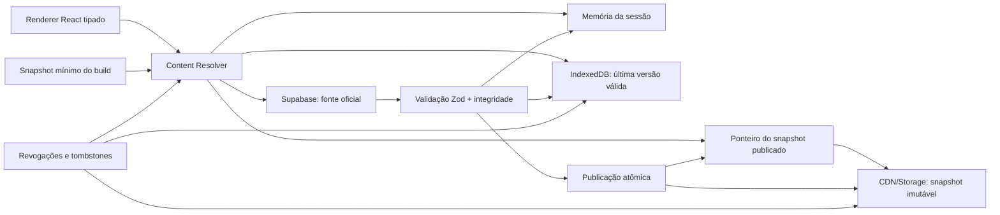
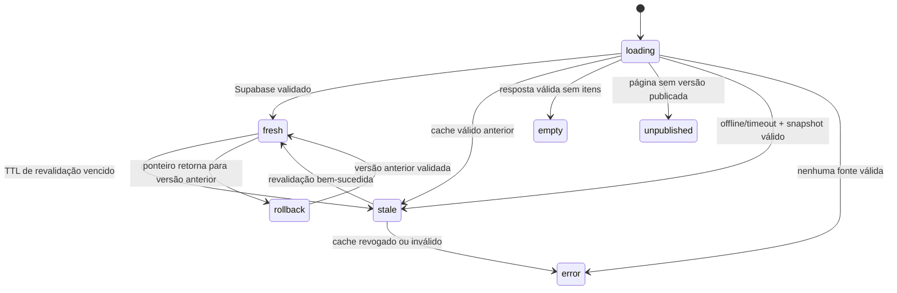

# DDUI-AVAIL-01 — Desenho técnico de disponibilidade e UI dirigida por dados

**Projeto:** J&S Empregos LTDA — CHECK BOULER 24H  
**Data:** 2026-11-08  
**Estado:** aprovado para documentação; implementação, schema, Auth, Storage, commit, push e deploy não autorizados  
**Matriz canônica:** `docs/database-driven-ui/STAGE02_MATRIZ_PAGINA_SECAO_DADOS.md`

## 1. Intenção

Permitir que administradores publiquem páginas, textos, imagens, heroes, cards, CTAs, menus e configurações editoriais sem alterar TSX, mantendo o site utilizável durante falhas temporárias do Supabase. O banco permanece a fonte oficial; React renderiza somente componentes conhecidos, tipados e autorizados.

O programa também estabelece o padrão futuro das 26 células:

```text
/dashboard/<modulo>                         dashboard analítico
/dashboard/<modulo>/<recurso>               listagem e operações
/dashboard/<modulo>/<recurso>/novo          criação
/dashboard/<modulo>/<recurso>/<id>          detalhes, histórico e relações
/dashboard/<modulo>/<recurso>/<id>/editar   edição
```

## 2. Decisões e limites

- Supabase é a fonte da verdade de identidade, tenants, conteúdo, publicação, mídia e dados operacionais.
- Conteúdo editorial público pode usar snapshot e cache. Dados privados, permissões, tokens, currículos, documentos e operações nunca entram em snapshot público.
- Resposta vazia válida é `EMPTY`; não ativa fallback.
- Fallback entra apenas em `ERROR`, `TIMEOUT`, `OFFLINE`, versão inválida ou indisponibilidade da fonte preferida.
- O antigo “mock” deixa de ser fonte concorrente e vira snapshot mínimo versionado, gerado de conteúdo aprovado.
- O banco nunca entrega JSX, SQL, nomes arbitrários de componentes ou funções executáveis.
- Footer institucional e identidade “J&S Empregos LTDA” permanecem intocados.
- P0.1, P0.2, OBS-01 e P0-B ficam fora deste escopo.
- Confirmação de e-mail do candidato continua sendo fluxo real de Supabase Auth/SMTP e não pode usar cache como prova de sucesso.

## 3. Arquitetura de disponibilidade



### 3.1 Ordem de resolução

1. Renderizar imediatamente uma versão validada da memória, se existir.
2. Consultar IndexedDB e renderizar a última versão válida com estado `stale` quando necessário.
3. Para primeira visita sem cache, obter o snapshot publicado pelo ponteiro estável.
4. Se também estiver indisponível, usar o snapshot mínimo do build.
5. Revalidar em segundo plano no Supabase.
6. Aceitar a resposta somente após schema, tenant, versão, hash e referências de mídia serem validados.
7. Atualizar memória e IndexedDB; trocar a interface sem misturar versões.

O snapshot do build é último recurso. Ele não é renovado pelo navegador e só muda em novo build. O snapshot publicado é renovado pelo fluxo de publicação; o IndexedDB é renovado após leitura válida.

## 4. Contratos TypeScript e Zod

Os nomes abaixo são contratos-alvo. Eles não afirmam que tabelas equivalentes já existem.

```ts
type ContentState =
  | 'loading'
  | 'fresh'
  | 'stale'
  | 'empty'
  | 'error'
  | 'unpublished'
  | 'rollback';

type ConnectivityState = 'online' | 'offline' | 'timeout';
type FallbackReason =
  | 'none'
  | 'network-error'
  | 'timeout'
  | 'offline'
  | 'schema-invalid'
  | 'integrity-invalid'
  | 'source-unavailable';

type SnapshotOrigin =
  | 'memory'
  | 'indexeddb'
  | 'published-snapshot'
  | 'supabase'
  | 'build-snapshot';

interface PublishedSnapshotManifest {
  schemaVersion: 1;
  snapshotId: string;
  tenantKey: string;
  locale: string;
  version: number;
  status: 'published' | 'revoked';
  generatedAt: string;
  publishedAt: string;
  expiresAt: string | null;
  contentHash: string;
  pages: SnapshotPageRef[];
  assets: SnapshotAssetRef[];
  revokedSnapshotIds: string[];
}

interface SnapshotAssetRef {
  assetId: string;
  path: string;
  hash: string;
  mimeType: string;
  bytes: number;
  alt: string;
  width: number | null;
  height: number | null;
}

interface PageSeo {
  title: string;
  description: string;
  canonicalPath: string;
  robots: 'index,follow' | 'noindex,follow' | 'noindex,nofollow';
  openGraphAssetId: string | null;
  jsonLd: Record<string, unknown> | null;
}

interface PublicVisibilityRule {
  published: boolean;
  startsAt: string | null;
  endsAt: string | null;
  locales: string[];
}

interface PublishedVersion {
  snapshotId: string;
  version: number;
  lifecycle: 'draft' | 'validating' | 'published' | 'revoked' | 'rolled-back';
  previousSnapshotId: string | null;
  validUntil: string | null;
}

interface ContentResolution {
  state: ContentState;
  connectivity: ConnectivityState;
  origin: SnapshotOrigin | null;
  fallbackReason: FallbackReason;
  version: PublishedVersion | null;
  data: PublishedPageSnapshot | null;
}

interface SnapshotPageRef {
  pageKey: string;
  route: string;
  hash: string;
  payloadPath: string;
}

interface PublishedPageSnapshot {
  schemaVersion: 1;
  snapshotId: string;
  tenantKey: string;
  pageKey: string;
  route: string;
  locale: string;
  seo: PageSeo;
  sections: PublishedSection[];
}

interface PublishedSection {
  id: string;
  component: AllowedComponentKey;
  order: number;
  enabled: boolean;
  props: Record<string, unknown>;
  visibility: PublicVisibilityRule;
}
```

Schemas Zod devem usar `.strict()` nos envelopes e rejeitar campos extras, componentes desconhecidos, URLs inseguras, tenant divergente, versões incompatíveis e props fora do contrato do componente. Manifesto, página, seção, mídia, SEO, visibilidade, versão e props de cada componente possuem schema próprio.

```ts
const publishedSnapshotManifestSchema = z.object({
  schemaVersion: z.literal(1),
  snapshotId: z.string().uuid(),
  tenantKey: z.string().min(1),
  locale: z.string().min(2),
  version: z.number().int().nonnegative(),
  status: z.enum(['published', 'revoked']),
  generatedAt: z.string().datetime(),
  publishedAt: z.string().datetime(),
  expiresAt: z.string().datetime().nullable(),
  contentHash: z.string().regex(/^[a-f0-9]{64}$/),
  pages: z.array(snapshotPageRefSchema),
  assets: z.array(snapshotAssetRefSchema),
  revokedSnapshotIds: z.array(z.string().uuid()),
}).strict();
```

### 4.1 Registro permitido de componentes

```ts
type AllowedComponentKey =
  | 'page.hero.split'
  | 'page.hero.centered'
  | 'content.rich-text'
  | 'content.cta'
  | 'content.card-grid'
  | 'entity.jobs'
  | 'entity.services'
  | 'entity.companies'
  | 'entity.blog-posts'
  | 'media.gallery';
```

Cada chave aponta para componente importado pelo código e para um schema Zod específico. Navegação, formulários operacionais, permissões e ações sensíveis não podem ser inventados pelo conteúdo editorial.

Rotas editoriais ficam dentro de namespaces públicos aprovados, não podem colidir com rotas autenticadas, reservadas ou aliases legados e são únicas por `tenant + locale`. Redirects são registros explícitos, versionados e validados; CTAs não criam rotas implicitamente.

## 5. Máquina de estados



`ContentState`, conectividade, origem e motivo do fallback são dimensões independentes. Assim, uma página pode estar `stale`, originada do IndexedDB e simultaneamente `offline` ou em `timeout`. Estados são visíveis para diagnóstico, mas o visitante não deve receber mensagens técnicas desnecessárias. Conteúdo antigo pode ser exibido com rastreabilidade interna; operações e Auth nunca simulam conclusão. Quando a revalidação válida retorna `EMPTY`, o conteúdo stale é removido e a interface assume `empty`.

## 6. Matriz de cache

| Conteúdo | Memória | IndexedDB | Snapshot público | Build | Regra |
|---|---:|---:|---:|---:|---|
| Home, heroes, textos, CTAs | sim | sim | sim | mínimo | stale-while-revalidate |
| Serviços publicados | sim | sim | sim | mínimo | vazio válido não usa fallback |
| Vagas publicadas | sim | sim, TTL curto | opcional por página | não | expiração e despublicação prevalecem |
| Blog publicado | sim | sim | sim | opcional | invalidação por versão |
| Empresas publicadas | sim | sim | sim | mínimo | somente campos públicos aprovados |
| Menus editoriais públicos | sim | sim | sim | mínimo | rotas em allowlist |
| Sidebar autenticada | sessão | não como autoridade | não | não | sempre recalcular com contexto/RBAC |
| Dashboards e KPIs | sessão | não por padrão | não | não | consulta autorizada e estado explícito |
| Formulários e CRUDs | rascunho seguro | rascunho seguro | não | não | nunca fingir gravação concluída |
| Imagens públicas | browser/CDN | metadados | sim | essenciais | hash e URL versionada |
| Currículos/documentos/PDF privados | não público | não público | não | não | URL assinada e autorização atual |
| Auth, sessão e permissões | memória segura | mecanismo do SDK | não | não | revalidação obrigatória |

## 7. TTL, atualização e revogação

- Manifesto publicado: `max-age` curto e revalidação; payloads imutáveis podem usar cache longo por hash.
- Home e páginas editoriais: revalidar em segundo plano a cada 5 minutos durante sessão ativa.
- Vagas: revalidar em até 60 segundos; `expires_at`, status e tombstones têm precedência sobre cache.
- Serviços, empresas e blog: revalidar em até 5 minutos, com invalidação imediata após publicação no painel.
- IndexedDB guarda no máximo duas versões válidas por `tenantKey + locale + pageKey`.
- Revogação de segurança ignora TTL assim que uma fonte confiável comunica o tombstone. Um cliente totalmente offline não consegue descobrir uma revogação nova; por isso cada classe possui `maxOfflineAge/validUntil`, e conteúdo sensível à revogação falha fechado depois desse limite.
- Cache sem versão, hash ou tenant compatível é descartado.
- Relógio do cliente não é autoridade para publicação; datas do servidor compõem a decisão.

Valores são defaults de projeto e precisam ser medidos em homologação antes de produção.

## 8. Publicação e rollback atômicos

1. Salvar rascunho sem alterar o ponteiro publicado.
2. Resolver relações e mídia da versão candidata.
3. Validar todos os componentes e props com Zod.
4. Gerar payloads completos e hashes.
5. Enviar arquivos imutáveis para staging privado em caminho versionado.
6. Ler novamente e verificar integridade.
7. Uma Edge Function/RPC autorizada executa compare-and-swap usando `expectedVersion` e registra versão, ponteiro e auditoria em transação.
8. Expor somente os artefatos da versão efetivamente publicada e trocar um único ponteiro público para o manifesto.
9. Emitir sinal de invalidação/revalidação.

Rollback usa a mesma autoridade server-side e troca o ponteiro para uma versão anterior íntegra. O navegador nunca possui autoridade de publicação. Nenhum arquivo anterior é sobrescrito. Se upload, validação ou compare-and-swap falhar antes da troca, visitantes continuam na versão vigente.

## 9. Integração com o estado real do Supabase

### Comprovado localmente

- `page_templates`: tabela/migration e RPC `resolve_page_template`; hoje resolve texto e variáveis, não uma árvore completa de páginas.
- `media_assets`: catálogo com tenant, entidade, finalidade, bucket, path, URL, metadados e ordenação.
- `jobs`: dados operacionais de vagas com status e publicação.
- `services`: catálogo de serviços com status, imagens e galeria.
- `blog_posts`: referenciado por migrations e documentação; contrato efetivo remoto deve ser reconfirmado antes de depender dele.

### Ainda não comprovado como implementado

- páginas, seções, versões e ponteiro de publicação completos;
- catálogo de domínios/sites por tenant;
- artefato de snapshot e tombstones;
- função autorizada de publicação atômica;
- CDN/Storage escolhido para snapshots.

Esses itens exigem auditoria read-only do schema real, ADR de dados e autorização separada para qualquer migration/RLS/Storage.

Evidências locais principais: `supabase/migrations/20260908000000_page_templates.sql`, `src/repositories/page-template.repository.ts`, `supabase/migrations/20260901000001_media_storage_v1.sql`, `src/repositories/media-assets.repository.ts`, `supabase/functions/media-upload/index.ts` e a matriz canônica da STAGE 02. A presença local não comprova aplicação ou equivalência no remoto.

## 10. Segurança e multi-tenant

- Chave de cache inclui ambiente, tenant público resolvido, locale, página e versão.
- O browser nunca escolhe `tenant_id` como autoridade; o tenant público vem de resolução autorizada de host/site.
- Snapshot contém somente campos classificados como públicos.
- Assets privados permanecem em bucket privado e nunca são copiados para snapshot/CDN público.
- URLs de CTA aceitam somente rotas e protocolos permitidos.
- Conteúdo rico é sanitizado; scripts, eventos inline e HTML arbitrário são proibidos.
- RLS continua obrigatória nas tabelas expostas. Snapshot público deve ser produzido por fluxo autorizado e auditável.
- Um snapshot não concede permissão. Sidebars e ações autenticadas são recompostas pelo CORE e CellRegistry.
- A resolução `host → site/tenant público` usa contrato server-side autorizado, domínio normalizado e allowlist. O resultado tem cache curto, chave por ambiente/host e invalidação quando domínio ou tenant muda; valores fornecidos pelo cliente não escolhem o tenant.
- Rascunhos locais usam allowlist, TTL curto e limpeza no logout e troca de tenant. Não armazenam tokens, currículos, documentos, arquivos, CPF/RG nem outro dado sensível.

### 10.1 CDN, HTTP e navegador

- Ponteiro: caminho estável por ambiente/tenant/locale, `Cache-Control: no-cache`, `ETag` e revalidação condicional.
- Manifestos e payloads: caminhos imutáveis com versão e hash, `Cache-Control: public, max-age=31536000, immutable` após publicação.
- Assets: nome versionado/hash, MIME correto, CORS restrito às origens aprovadas e dimensões/alt no manifesto.
- IndexedDB: quota, eviction, corrupção, navegação privada e indisponibilidade são resultados esperados; o resolver continua para a próxima camada.
- Service Worker/Cache Storage não faz parte da primeira implementação. Sua adoção exige ADR para evitar segunda autoridade de cache.
- SEO público exige HTML renderizável por crawler via prerender/edge/SSR a definir no gate de infraestrutura, com canonical, robots, sitemap, Open Graph e JSON-LD derivados da mesma versão publicada. IndexedDB não é estratégia de SEO.

## 11. Mapeamento de UI/UX dirigida por dados

| Elemento | Banco controla | Código controla |
|---|---|---|
| Página | chave, rota pública, versão, SEO | resolução, segurança e renderer |
| Hero | conteúdo, mídia, variante permitida, CTA | layout responsivo e acessibilidade |
| Cards | ordem, dados e variante permitida | componente, limites e interação |
| CTA | texto, destino permitido, tracking | allowlist, navegação e autorização |
| Navbar pública | itens publicados e ordem | rotas válidas, responsividade |
| Sidebar autenticada | rótulos opcionais aprovados | células, RBAC, contexto e destinos |
| Formulários editoriais | campos permitidos e conteúdo | schemas, submit e segurança |
| CRUD operacional | configuração visual limitada | domínio, repository, RLS e auditoria |
| Estados | mensagens editoriais aprovadas | loading, empty, error, timeout e retry |
| Footer institucional | nenhum conteúdo protegido | conteúdo atual preservado integralmente |

## 12. Padrão das 26 células

Cada célula terá contrato, dashboard, recursos, repositories, permissões e testes próprios. O banco pode configurar composição e conteúdo, mas não substituir regras do domínio.

Experiências mínimas por recurso:

1. dashboard analítico com métricas reais ou estado sem fonte;
2. listagem com filtros, paginação e ações autorizadas;
3. criação em rota exclusiva;
4. detalhe com histórico e relações;
5. edição em rota exclusiva;
6. loading, empty, error, access denied e sucesso;
7. dark/light, mobile e teclado;
8. isolamento por tenant e RLS;
9. auditoria para ações sensíveis.

As imagens fornecidas são referência de organização, densidade e hierarquia. Números, empresas, planos e pessoas nelas não são dados do produto.

A lista nominal das 26 células, owner funcional, rota canônica, recursos e ordem de migração será mantida na matriz executável da Task 1. Até esse inventário ser reconciliado com CellRegistry e código, esta seção é padrão transversal e não afirma que todas as células estejam completas.

## 13. Cadastro e confirmação do candidato

Esta é uma frente P0 paralela:

```text
cadastro real
→ Supabase Auth
→ bootstrap de pessoa/candidato
→ e-mail de confirmação real
→ callback
→ primeiro acesso
→ /candidato
```

Cache pode preservar rascunho não sensível do formulário, mas não pode fabricar usuário, confirmação, sessão ou aceite. A homologação exige recebimento real do e-mail em ambiente autorizado. SMTP, URLs, templates, reenvio e logs permanecem sob gate específico.

## 14. Observabilidade, feedback e rollback

Cada resolução registra, sem dados pessoais:

- versão e hash;
- origem usada;
- idade do cache;
- tempo de revalidação;
- estado final;
- motivo do fallback;
- falha de schema ou integridade.

Falhas de uma página não derrubam o site. A interface usa última versão válida, estado vazio honesto ou erro recuperável. Métricas não devem chamar cache local de disponibilidade funcional do Supabase.

## 15. Critérios de aceite

- Alteração publicada no painel aparece sem novo deploy de frontend.
- Falha temporária do Supabase mantém conteúdo público anteriormente publicado.
- `EMPTY` não exibe conteúdo antigo ou fictício.
- Revogação remove conteúdo comprometido assim que o cliente recebe um tombstone confiável; offline, `validUntil/maxOfflineAge` limita a exposição.
- Publicação nunca mistura seções ou imagens de versões diferentes.
- Visitante novo possui snapshot publicado ou reserva mínima válida.
- Dados privados e autorização nunca entram em cache público.
- Todas as fontes exibem versão, origem e estado para diagnóstico.
- Nenhum componente arbitrário é executado a partir do banco.
- Footer institucional permanece exatamente como está.

## 16. Riscos principais

| Risco | Controle |
|---|---|
| Conteúdo antigo após despublicação | tombstone, ponteiro curto e revogação prioritária |
| Mistura de versões | manifesto imutável e troca atômica do ponteiro |
| Vazamento entre tenants | chave composta, resolução autorizada e validação do tenant |
| Snapshot com dado privado | allowlist de campos e revisão de publicação |
| Primeiro acesso sem cache | snapshot publicado e snapshot mínimo do build |
| Cache tratado como sucesso operacional | estados e telemetria separados |
| Migração quebrar site atual | strangler por página, feature flag e rollback de ponteiro |

## 17. Decisões posteriores necessárias

1. Storage/CDN definitivo para snapshots públicos.
2. API nativa de IndexedDB ou dependência dedicada, após avaliação técnica.
3. Modelo real de páginas/seções/versões após auditoria remota autorizada.
4. Serviço responsável por gerar snapshots e trocar o ponteiro.
5. Estratégia de domínio/site por tenant.
6. TTLs finais após medição.

